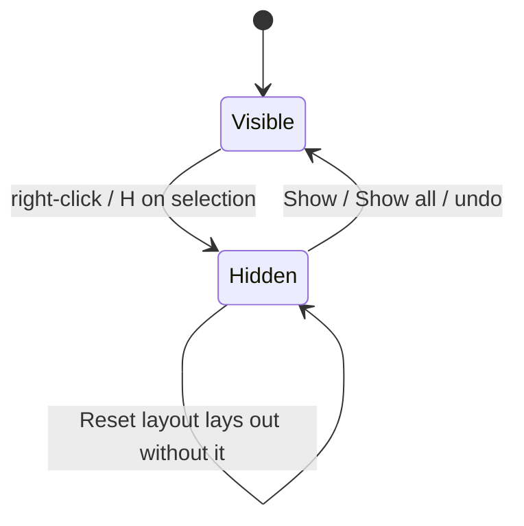

# Graph arrangement

## Problem

On a large model the Graph view fights the user in three ways.

**Hierarchical mode scatters colour groups.** ELK `layered` sees one flat graph. It puts every table in a layer by FK depth and orders each layer to cut crossings, so a group's tables end up spread across every layer and across the full width. Subtypes land far from their basetype's other relatives, and a classifier lands wherever its layer has room, far from the tables in its own group.

**Any model edit throws the arrangement away.** Positions are stored under a structural fingerprint of the model. Adding one entity changes the fingerprint, so the next load lays out from scratch and every node the user placed by hand moves.

**There is no way back and no way to work on more than one node.** A mis-drag is permanent, nodes move one at a time, and a hub table that references everything (a `User` table) draws lines across the whole picture with no way to set it aside.

## Goals / Non-goals

- Goals: hierarchical mode keeps each colour group in one block; a model edit keeps the user's arrangement and only places the new nodes; undo and redo for moves, hides, and layout changes; select and move several nodes at once; take nodes out of the view and bring them back.
- Non-goals: pinning a node so a re-layout keeps it in place; sharing arrangements across browsers; changing the organic layout; per-group manual block placement.

## Grouped hierarchical layout

Each colour group is laid out on its own with ELK `layered`, then the group blocks are packed into one picture:

1. `buildScratchCore(cy, true, hidden)` builds a headless mirror with one compound per group.
2. `layoutByGroup` runs ELK `layered` on each group.
3. `orderRegions` puts groups that others reference first.
4. `packRegions` skyline-packs the blocks at about 16:10.
5. The positions are applied to the live graph.

Organic mode at 500 or more entities already falls back to the layered path, so it gets the blocks too.

| # | Approach | Pros | Cons |
|---|----------|------|------|
| A | One compound per group, ELK `layered` with `INCLUDE_CHILDREN` on the whole graph | One ELK call; cross-group edges routed | Groups stack in one tall column; wide empty bands where cross-group edges pass |
| B | Lay out each group alone, pack the blocks (chosen) | Each group is compact and readable; picture fills the screen | Cross-group edges are long; block order is a heuristic |
| C | Keep flat `layered`, post-process to pull groups together | No new layout stage | Fights ELK's layering; overlaps to repair |

**B** because the complaint is cohesion. A was built and rendered first: groups held together but the picture was a single column three screens tall. Block order puts a group that others reference first, the same top-down reading the layered layout gives inside a block. Skyline packing drops a short block into the gap beside a tall one instead of opening a new row under it.

Joiner diamonds carry no group, so each goes in the block of the cluster it feeds. Ungrouped tables form one block of their own.

## Arrangement survives model edits

The layout store holds the last ten arrangements, one per fingerprint, shared by every model the browser has opened. On a load whose fingerprint has no entry, the newest entry whose shared tables are at least half of the current tables and half of its own is taken as the same model before its edit. Its positions are applied, and each table it lacks is seated next to its placed neighbours at the nearest clear spot. Without such an entry the graph lays out from scratch as before.

The two-sided half-overlap test is what keeps another model's arrangement out: two unrelated models rarely share half their table names, and a larger model that contains these tables shares less than half of its own. An entry from before the edit carries the hidden set too.

This reverses the all-or-nothing rule in [`graph-position-persistence.md`](graph-position-persistence.md). That rule avoided stranding new nodes at the origin; placing them beside their neighbours removes that failure, and losing a hand-made arrangement on every edit was the larger cost.

## Edits, undo, selection, hiding

An edit history holds snapshots: every node's position, the hidden set, and the layout mode. A drag, a hide or show, Reset layout, and a layout-mode switch each push the state from before the change. Undo swaps the current state for the newest snapshot; redo swaps back. The history lives with the Graph view component, so a live reload keeps it. An edit made while a Reset or mode switch is still computing drops that layout; otherwise the layout would land over the edit.

A node is visible or hidden; hiding and showing are undoable, and a Reset leaves a hidden node hidden:

- Select mode turns off canvas panning and makes clicks additive, so a plain drag draws a selection box and a click toggles a node. Shift+drag boxes in either mode. Dragging any selected node moves the selection; cytoscape does this natively.
- A hidden node gets a class with `display: none`; cytoscape hides its edges with it, and a subtype joiner goes too once all its members are hidden. Layouts run on a mirror without hidden nodes, so a Reset closes the space they took. A node shown again returns to its old spot unless something now sits there, in which case it is seated beside its neighbours. Deciding by overlap at show time, not by remembering which layouts ran, holds across reloads and view switches.
- Navigating to a hidden entity (search, links, panel rows, deep links) shows it first.
- The hidden list and positions are saved together, so a reload and a model edit keep both.
