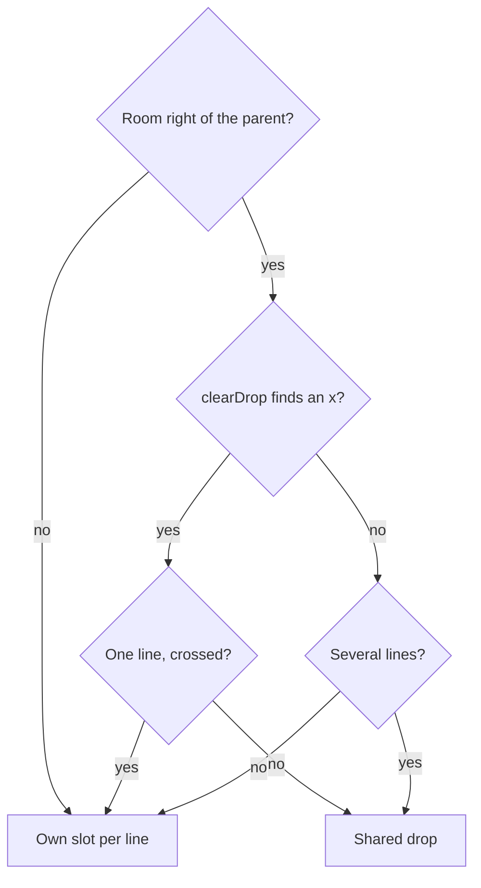
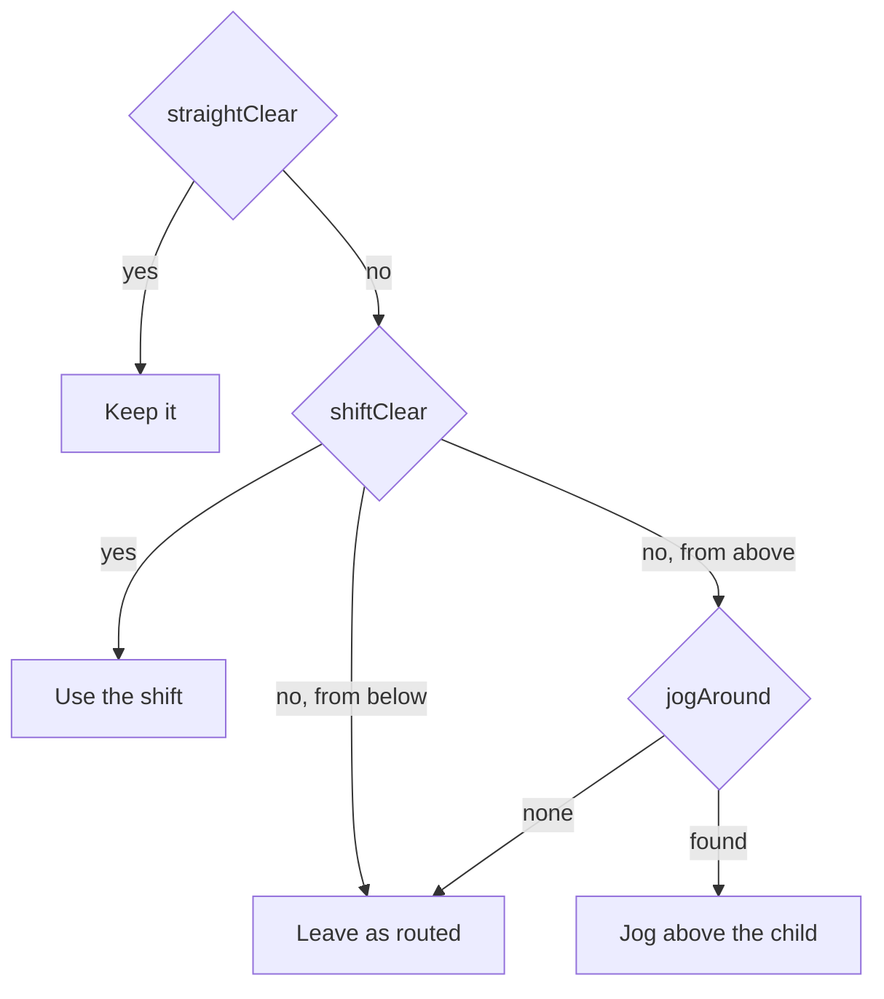

# Graph tree layout


## Problem


The Organic and Hierarchical layouts place tables in two dimensions and draw straight or curved lines between them. On a model with deep key inheritance the reader has to trace lines to answer "what does this table belong to". Hand-drawn IDEF1X diagrams answer it by position: each table sits below and to the right of the table whose key it inherits, like an outline, and every line is horizontal or vertical.


## Goals / Non-goals


- Goals: a third layout mode that reads as an indented outline, left to right and top to bottom; a tree or lookup parent always above and left of its child; every line leaves its parent's bottom edge and enters its child's left side; a parent's lines share one trunk and branch into each child, as IDEF1X tools draw them; the relationship name on the run into the child; Tree is the layout a first visit opens in.
- Non-goals: column lists or icons inside the boxes; free-floating notes on the canvas; hand-tuned per-child offsets.


## Building the tree


A table's tree parent is the table whose key it inherits. With several, the deepest one wins, so `Unit` hangs under `Building` rather than a sibling lookup; ties go to the id. A table with no key parent takes a plain FK parent, except a classifier or a hub. A hub is a table that the larger of 8 tables or 10% of the model reference without inheriting its key, such as the `users` table behind every `created_by`; without the rule every independent table hangs under it.

A cycle is cut at a plain FK link, never at a key link while one exists.

A root with nothing under it that some table references (a classifier, a table whose consumers all have other parents) is a lookup. It is never hung under the table that uses it: there the line would run from parent back to child, right to left and bottom to top. It is assigned to one consumer that is not itself a lookup, same colour group first, and placed above that consumer's tree. Hubs, and lookups used only by other lookups, stay roots.


## Placing it


1. Each tree is laid out depth first: a node takes the next row, its children follow in rows below it, indented to its right.
2. Children are ordered smallest subtree first, so the largest subtrees come last on the trunk.
3. A parent's tree lines share one trunk a quarter of its width in from its left edge, so a parent with many children draws one vertical, not a band of them. A child's indent is the trunk plus the widest relationship label among its siblings, so every label fits on its branch.
4. A tree's lookups form a staircase above it. Each drops one trunk from its bottom-left, past the lookups below it (each starts right of the trunk above), and branches right into its consumers. The lookup feeding the deepest table is top-left, so a lookup's run into its deepest table crosses no other lookup's trunk; a lookup that also feeds a shallower table crosses the trunks of the lookups after it on that run, which a staircase cannot avoid. The tree starts right of the last trunk, under the staircase.
5. Trees are stacked into columns about as tall as makes the picture 16:10. A tree that other trees reference goes first, colour groups first and then the trees inside each group, so links between trees also run right and down.
6. A parent whose children would run past the bottom of the column keeps those that fit under it. The rest wrap into columns to its right, the way an outline wraps. Each wrapped column starts one row below the parent, so its cross links still run down and right. Wrapped children stay part of the parent's tree, so the tree order never moves them above or left of it.
7. Children wrap only when a fresh column has room for two of the parent's child rows. With less room, wrapping would make a strip of one-table columns, so the tree runs past the column instead.
8. A subtype joiner never wraps: it stays under its basetype, and only its members wrap. When a basetype's children wrap, the joiner goes first, so the cluster gets the column's room.
9. A lookup's line into a table in a wrapped column is a cross link. A straight run from the staircase would pass behind the boxes that share that row in the columns to its left.

The staircase above `order`: each lookup drops past the ones below it into its consumer's left side.

```
order status ┐
  order kind ┐│
    region ──┐ ││
             │ ││   order
             │ ││    ├─── note
             └─┼┼───►    …
               │└──────► shipment     every line: out of a bottom edge,
               └───────► order line   into a left side
```

A wide parent wraps: the children that fit stay under it, the rest continue in columns to its right, one row below it.

```
Party
 │ └───────────────────────────────┐     Party's street feeds one drop
 ├── is a ───────► Business         ├── is placed by ─► SalesOrder
 ├── is a ───────► Person           │                    └─► SO Line
 ├── is held by ─► PaymentMethod    └── identifies ────► Identity
 └── is owed by ─► SalesInvoice                          └─► ITIN
   one trunk, a branch per child        one drop, a branch per child
```


## Drawing the lines


| # | Approach | Pros | Cons |
|---|----------|------|------|
| A | cytoscape `taxi` edges | Built in, adapts to drags | Leaves and enters on whichever side the shape picks; no per-edge lanes |
| B | `segments` edges with computed bends (chosen) | Exact control of where a line leaves and enters, and of the trunk or lane it runs down | Bends are relative to the endpoints, so they are recomputed when a node moves |

**B** for every line, with both ends pinned (`source-endpoint`/`target-endpoint`) so a line leaves exactly on its trunk or lane and enters exactly on its row. A `down` line (tree lines and lookup lines) bends once, at (trunk, entry row): straight down the parent's trunk, right into the child's left edge. If the child no longer sits below the parent and right of the trunk, with room between them for the child's approach columns from above (after a hide, a reveal, a reload or a drag), the line is drawn with cross geometry instead: those columns would otherwise cross the trunk. A `cross` line (any other link) leaves on a lane in the right half of the parent's bottom edge, runs along a short street just under the parent, down or up an approach column just left of the child, and into the child's left side.

Lines from one parent into a wrapped column share one lane, one street and one drop in the gap before the column, like a second trunk; each branches into its child with its label on the branch. A parent's streets sit at most 2 px apart, so labels on separate streets print over each other; on the branches they each have their own row. The gap before a wrapped column is widened to fit those labels. Two parents' drops into one column would sit at the same x and draw as one line, so one parent owns the column's drop: the one with the most lines into it. The other parents' lines keep their own slots, and the drop sits left of their columns into the same children as well as a label run left of the column.

The owner's lines share a drop unless there is no room for it, or a single line does better on its own:



The drop moves left until it, its street and its runs miss every box. With nothing clear, several lines keep the drop, behind a box, rather than print their labels over each other. A single line's label has no sibling to collide with on its own street, so it takes its own slot, as it does when another line's street into its child would cross its drop. With no room right of the parent (a drag moved the parent next to the column), the column is not shared: a drop there would land among the other columns or squeeze its labels.

Lines share the child's left side: cross links from above enter highest, then `down` lines from the rightmost trunk to the leftmost, then cross links from below. Approach columns follow the same order (from above, the further-left column enters lower, shared drops leftmost; from below, higher), so no two last turns into one child cross.

A child's own approach columns can still pass through a box, on a fresh layout as well as after a drag (orm-pure jogs two lines). Lines from above and lines from below are two groups, each moved left together, which keeps its order.

A blocked line jogs only when it comes from above and no shifted column is clear:



Lines from above stop at the child's trunks and shared drops, so a moved column never crosses the child's own tree line. A jog column keeps to the same side, stays 6 px clear of the child's other columns, and is rejected when its row would cross another column from above or its drop another line's street. So only the outermost lines from above can jog, to either side, and their rows never meet. A drop lies no further right than 12 px past both the child and the line's own lane. Right of both, the street overshoots and the jog row hooks back across other lines; on a 400-table model such hooks ran 3000 px past their child. A drop between the child and a lane far to the right stays allowed: that path only ever runs left. Jogs into different children never drop down one column, where they would draw as one line; a line whose only jog would do that stays behind its box. Rejecting jogs whose street crosses another line's lane was tried and dropped: across 20,000 fuzzed scenes it removed 35 such crossings but added 179 elsewhere, because the lines it stopped from jogging crossed more. Lines from below enter under the trunks and need no such stop. A jog costs two bends, so it is used only when every straight drop would run behind a box.

Routing is separate from placement. `routeTree` takes the positions on screen and the lines the last Tree layout drew as tree lines, and derives every lane, street, entry row and approach column from them. After a hide, a reveal, an undo or the end of a drag, the graph routes again on the boxes as they stand, so nothing reorders; a tree line whose child no longer sits below and right of its parent becomes a cross link with a slot of its own. Across parents and children there is no global channel routing: lines into stacked siblings can share an approach column, and a long street can run along another line. Bends are stored relative to the parent's edges and the child's left edge and centre, and recomputed on every node move, so a dragged node keeps right-angled lines.

A `down` line's predicate, and a shared-drop line's, sits on the run into the child (`target-label`, or `source-label` when the edge runs child→parent). Any other `cross` line's predicate sits centred on the street: cytoscape puts a segments edge's mid label between the two central bends when their count is even, so the first bend is repeated. Runs are sized for the longer of a line's two predicates, because hovering a table swaps each line into it to its reverse predicate on the same run. Rows are 20 px apart to leave the street and its label room under the parent. Crow's-foot markers take their angle from the bend next to each end.
