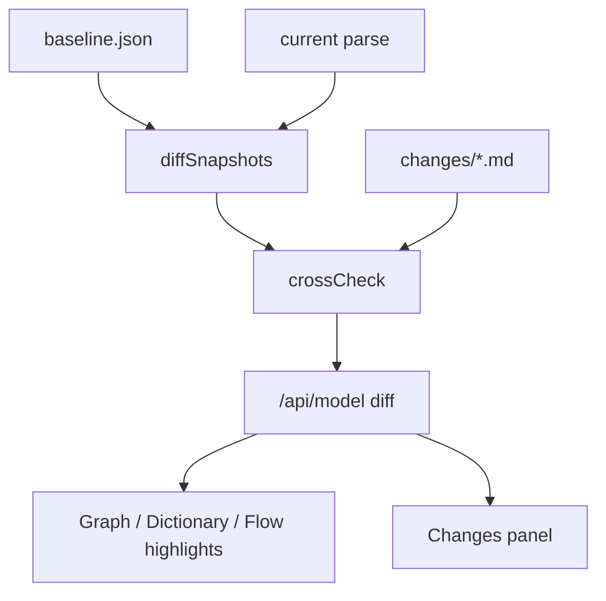
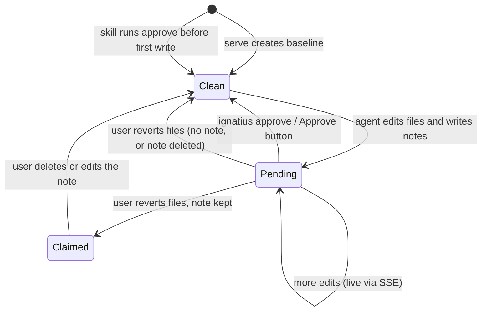

# Design: Model change review

## Problem

An AI agent edits a model by writing entity and flow markdown files directly. When the user opens `ignatius serve` afterwards, the graph renders the new state with nothing marking what the agent added, removed, or changed. The user has no way to review the edit visually before accepting it.

## Concepts

| Term | Meaning |
|------|---------|
| Baseline | The parsed model and flows at the last approval, stored as `.ignatius/baseline.json` next to `ignatius.yml`. |
| Change item | One semantic difference between the baseline and the current parse: an entity, column, relationship, body, or flow node that was added, removed, or changed. |
| Change note | A markdown file the agent writes to `.ignatius/changes/`. Frontmatter names the entities, columns, diagrams, and flow nodes it touched; the body explains why. |
| Approve | Moves the baseline to the current state and deletes the change notes. |

## Approach

Hybrid: ignatius computes the diff deterministically, and the agent's change notes explain it. Each source checks the other.

Cross-check outcomes:

| Diff | Note | Result |
|------|------|--------|
| changed | names it | highlighted, explanation shown |
| changed | silent | highlighted, flagged unexplained |
| unchanged | names it | flagged claimed but unchanged |

The diff alone shows what changed but never why. Notes alone are only as accurate as the agent that wrote them: an entity the agent forgot to list would never highlight. The two together surface both failure modes during approval.

## Business rules

- The baseline is a snapshot ignatius writes, not a git ref, so review works for a model folder outside any repository.
- `.ignatius/` is review state, never committed. A `.gitignore` next to `ignatius.yml` lists it. The modeling skill writes that file for every model it generates; ignatius adds the line when it creates `.ignatius/` and the line is missing.
- The diff runs on the parsed model, not file text. Reordering YAML keys or reformatting produces no change item.
- A body-only edit is its own kind (`doc`), so prose edits do not read as structural changes.
- `ignatius export` reads the baseline and never writes one, so exporting cannot approve unreviewed edits; it exists because agents hand over exported HTML, and a file that hides the changes defeats the review.
- Column granularity is required: a note covers a column change only when it names the column.
- Serve creates the baseline from the current state when none exists, so a first run highlights nothing. The modeling skill runs `approve` before its first write to a model with no baseline, so an agent's edits to a never-served model still show.

## Lifecycle

## Rejected approaches

- **Git diff against HEAD.** Fails for model folders outside a repository, and conflates "committed" with "approved".
- **Change notes only.** Cheaper, but the highlight trusts the agent; an omission is invisible.
- **Diff only.** Shows what changed but carries no explanation for the approval decision.
- **Committing notes.** They exist for one review cycle; git history already records what landed.
