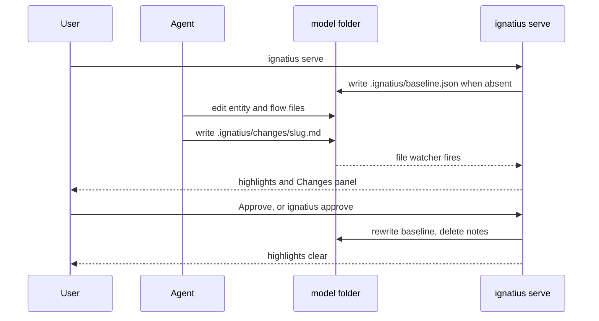

# Change review


`ignatius serve` shows what changed in a model since you last approved it. When an agent (or a person) edits entity or flow files, the app marks every added, changed, and removed entity, column, relationship, and flow node. A Changes panel lists each change next to the note that explains it. When the changes look right, `ignatius approve` accepts the current files as the new starting point and the highlights clear.

An exported HTML file carries the same review, read-only, so a file an agent hands you shows what it changed. Write the change note before exporting; see [What it does not do](#what-it-does-not-do).

```bash
$ ignatius serve models/billing
# ...an agent adds Invoice.line_total and writes .ignatius/changes/split-invoice-lines.md
# the open tab marks Invoice changed and line_total added; the Changes panel shows the note
$ ignatius approve models/billing
Approved 1 change(s), cleared 1 note(s).
```

Reach for it when a model is edited by someone else, most often the [modeling skill](modeling-skill.md), and you want to read the edit as a diff instead of re-reading every file.


## How it works


ignatius keeps a baseline: a snapshot of the parsed model and flows, written to `.ignatius/baseline.json` inside the model folder. On every load and every live reload it parses the current files, diffs them against the baseline, and checks the diff against the change notes in `.ignatius/changes/`. The diff is semantic: reordering YAML keys, columns, or key members produces no change.

Once written, the baseline only moves when you approve or when it is unreadable, so every edit made between two approvals stays highlighted, however many sessions it took:



The first `serve` of a model writes the baseline from the files as they are, so a model opened for the first time shows no changes. An edit made before that first `serve` would land in the baseline and never show. To prevent that, run `ignatius approve` before editing a model that has no `.ignatius/baseline.json`: with nothing pending it accepts nothing and records the untouched files as the baseline. If `.ignatius/changes/` already holds notes, read them first, because `approve` deletes them. The [modeling skill](modeling-skill.md) runs `approve` before its first write when there is no valid baseline and no note, and asks you when notes exist without a baseline.


## What the app shows


Green marks an addition, amber a change. On the Graph and Flows views the mark is a pulsing glow; a change no note explains alternates its glow between its color and red. In the Dictionary it carries an `unexplained` label. With reduced motion turned on in your operating system, or on a view too large to animate, the glows hold steady and an unexplained one stays tinted red.

| Where | Added | Changed | Removed |
|-------|-------|---------|---------|
| Graph | green glow around the entity or along the relationship | amber glow; a column-only or body-only change marks the entity | entity drawn as a dashed, faded ghost node with a muted glow and a red ✕ badge on its corner; relationship drawn as a dashed edge |
| Dictionary | `added` badge on the entity, green marker on a new column row | `changed` badge, amber marker on a changed column row | struck-through column rows with a red marker; removed entities, with a red `removed` badge, in a Removed section at the end |
| Flows | green glow behind the process, external, or store; on a new diagram, behind every node | amber glow | listed in the Changes panel only; the diagram does not draw them |
| Flow index | green glow on the row of a new process or diagram, and on every row inside a new diagram | amber glow on the row; the side pane names the changed fields | no row; listed in the Changes panel only |
| Level menus | pulsing green dot after the diagram's name | pulsing amber dot | no row; listed in the Changes panel only |
| Changes panel | green bar | amber bar | a solid red bar, a red ✕ before the name, and `removed` in red |

In the flow index (**☰ Process Flows**, or `i`) and the breadcrumb level menus, a row whose diagram holds changes further down shows a steady dot after its label: red if any of them is unexplained, amber if any is a change or removal, green if all are additions.

The Changes panel appears in `serve`, and read-only in an export made from a model with an approved baseline, and only when there is something to review. It lists, in order:

1. Each note: its title, its body, and the changes it covers.
2. **Unexplained**: changes no note covers.
3. **Named but unchanged**: names in a note with no matching change.
4. **Note errors**: notes whose frontmatter did not parse.

Clicking an entity item opens it in the graph, ghost nodes included. Clicking a flow item opens its diagram. The **Highlight changes** checkbox hides every marker and ghost without reloading, and the **Approve** button does what `ignatius approve` does.


## The .ignatius folder


```
models/billing/
    ignatius.yml
    .gitignore                 contains the line .ignatius/
    .ignatius/
        baseline.json          the last approved parse
        changes/
            split-invoice-lines.md
```

`.ignatius/` is local review state, never committed. Whenever ignatius writes the baseline (the first `serve`, or `approve`), it also makes sure the model's `.gitignore` lists `.ignatius/`: it creates the file when absent, appends the line when missing, and never adds it twice. ignatius never reads `.ignatius/` as model files.


## Change notes


A change note is a markdown file in `.ignatius/changes/`, one per edit session. The [modeling skill](modeling-skill.md) writes one at the end of every session that changes the model; you can write one by hand the same way.

```markdown
---
title: Split invoice lines out of Invoice
entities:
  Invoice: [line_total]
  InvoiceLine: []
flows:
  order-to-cash: [Issue-Invoice, invoice-events]
---

Billing needs one row per charged item so partial credits can target a line.
`InvoiceLine` inherits the invoice key; `Invoice.line_total` keeps the summed
amount the statement prints.
```

| Key | Value |
|-----|-------|
| `title` | Required. Shown as the note's heading in the panel. |
| `entities` | Optional. Entity id to a list of column names. |
| `flows` | Optional. Diagram id (its folder name under `flows/`) to a list of node ids: a process's file name, an external's name, or a store's name (`invoice-events` for `queue:invoice-events`). |

The body is markdown, rendered in the panel. It should say why the change was made; the panel already shows what changed.


### What a note covers


| Change | Covered when the note |
|--------|-----------------------|
| Entity added, removed, or a field changed (`pk`, `ak`, `classification`, `group`, `description`, `examples`, `singleton`, subtypes) | names the entity |
| Column added, removed, or changed (`type`, `nullable`, `default`, `desc`) | names the entity and lists the column |
| Relationship added, removed, or changed | names the source or the target entity |
| Body text only | names the entity |
| Diagram added or removed | names the diagram |
| Process, external, or store added, removed, or changed | names the diagram and lists the node |

The check runs both ways. A change no note covers is **unexplained**. A name in a note that matches no change is **named but unchanged**: an entity with no change, a column with no column change, a diagram with no flow change, or a node with no change of its own. Both show in the panel so a note that misdescribes the edit is caught before you approve it.

Externals and stores are defined once, in `externals/<Name>.md` and `stores/<slug>.md`, and every diagram that references one draws it as a node of its own. An edit to that file changes the node in each of those diagrams, so the note lists it under every one. Adding a diagram's first reference to an external or store adds the node to that diagram; removing the last reference removes it.

A relationship change is covered by either end, but name the child entity, the one holding the foreign key. Adding or removing an identifying relationship re-derives the child's `classification`: a foreign key inside the child's primary key turns an Independent entity into a Dependent one, or back. Only the child's name covers that entity change.

When a subtype cluster gains or loses a member, name that member as well as the basetype. An entity listed in a basetype's `subtypes:` is classified as a Subtype, so adding or removing it re-derives the member's `classification`, and only the member's name covers that change.

Flow changes are diffed on the diagrams you author. The derived context and Level 1 diagrams are never diffed, since no note could name them and their nodes repeat the leaves'.


## Approve


```bash
ignatius approve [path] [--model <key>]
```

`approve` resolves the model the same way the other commands do (see [Commands](commands.md#approve)). It writes the current parse as the new baseline, deletes every file in `.ignatius/changes/`, and prints what it accepted. The panel's **Approve** button does the same and refreshes every open tab. After either, the app shows no changes until the next edit.

The button only answers requests from the app's own page on `localhost` or an IP address, so another site open in the browser cannot approve on your behalf.

To reject a change, edit the files back. The diff empties on its own once the files match the baseline again. The note stays, though, and every name in it now shows as named but unchanged. Delete the note, or edit it down to the changes you kept.


## What it does not do


| Not covered | Instead |
|-------------|---------|
| Git history | The baseline is a file ignatius writes; it does not read commits or branches. |
| `validate` | Does not diff. Review changes in `serve` or `export`. |
| Approving from an export | A static export shows the changes read-only. Approve with `ignatius approve` or from a served model. |
| `export` without a baseline | Carries no review. Export never creates a baseline; serve the model once, or run `ignatius approve`, to set one. |
| Removed flow nodes on the diagram | They are listed in the Changes panel; the DFD canvas draws only what exists now. |
| Layout | Highlights never move nodes or change saved positions. Ghost nodes are placed near their old neighbours and are not saved. |
| Keeping notes | Approve deletes them. Copy anything worth keeping into the entity or flow body first. |


## When the review cannot be built


If ignatius cannot build the review, for example in a read-only model folder where it cannot write the baseline, `serve` still serves the model. `/api/model` returns `diff: null`, the app shows no highlights and no Changes panel, and `serve` prints the reason to stderr. At startup, when it cannot prepare the baseline:

```
ignatius: could not prepare the change-review baseline: <reason>
```

On each request for the model, when it cannot build the review (`export` prints the same line to stderr and writes the HTML without a review):

```
ignatius: could not build the change review: <reason>
```
