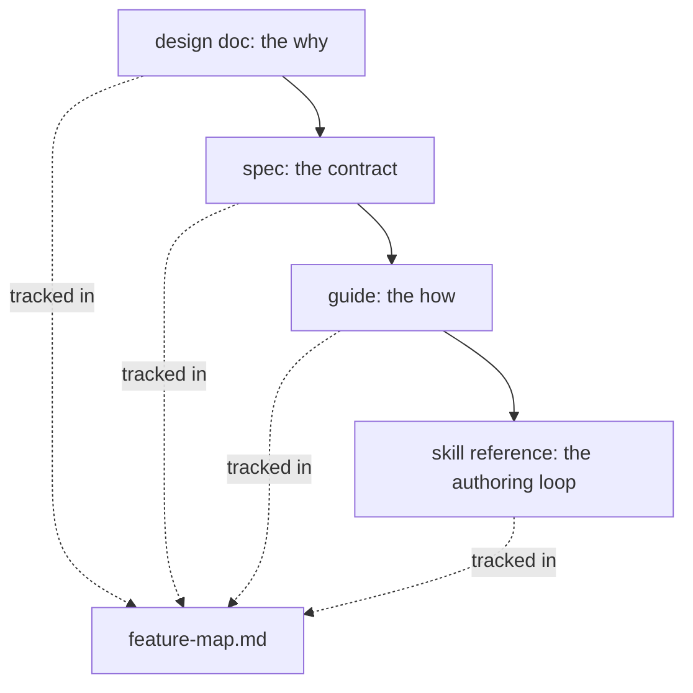
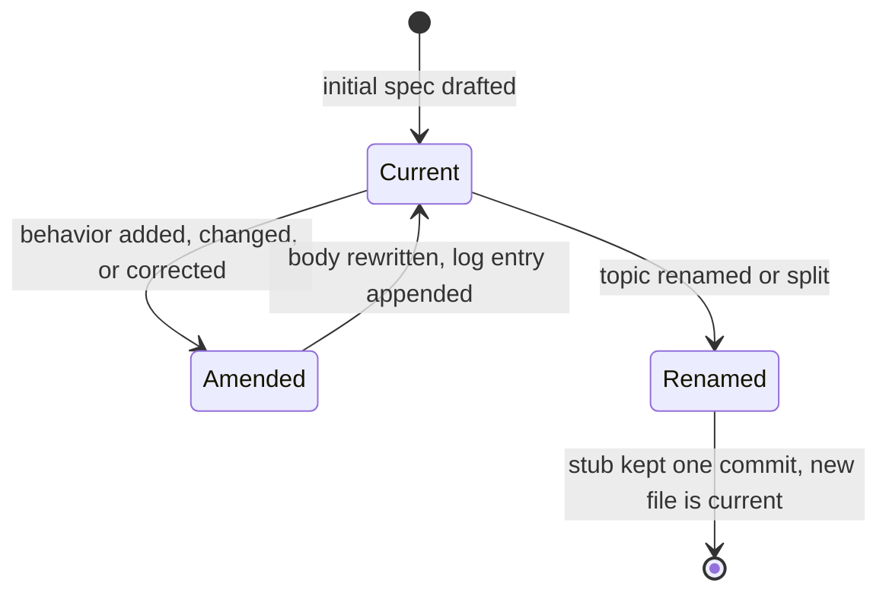

# docs

## What it does

[`docs/`](..) (excluding the generated [`docs/wiki/`](.)) is ignatius's documentation corpus, split into directories that each answer a different question about a feature: why it exists, what its contract is, how to drive it, and what background research shaped it. A session that needs one of those answers goes to the directory that owns it, rather than searching the whole tree. [`docs/design/`](../design) states why a feature exists and which approach was chosen over its alternatives. [`docs/spec/`](../spec) is the implementation contract derived from a design: checkpoints, success criteria, and (for specs drafted under the current rule) a change-tree/outline/flows triad. [`docs/guides/`](../guides) teaches a user how to drive the built feature. [`docs/research/`](../research) records background investigation that fed a design's option table. None of these files execute; every other domain's code and tests point back at them by name for the "why is it built this way" and "what is the contract" questions code alone can't answer. [`docs/glossary.md`](../glossary.md) holds the shared vocabulary.

[`README.md`](../../README.md) states the design/spec relationship directly: "Conceptual designs live in [`docs/design/`](../design); the implementation contracts derived from them live in [`docs/spec/`](../spec)."

## How it works

A feature's surfaces are written by hand, in sequence, and kept in sync by a separate file that is neither generated nor derived from any of them.

A design doc that never gets a spec (`markdown-driven-erd.md`) or a spec with no design doc (see Where it lives) are both valid end states; `feature-map.md` records the actual per-feature surface set rather than assuming every feature has all four.

### A spec's body describes only current truth; correction and rename are explicit states

[`docs/spec/model-index-routing.md`](../spec/model-index-routing.md) carries dated `## Change log` entries that append a **Superseded:** line rather than leaving the old text in place ("Reserved-name skip covers every scan, not just `data/`", "Correction: routers follow the folder tree, not declared groups", "Audit corrections", "Region boundaries are position-based"); another entry, "Correction: `build.ts` does I/O", amends the body but carries no **Superseded:** line. [`docs/spec/noorm-modeling-skill.md`](../spec/noorm-modeling-skill.md) and [`docs/design/noorm-modeling-skill.md`](../design/noorm-modeling-skill.md) show the renamed-file end state: both are stubs whose body is one sentence pointing at `ignatius-modeling-skill.md`, kept only so a rename-era grep still finds them.

A spec body is only ever Current; amendments rewrite the body and append a log entry, and a rename leaves a stub.

### The change-tree / outline / flows triad is opt-in by spec age, not by feature size

[`docs/spec/graph-flow-search.md`](../spec/graph-flow-search.md), [`docs/spec/model-index-routing.md`](../spec/model-index-routing.md), [`docs/spec/dfd-store-clusters.md`](../spec/dfd-store-clusters.md), [`docs/spec/large-model-nav.md`](../spec/large-model-nav.md), and [`docs/spec/model-change-review.md`](../spec/model-change-review.md) are the specs carrying `## Change tree`, `## Outline`, and `## Flows` sections; the older specs predate the rule that requires them and are not backfilled by an unrelated amendment. Most specs also carry a `## Implementation log` (narrative build history: checkpoints landed, out-of-scope work performed, unforeseens, deferred items) — a section distinct from `## Change log`, which records contract amendments, not build narrative.

## Where it lives

The guides are linked from [`README.md`](../../README.md)'s docs table. `markdown-driven-erd.md` has no spec; `dict-polish.md`, `derive-classification.md`, `render-perf-indexing.md`, `unified-app-polish.md`, `dfd-polish-round2.md`, `dfd-polish-round3.md`, `dfd-polish-round4.md`, and `update-download-progress.md` have no design doc. [`docs/wiki/`](.) also lives under [`docs/`](..) as the generated signals wiki; it is separate infrastructure, out of scope for this domain.

| Directory | Path | Covers |
|---|---|---|
| [`docs/design/`](../design) | [`docs/design/model-change-review.md`](../design/model-change-review.md) | Why `serve` diffs the model against a stored baseline: the baseline/change item/change note/approve vocabulary, the hybrid diff-plus-notes cross-check and its cross-check outcomes, and the business rules (the baseline is a file ignatius writes, `.ignatius/` is never committed, body-only edits are their own kind, column-level coverage) |
| [`docs/design/`](../design) | [`docs/design/model-index-routing.md`](../design/model-index-routing.md) | Per-folder generated routers (`index.md`), rolled-up SHA digests, `<ignatius-*>` managed regions, `index_file:`/`harness:` config, in-folder `AGENTS.md`/[`CLAUDE.md`](../../CLAUDE.md)/`SKILL.md` agent guidance |
| [`docs/design/`](../design) | [`docs/design/markdown-driven-erd.md`](../design/markdown-driven-erd.md) | Canonical source for the markdown-driven entity file format; no [`docs/spec/`](../spec) counterpart |
| [`docs/design/`](../design) | [`docs/design/dfd-store-clusters.md`](../design/dfd-store-clusters.md) | Per-process vs. connected DFD views, prose `label:` on any flow entry, `clusters/` author-cluster files, the `cluster:` token, subtype-family and group collapse levels, adjacency stacking, the stack/contract/subtype/group dialog rules, the stacked-paper "more inside" marker construction, row-local store-kind identity and coloring inside a mixed stack |
| [`docs/design/`](../design) | [`docs/design/process-flows.md`](../design/process-flows.md) | SSADM DFD subsystem: processes, externals, stores, sub-DFDs |
| [`docs/design/`](../design) | [`docs/design/schema-lint-and-error-ux.md`](../design/schema-lint-and-error-ux.md) | Schema lint + error UX |
| [`docs/design/`](../design) | [`docs/design/noorm-flow-discovery.md`](../design/noorm-flow-discovery.md) | `ignatius-modeling` skill's `flow` and `discover` Q&A modes |
| [`docs/design/`](../design) | [`docs/design/key-inheritance-lineage.md`](../design/key-inheritance-lineage.md) | Key-edge connected-component lineage (FK ⊆ child PK), associative-entity traversal barriers |
| [`docs/design/`](../design) | [`docs/design/ignatius-modeling-skill.md`](../design/ignatius-modeling-skill.md) | The `ignatius-modeling` skill itself |
| [`docs/design/`](../design) | [`docs/design/branding.md`](../design/branding.md) | Branding system |
| [`docs/design/`](../design) | [`docs/design/unified-app.md`](../design/unified-app.md) | Unified SPA collapse (Graph/Dictionary/Flows in one app) |
| [`docs/design/`](../design) | [`docs/design/viewer-fab-ux.md`](../design/viewer-fab-ux.md) | Floating action button UX |
| [`docs/design/`](../design) | [`docs/design/app-tsx-decomposition.md`](../design/app-tsx-decomposition.md) | `src/App.tsx` → [`src/app/`](../../src/app) decomposition |
| [`docs/design/`](../design) | [`docs/design/cli-and-outputs.md`](../design/cli-and-outputs.md) | CLI modes and the static output approach |
| [`docs/design/`](../design) | [`docs/design/example-instance-tables.md`](../design/example-instance-tables.md) | Example/sample-row instance tables |
| [`docs/design/`](../design) | [`docs/design/viewer-ux-polish.md`](../design/viewer-ux-polish.md) | viewer-ux-polish batch |
| [`docs/design/`](../design) | [`docs/design/folder-model.md`](../design/folder-model.md) | Folder-model migration (`_*`-prefix vs hoisted top-level folders) |
| [`docs/design/`](../design) | [`docs/design/keyboard-nav-shortcuts.md`](../design/keyboard-nav-shortcuts.md) | Single-key keyboard navigation shortcuts |
| [`docs/design/`](../design) | [`docs/design/ignatius-project-config.md`](../design/ignatius-project-config.md) | `ignatius.yml` config + model discovery |
| [`docs/design/`](../design) | [`docs/design/graph-position-persistence.md`](../design/graph-position-persistence.md) | Graph node position persistence |
| [`docs/design/`](../design) | [`docs/design/dict-navigation.md`](../design/dict-navigation.md) | Data-dictionary side navigation |
| [`docs/design/`](../design) | [`docs/design/dfd-edge-hover-data.md`](../design/dfd-edge-hover-data.md) | DFD edge-hover data reveal |
| [`docs/design/`](../design) | [`docs/design/large-model-nav.md`](../design/large-model-nav.md) | Hover-intent settle-then-apply dimming, the `ANIMATION_ELEMENT_LIMIT` animation cutoff, the SSADM flow index, breadcrumb level menus, and where a flow folder's `description:` lives |
| [`docs/design/`](../design) | [`docs/design/dfd-overhaul.md`](../design/dfd-overhaul.md) | DFD viewer overhaul: Yourdon/SSADM leveling, ELK layout, 5-band partitioning |
| [`docs/design/`](../design) | [`docs/design/graph-flow-search.md`](../design/graph-flow-search.md) | Search on Graph and Flows views |
| [`docs/design/`](../design) | [`docs/design/dfd-nesting-depth.md`](../design/dfd-nesting-depth.md) | Arbitrary DFD nesting depth fix |
| [`docs/design/`](../design) | [`docs/design/bidirectional-predicates.md`](../design/bidirectional-predicates.md) | Bidirectional predicate feature |
| [`docs/design/`](../design) | [`docs/design/help-overlay.md`](../design/help-overlay.md) | View-aware help overlay |
| [`docs/design/`](../design) | [`docs/design/dd-spotlight-grid.md`](../design/dd-spotlight-grid.md) | DD browse-lens spotlight grid; off-screen connection chips scroll to the target, then flash it only once the scroll settles |
| [`docs/design/`](../design) | [`docs/design/wiki-entity-links.md`](../design/wiki-entity-links.md) | Wiki-style `[[Entity]]` body links |
| [`docs/design/`](../design) | [`docs/design/src-root-organization.md`](../design/src-root-organization.md) | [`src/`](../../src) top-level subdirectory split |
| [`docs/design/`](../design) | [`docs/design/noorm-modeling-skill.md`](../design/noorm-modeling-skill.md) | Rename stub; points to `ignatius-modeling-skill.md` |
| [`docs/spec/`](../spec) | [`docs/spec/model-change-review.md`](../spec/model-change-review.md) | Change review contract: non-goals (no VCS integration, no diff in `export`/`validate`, no reject command, no layout changes), the `.ignatius/` on-disk layout (`baseline.json`, `changes/<slug>.md`), coverage rules, success criteria, checkpoints CP1-CP5 (pure diff in [`src/model/change-review.ts`](../../src/model/change-review.ts), storage/server/CLI, graph highlights and Changes panel, Dictionary and Flow highlights, skill and docs); carries the change-tree/outline/flows triad, a `## Change log`, and an `## Implementation log` |
| [`docs/spec/`](../spec) | [`docs/spec/process-flows.md`](../spec/process-flows.md) | Largest spec; SSADM DFD: parse, the `flow.*` rules, viewer, sub-DFD drill-down, `db:` store dialog |
| [`docs/spec/`](../spec) | [`docs/spec/key-inheritance-lineage.md`](../spec/key-inheritance-lineage.md) | `buildInheritedConnections` key-edge connected-component algorithm, DG/DD lineage reveal |
| [`docs/spec/`](../spec) | [`docs/spec/dfd-store-clusters.md`](../spec/dfd-store-clusters.md) | CP1–CP8: `label:` on every flow entry + contract dialog, `flow-clusters.ts` registry + `cluster:` token expansion, the `flow.cluster_*` rules, per-process/connected view stacking, collapse levels, row-local store-kind identity and kind-specific numbered caps inside a mixed stack, `StackDialog`/`EdgeContractDialog`; `## Change log` entries plus an `## Implementation log` recording the shipped build and an open followup |
| [`docs/spec/`](../spec) | [`docs/spec/model-index-routing.md`](../spec/model-index-routing.md) | Router build/write, fingerprint roll-up, `index_file`/`harness` config, the `config.index_file_*`/`index.*` rules, `--agents` guidance files, a flow/sub-DFD folder row's description-folded digest |
| [`docs/spec/`](../spec) | [`docs/spec/app-tsx-decomposition.md`](../spec/app-tsx-decomposition.md) | `App.tsx` decomposition |
| [`docs/spec/`](../spec) | [`docs/spec/dd-spotlight-grid.md`](../spec/dd-spotlight-grid.md) | DD browse-lens spotlight grid |
| [`docs/spec/`](../spec) | [`docs/spec/dfd-polish-round3.md`](../spec/dfd-polish-round3.md) | CP18–23 |
| [`docs/spec/`](../spec) | [`docs/spec/render-perf-indexing.md`](../spec/render-perf-indexing.md) | Preset-layout cache-skip, ELK cost scaling, `buildModelIndex` |
| [`docs/spec/`](../spec) | [`docs/spec/unified-app.md`](../spec/unified-app.md) | Unified SPA |
| [`docs/spec/`](../spec) | [`docs/spec/ignatius-modeling-skill.md`](../spec/ignatius-modeling-skill.md) | `ignatius-modeling` skill contract |
| [`docs/spec/`](../spec) | [`docs/spec/graph-flow-search.md`](../spec/graph-flow-search.md) | Graph/Flows search (SC1–SC12); SC12 names no diagram nav card, since Flows has none |
| [`docs/spec/`](../spec) | [`docs/spec/large-model-nav.md`](../spec/large-model-nav.md) | `createHoverIntent`/`HOVER_INTENT_MS`/`ANIMATION_ELEMENT_LIMIT` in `motion.ts`, flow folder `description:` through parse/leveling/router, `flow-nav.ts` navigation model, breadcrumb `LevelMenu`, the `FlowIndex` hierarchy chart, the `i` shortcut; carries a `## Change tree`/`## Outline`/`## Flows` triad |
| [`docs/spec/`](../spec) | [`docs/spec/unified-app-polish.md`](../spec/unified-app-polish.md) | CP1–CP13 unified-app-polish batch |
| [`docs/spec/`](../spec) | [`docs/spec/keyboard-nav-shortcuts.md`](../spec/keyboard-nav-shortcuts.md) | `resolveShortcut`, `useKeyboardShortcuts`, the flow-only `i` binding |
| [`docs/spec/`](../spec) | [`docs/spec/viewer-ux-polish.md`](../spec/viewer-ux-polish.md) | viewer-ux-polish batch |
| [`docs/spec/`](../spec) | [`docs/spec/example-instance-tables.md`](../spec/example-instance-tables.md) | Example/sample-row instance tables |
| [`docs/spec/`](../spec) | [`docs/spec/dfd-polish-round2.md`](../spec/dfd-polish-round2.md) | CP14–17 |
| [`docs/spec/`](../spec) | [`docs/spec/dfd-polish-round4.md`](../spec/dfd-polish-round4.md) | CP24–26 |
| [`docs/spec/`](../spec) | [`docs/spec/bidirectional-predicates.md`](../spec/bidirectional-predicates.md) | Bidirectional predicates |
| [`docs/spec/`](../spec) | [`docs/spec/dfd-overhaul.md`](../spec/dfd-overhaul.md) | DFD viewer overhaul; success criteria C1–C18 |
| [`docs/spec/`](../spec) | [`docs/spec/cli-and-outputs.md`](../spec/cli-and-outputs.md) | CLI output modes and theme system |
| [`docs/spec/`](../spec) | [`docs/spec/schema-lint-and-error-ux.md`](../spec/schema-lint-and-error-ux.md) | Schema lint + error UX |
| [`docs/spec/`](../spec) | [`docs/spec/folder-model.md`](../spec/folder-model.md) | Folder-model migration |
| [`docs/spec/`](../spec) | [`docs/spec/ignatius-project-config.md`](../spec/ignatius-project-config.md) | `ignatius.yml` config loading + model discovery |
| [`docs/spec/`](../spec) | [`docs/spec/graph-position-persistence.md`](../spec/graph-position-persistence.md) | Graph node position persistence |
| [`docs/spec/`](../spec) | [`docs/spec/branding.md`](../spec/branding.md) | Branding |
| [`docs/spec/`](../spec) | [`docs/spec/viewer-fab-ux.md`](../spec/viewer-fab-ux.md) | FAB UX |
| [`docs/spec/`](../spec) | [`docs/spec/dict-navigation.md`](../spec/dict-navigation.md) | Dict side nav |
| [`docs/spec/`](../spec) | [`docs/spec/dict-polish.md`](../spec/dict-polish.md) | Dict visual polish; no design-doc counterpart |
| [`docs/spec/`](../spec) | [`docs/spec/noorm-flow-discovery.md`](../spec/noorm-flow-discovery.md) | `flow`/`discover` skill modes; skill-markdown-only |
| [`docs/spec/`](../spec) | [`docs/spec/dfd-edge-hover-data.md`](../spec/dfd-edge-hover-data.md) | DFD edge-hover data reveal |
| [`docs/spec/`](../spec) | [`docs/spec/src-root-organization.md`](../spec/src-root-organization.md) | [`src/`](../../src) directory split |
| [`docs/spec/`](../spec) | [`docs/spec/update-download-progress.md`](../spec/update-download-progress.md) | `downloadProgressRenderer` + a streamed, incrementally-hashed `downloadAndReplace` in [`src/cli/update.ts`](../../src/cli/update.ts); no design-doc counterpart |
| [`docs/spec/`](../spec) | [`docs/spec/wiki-entity-links.md`](../spec/wiki-entity-links.md) | Wiki-entity links |
| [`docs/spec/`](../spec) | [`docs/spec/derive-classification.md`](../spec/derive-classification.md) | rule-order classification derivation; no design-doc counterpart |
| [`docs/spec/`](../spec) | [`docs/spec/help-overlay.md`](../spec/help-overlay.md) | Help overlay; Flows body covers the flow index and breadcrumb level switching |
| [`docs/spec/`](../spec) | [`docs/spec/dfd-nesting-depth.md`](../spec/dfd-nesting-depth.md) | DFD nesting-depth fix |
| [`docs/spec/`](../spec) | [`docs/spec/noorm-modeling-skill.md`](../spec/noorm-modeling-skill.md) | Rename stub; points to `ignatius-modeling-skill.md` |
| [`docs/guides/`](../guides) | [`docs/guides/change-review.md`](../guides/change-review.md) | What `ignatius serve` marks since the last approval, how the diff is cross-checked against change notes, the Changes panel, the `.ignatius/` folder, the note format and what a note covers, `ignatius approve`, what review does not do, and when the review cannot be built |
| [`docs/guides/`](../guides) | [`docs/guides/folder-format.md`](../guides/folder-format.md) | `ignatius.yml`, the top-level folders including `clusters/`, entity/column/relationship authoring, `index_file:`/`harness:` config, generated routers, `description:` frontmatter, a flow folder's `description:` folding into its router row's hash, and the `.ignatius/` folder (`baseline.json`, `changes/`) with its [`.gitignore`](../../.gitignore) line |
| [`docs/guides/`](../guides) | [`docs/guides/commands.md`](../guides/commands.md) | The CLI subcommands including `index`/`index --agents`, `approve`, `validate --index`, and the full keyboard-shortcut table including `i` (open or close the flow index) |
| [`docs/guides/`](../guides) | [`docs/guides/flows.md`](../guides/flows.md) | DFDs: processes, externals, stores, sub-DFDs, `description:` on process/external/store/flow folder, plus labels/stacks/clusters/groups — the contract dialog, the closed endpoint-prefix set and its one `cluster:` exception, the per-process vs. connected view split, the stores/clusters/groups collapse level, adjacency stacking and its `ignatius.yml` switch, the Flows FAB controls, the "☰ Process Flows" flow index and breadcrumb ▾ level menus, and the 300 ms hover-settle / 150-element animation cutoff |
| [`docs/guides/`](../guides) | [`docs/guides/validation.md`](../guides/validation.md) | The linter, severity tiers, the Config-rules/Index-rules tables (`config.index_file_*`, `index.stale`, `index.orphaned`, `index.unreadable_target`), and the `flow.cluster_*` rules |
| [`docs/guides/`](../guides) | [`docs/guides/getting-started.md`](../guides/getting-started.md) | Install, build from source, serve the first model; command list names `index` and `approve`, with a link to the change-review guide |
| [`docs/guides/`](../guides) | [`docs/guides/modeling-skill.md`](../guides/modeling-skill.md) | The `/ignatius-modeling` skill's Q&A modes; the `flow` mode's step list names the cluster-membership decision and the flow label alongside the `db:`-or-`kind:` store decision; verification loop runs `ignatius validate --index`; a `## Change notes` section describes the note every session ends with, the baseline `approve` before the first write, and that the skill never approves after editing |
| [`docs/guides/`](../guides) | [`docs/guides/derivation.md`](../guides/derivation.md) | What gets derived (cardinality, classification, subtype clusters) vs authored by hand |
| [`docs/guides/`](../guides) | [`docs/guides/predicates.md`](../guides/predicates.md) | Bidirectional relationship-edge label authoring |
| [`docs/guides/`](../guides) | [`docs/guides/themes-and-branding.md`](../guides/themes-and-branding.md) | `theme`/`branding` blocks in `ignatius.yml` |
| [`docs/guides/`](../guides) | [`docs/guides/building-from-source.md`](../guides/building-from-source.md) | Bun build stages, project layout, tests |
| [`docs/research/`](../research) | [`docs/research/dfd-layout-and-leveling.md`](../research/dfd-layout-and-leveling.md) | DFD layout engines and Yourdon leveling; primary source for `dfd-overhaul`'s ELK algorithm choice |
| [`docs/research/`](../research) | [`docs/research/ssadm-dfd-rules.md`](../research/ssadm-dfd-rules.md) | SSADM DFD rules |
| [`docs/glossary.md`](../glossary.md) | [`docs/glossary.md`](../glossary.md) | Canonical vocabulary table: DG (Data Graph), DD (Data Dictionary), DFD (Data Flow Diagram), DE (Data Entity), DS (Data Store), EE (External Entity), Process, Data Flow, plus the DS ⊃ DE relationship note, the `kind:` store taxonomy (`db`/`cache`/`queue`/`file`/`doc`/`manual`/`other`), and a "Flow view: stacks, clusters, and groups" table (flow label, cluster, group, stack, collapse level, per-process view, connected view, adjacency stack) |

## Constraints

| Constraint | Detail |
|------------|--------|
| Spec body is forward-only | `docs/spec/<topic>.md` must describe only the current decision; superseded content moves to a dated `## Change log` entry with a **Superseded:** line. Leaving old text in the body instead means a subagent implementing from the spec reads a contradicted or stale contract as current truth |
| Change-tree/outline/flows apply forward only | The three required sections apply to specs drafted after the rule shipped; only `graph-flow-search.md`, `model-index-routing.md`, `dfd-store-clusters.md`, `large-model-nav.md`, and `model-change-review.md` carry them. Backfilling them onto a pre-existing spec via an unrelated amendment would bundle an unrelated structural change into that amendment's `## Change log` entry, misstating what the amendment actually changed |
| The `cluster:` prefix is the one exception to the closed endpoint-prefix set | [`docs/guides/flows.md`](../guides/flows.md)'s Endpoints section states the `db:`/`ext:`/`proc:`/`cache:`/`queue:`/`file:`/`doc:`/`manual:`/`other:` prefix set is closed, then names `cluster:` as intercepted and expanded before endpoint parsing runs; [`docs/spec/dfd-store-clusters.md`](../spec/dfd-store-clusters.md)'s Checkpoints table (CP8's Verifies cell) requires every closed-prefix-set passage across the guides and the `ignatius-modeling` skill references to name this one exception. A guide or skill passage that repeats the closed-set list without this exception either teaches an author that `cluster:` is unsupported, or contradicts the other doc stating the same closed set |

## Coupling

| Docs surface | Coupled domain | Coupling |
|---|---|---|
| [`docs/design/model-index-routing.md`](../design/model-index-routing.md) + [`docs/spec/model-index-routing.md`](../spec/model-index-routing.md) | **router** | The pair is the sole source for [`src/router/`](../../src/router) (`region.ts`, `fingerprint.ts`, `build.ts`, `write.ts`, `detect.ts`, `agents.ts`); the spec's Change tree also names edits to **parser** ([`src/model/parse.ts`](../../src/model/parse.ts)), **validate** ([`src/model/validate.ts`](../../src/model/validate.ts)), **flows** ([`src/flows/flow-parse.ts`](../../src/flows/flow-parse.ts)), **cli** ([`src/cli/cli.ts`](../../src/cli/cli.ts)), and **skill** (`skills/ignatius-modeling/**`) |
| [`docs/design/large-model-nav.md`](../design/large-model-nav.md) + [`docs/spec/large-model-nav.md`](../spec/large-model-nav.md) | **flow-view**, **frontend**, **flows**, **router** | The pair's Change tree adds [`src/flow-view/flow-nav.ts`](../../src/flow-view/flow-nav.ts) (`resolveDiagramPath`, `levelEntries`, `buildFlowIndex`), [`src/flow-view/FlowIndex.tsx`](../../src/flow-view/FlowIndex.tsx), and [`src/flow-view/LevelMenu.tsx`](../../src/flow-view/LevelMenu.tsx), plus edits to [`src/flow-view/FlowChrome.tsx`](../../src/flow-view/FlowChrome.tsx) (split crumbs, index button) and `FlowDiagramSvg.tsx` (hover intent, memoized flow data) for **flow-view**; new [`src/app/logic/motion.ts`](../../src/app/logic/motion.ts) (`createHoverIntent`, `HOVER_INTENT_MS`, `ANIMATION_ELEMENT_LIMIT`, `scrollBehaviorWithin`) plus edits to `GraphView.tsx`, `DictionaryView.tsx`, and `App.tsx` for **frontend**; `description:` frontmatter reads in [`src/flows/flow-parse.ts`](../../src/flows/flow-parse.ts) (`FlowDiagram.description`) and `flow-derive-levels.ts` (copied onto the L1 process) for **flows**; and a folder-row description plus its hash fold in [`src/router/build.ts`](../../src/router/build.ts) (`buildFlowFolder`) for **router** |
| [`docs/spec/update-download-progress.md`](../spec/update-download-progress.md) | **cli** | No design-doc counterpart; the checkpoints target [`src/cli/update.ts`](../../src/cli/update.ts) alone — `downloadProgressRenderer` (Checkpoint 1) and a streamed, incrementally-hashed `downloadAndReplace` (Checkpoint 2) |
| [`docs/spec/dfd-overhaul.md`](../spec/dfd-overhaul.md) | **flow-view**, **frontend** | Success criteria C4/C16/C17 cited by name in [`src/flow-view/elk-flow-layout.ts`](../../src/flow-view/elk-flow-layout.ts); C4/C5/C13/C15/C16/C17 checked directly by [`test/checks/test-cp4b-elk-edge-routing.ts`](../../test/checks/test-cp4b-elk-edge-routing.ts) and siblings |
| [`docs/spec/graph-flow-search.md`](../spec/graph-flow-search.md) | **frontend** | SC5 cited by name in [`src/app/logic/search.ts`](../../src/app/logic/search.ts); CP1 checked by [`test/checks/test-viewer-search.ts`](../../test/checks/test-viewer-search.ts) |
| [`docs/spec/derive-classification.md`](../spec/derive-classification.md) | **parser**, **validate** | Cited by name in [`test/checks/test-validate-entity.ts`](../../test/checks/test-validate-entity.ts) for classification-derivation rules |
| [`docs/spec/example-instance-tables.md`](../spec/example-instance-tables.md) | **skill** | Names [`skills/ignatius-modeling/references/entity-flow.md`](../../skills/ignatius-modeling/references/entity-flow.md) and directs it to add Step E7b — Examples, between E7 (Columns) and E8 (Reference table) |
| [`docs/spec/process-flows.md`](../spec/process-flows.md) | **skill** | Its `flow.*` frontmatter/token grammar is matched by [`skills/ignatius-modeling/references/flow-templates.md`](../../skills/ignatius-modeling/references/flow-templates.md) |
| [`docs/guides/themes-and-branding.md`](../guides/themes-and-branding.md) | **theme**, **skill** | Its worked example is pointed to by [`skills/ignatius-modeling/references/model-flow.md`](../../skills/ignatius-modeling/references/model-flow.md) |
| [`docs/design/dfd-store-clusters.md`](../design/dfd-store-clusters.md) + [`docs/spec/dfd-store-clusters.md`](../spec/dfd-store-clusters.md) | **flows**, **flow-view**, **frontend**, **skill** | The pair's Change tree names a new [`src/flows/flow-clusters.ts`](../../src/flows/flow-clusters.ts) plus edits to `flow-parse.ts`/`flow-validate.ts` (**flows**); `flow-layout.ts`/`elk-flow-layout.ts`/`FlowDiagramSvg.tsx` for per-process/connected-view stacking, collapse levels, and row-local store-kind coloring (**flow-view**); `App.tsx`/`FlowsView.tsx` and new `StackDialog.tsx`/`EdgeContractDialog.tsx` for the view/collapse toggles and dialogs (**frontend**); and `dfd-authoring.md`/`flow-templates.md`/`discover-flow.md`/`verification.md` for the new authoring and validation surface (**skill**) — [`docs/guides/modeling-skill.md`](../guides/modeling-skill.md) documents that same skill-side coupling from the user's side, naming the cluster-membership decision and the flow label as steps in the `flow` mode's Q&A |
| [`docs/design/model-change-review.md`](../design/model-change-review.md) + [`docs/spec/model-change-review.md`](../spec/model-change-review.md) | **cli**, **server**, **parser**, **frontend**, **flow-view**, **skill**, **scripts** | The pair's Change tree and checkpoints name [`src/model/change-review.ts`](../../src/model/change-review.ts) and [`src/model/change-store.ts`](../../src/model/change-store.ts) (diff, cross-check, baseline and note storage; owned by **parser** along with [`src/model/wikilink.ts`](../../src/model/wikilink.ts)), [`src/server/server.ts`](../../src/server/server.ts) (`/api/model` `diff`, `POST /api/approve`), and [`src/cli/cli.ts`](../../src/cli/cli.ts) (`approve`) for **cli**/**server**/**parser**; [`src/app/logic/change-marks.ts`](../../src/app/logic/change-marks.ts), [`src/app/components/changes/`](../../src/app/components/changes), and the graph, Dictionary, and Flows views for **frontend**; the `changeMarks` prop in `FlowDiagramSvg.tsx` for **flow-view**; [`skills/ignatius-modeling/references/change-notes.md`](../../skills/ignatius-modeling/references/change-notes.md) plus edits to `SKILL.md`, `model-flow.md`, `verification.md`, `dfd-authoring.md`, `discover-flow.md`, and `reverse-engineering.md` for **skill**; and [`scripts/clear-review-state.ts`](../../scripts/clear-review-state.ts) (wired into [`package.json`](../../package.json)'s [`test`](../../test)) for **scripts**. The skill's change-note format must stay in step with the spec's note format and coverage rules |
| [`docs/wiki/feature-map.md`](feature-map.md) | all domains | Hand-authored feature-to-doc-to-skill cross-reference table; not generated by this signals pipeline, maintained separately |
