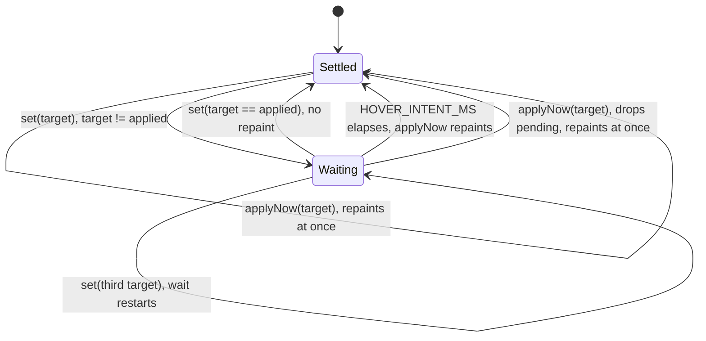
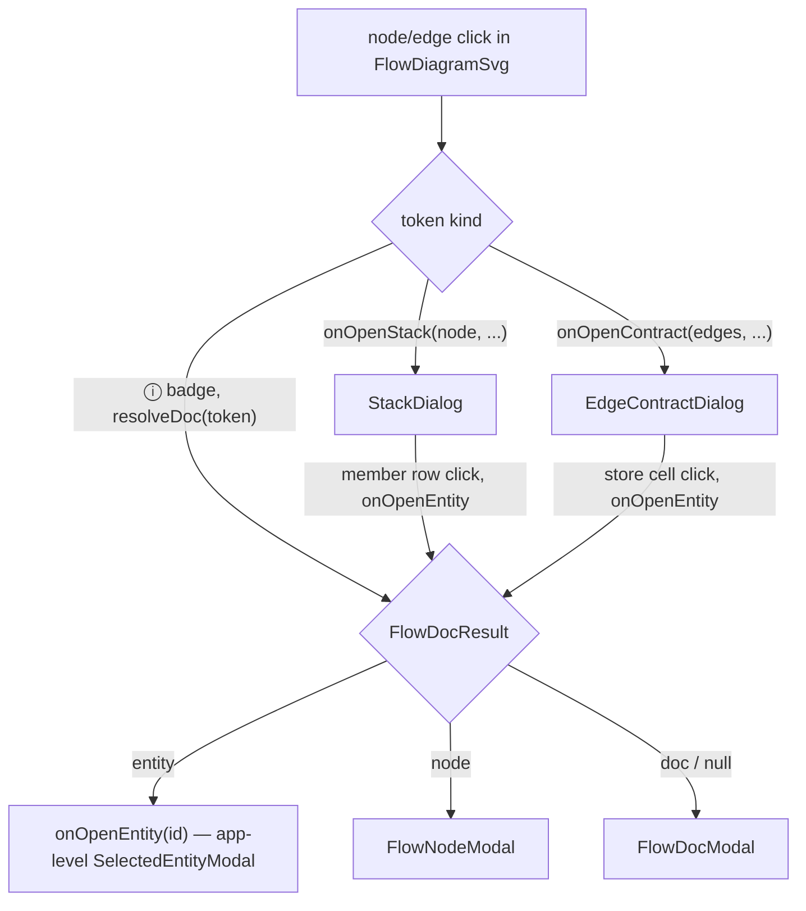
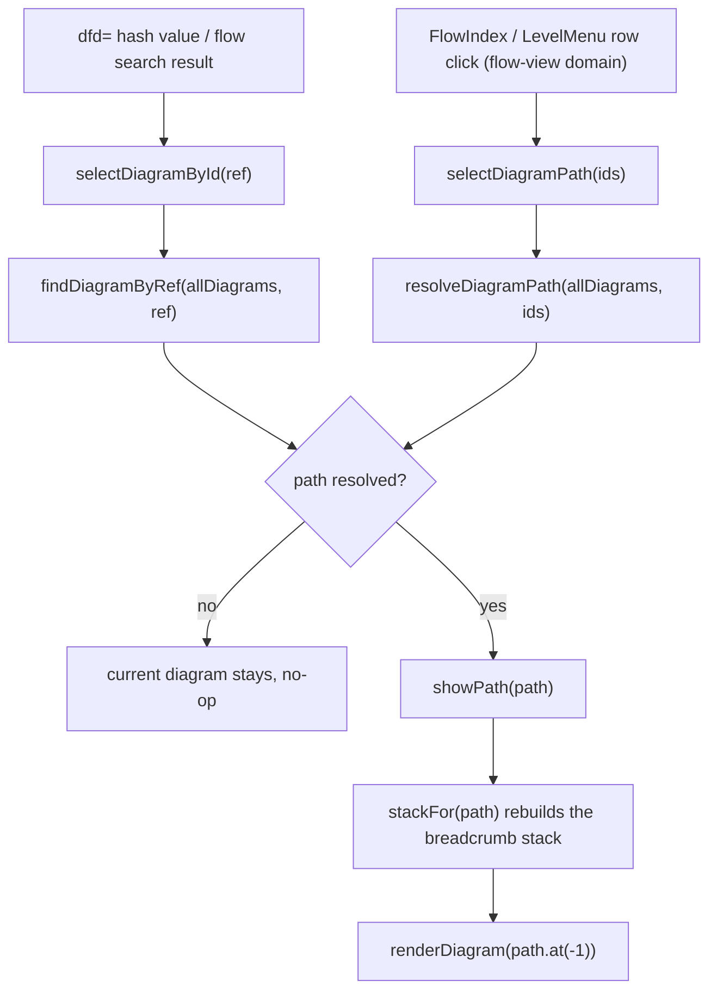
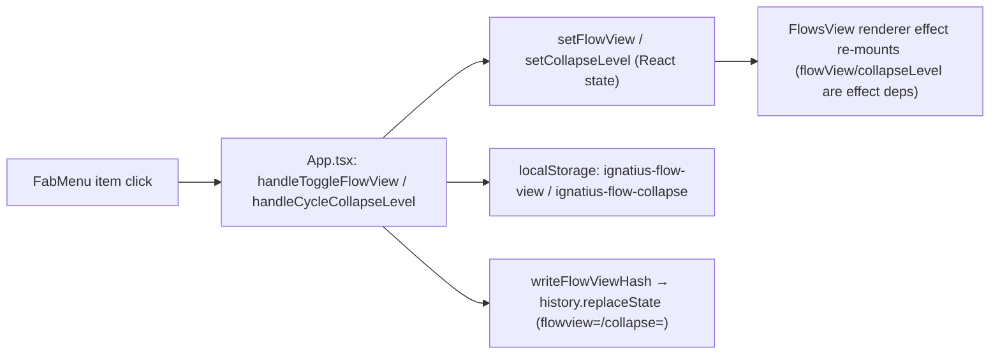
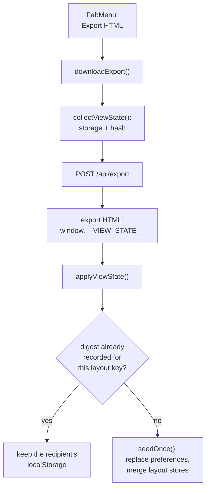
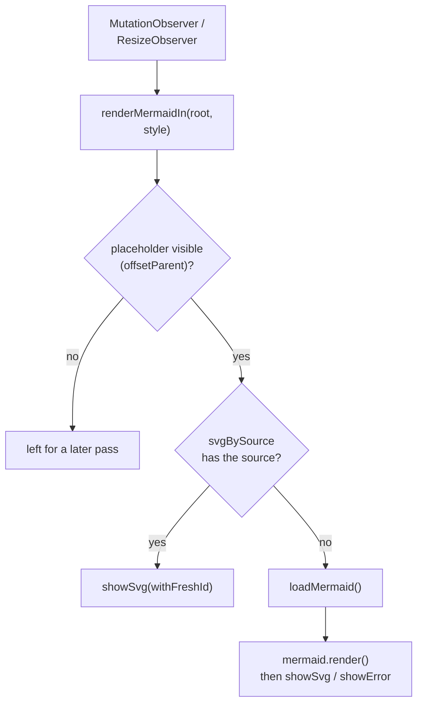
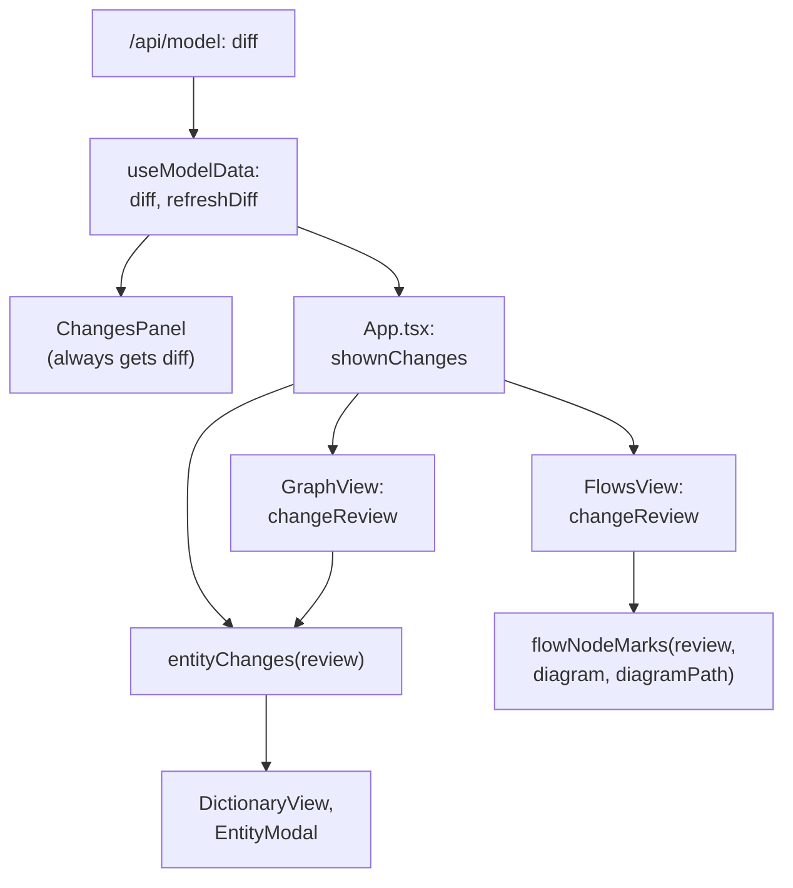
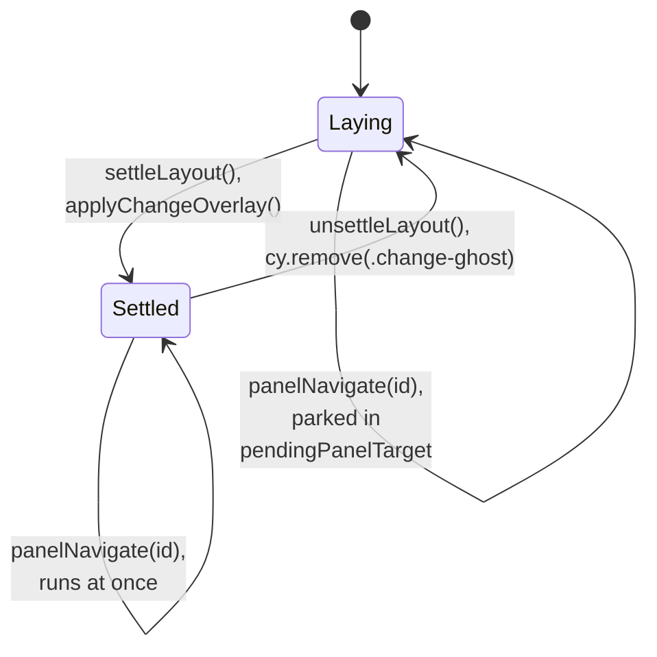
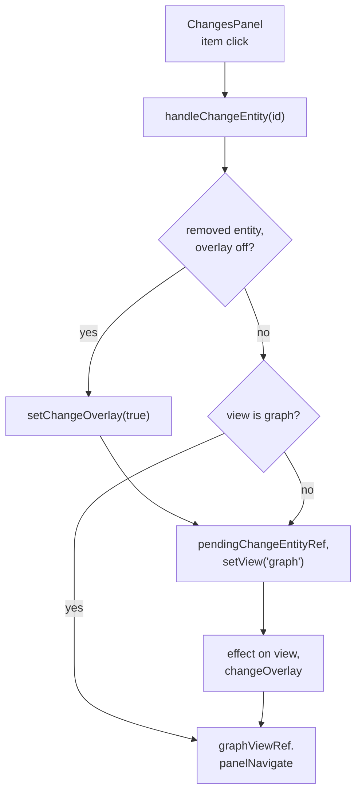
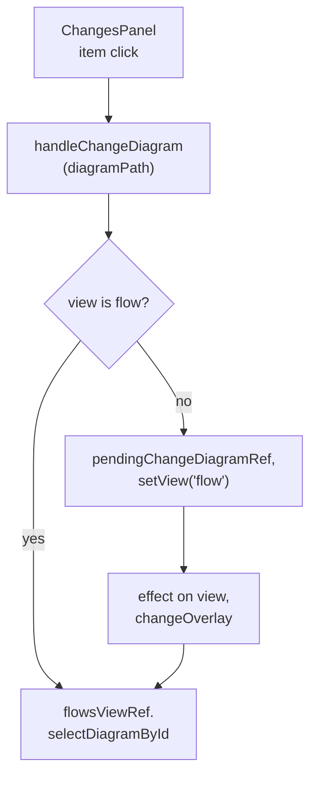

# frontend

## What it does

The unified SPA collapses three surfaces — graph (ERD), dict (data dictionary), and flow (DFDs) — into one React app: `GraphView`, `DictionaryView`, and `FlowsView` stay mounted simultaneously (graph/flow toggle `isActive`; dict toggles CSS `display:none`) so search text, scroll position, and canvas state survive view switches. `useHashRoute` owns only `view=` and `entity=` in the URL hash; every other hash param is owned by the surface that reads and writes it, and `useHashRoute`'s `popstate` handler only reconciles those surfaces via injected callbacks on Back/Forward. `GraphView` owns `zoom=`/`pan=` directly, through `parseHash`/`serializeHash` from [`src/app/hash-router.ts`](../../src/app/hash-router.ts), bypassing the hook. `FlowsView` owns `dfd=`. `App.tsx` owns `flowview=`/`collapse=`.

On a large model all three surfaces share one hover-settle and animation-cutoff discipline ([`src/app/logic/motion.ts`](../../src/app/logic/motion.ts), [`docs/spec/large-model-nav.md`](../spec/large-model-nav.md)): a hover focus applies only once the pointer has rested on a target for 300 ms, and a view whose rendered element count passes 150 drops its transitions and scrolls straight to the end state.

[`src/app/App.tsx`](../../src/app/App.tsx) is the entry point. It was decomposed from the original `src/App.tsx` monolith, into a layered [`src/app/`](../../src/app) tree: shell → views → components → ui → logic/dom, downward only. [`src/app/main.tsx`](../../src/app/main.tsx) is the React entry point.

When an agent edits the model files, the SPA shows what changed since the last approval instead of presenting the new state as if it had always been there. In live mode `/api/model` carries a `ChangeReview` (`diff`); a Changes panel lists it and approves it, and every surface marks the same items: pulsing glows and badges on graph entities with dashed ghosts for removals, badges and per-column row marks in the Dictionary and entity modal, and marked nodes in the flow diagram. Flow index rows glow, level-menu rows carry a pulsing dot, and a row with changes below it carries a static dot. Removed items read in warning red in the Changes panel, the Dictionary, and the ghost node's ✕ badge. A static export made from a model with an approved baseline carries the review in `window.__CHANGE_REVIEW__`: every surface marks the same items and the Changes panel renders read-only, without Approve. An export with no baseline has a `null` `diff` and nothing is marked.

The viewer also keeps the reader's place and choices. Viewer preferences (`ignatius-settings`), the Dictionary sidebar state, and each scroll position persist across reloads, a live viewer can download itself as a static HTML file that opens with the layout, theme, and hash it was exported from, and `mermaid` code blocks in model bodies render as diagrams in the browser.

## How it works

### Hover focus settles before it repaints

A hover fade or focus repaints only once the pointer has rested on one target for `HOVER_INTENT_MS`, so a pointer sweep across a canvas never triggers it.

`createHoverIntent` ([`src/app/logic/motion.ts`](../../src/app/logic/motion.ts)) backs every hover site in the domain: `GraphView`'s node-hover fade, `DictionaryView`'s browse-lens card spotlight, and — via [`src/flow-view/FlowDiagramSvg.tsx`](../../src/flow-view/FlowDiagramSvg.tsx), the flow-view domain — the Flows view's node/edge/chip dimming and edge tooltip. `set(target)` reports whatever the pointer currently sits over; reporting the same target again while its wait is running never restarts the timer, and a target only passed through on the way to another one is never applied, so `A → B` switches focus in one step with no intermediate clear. `applyNow(target)` skips the wait for a deliberate action: in `GraphView`, pressing Shift over a node whose hover is still waiting applies it at once (with lineage), and tapping a node clears the shown hover immediately. Leaving the canvas goes through the normal `set(null)` path instead, so the hover still waits out `HOVER_INTENT_MS` before it clears.

Above `ANIMATION_ELEMENT_LIMIT` (150, inclusive), `animationsAllowed(renderedElementCount)` returns `false` and a view drops its transitions and smooth scrolls. `GraphView` has no fade transition to drop, so it only ever gets the hover delay. `DictionaryView` sums its currently visible entities (`totalVisible`) and visible processes/externals/stores (`totalFlowVisible`) and marks its root `.dict-view` `data-motion="off"` once the total passes the limit; `scrollBehaviorWithin(el)` reads that marker from any descendant, so `App.tsx`'s process-scroll, `DictionaryView`'s own scroll-to-anchor calls, and `SpotlightOverlay`'s scroll-to-card all jump instead of animating inside a `data-motion="off"` Dictionary.

### Flow-surface dialog routing

A click inside the rendered flow SVG resolves to exactly one of four dialog kinds; `FlowSurface` (in [`src/app/views/flow/FlowsView.tsx`](../../src/app/views/flow/FlowsView.tsx)) enforces a single-dialog-at-a-time invariant across all of them.

Opening any of the five outcomes calls `setOpenResult`, which replaces whatever was open; a member click inside `StackDialog` or a store cell click inside `EdgeContractDialog` routes back through the same `open(token)` dispatcher, so it closes the dialog it was clicked from before opening the entity modal.

`EdgeContractDialog` ([`src/app/components/flow-node/EdgeContractDialog.tsx`](../../src/app/components/flow-node/EdgeContractDialog.tsx)) renders the CONTRACT for one data-carrying edge (or every member edge of a stack): a `db:`-endpoint edge resolves each edge's `data` column against the entity model for a Group/Store/Column/Type table sorted by store then by the entity's own column order; any other endpoint kind (`ext:`, `cache:`, `queue:`, …) has no entity-model backing and renders a one-column table of the authored `data` lines instead. `StackDialog` ([`src/app/components/flow-node/StackDialog.tsx`](../../src/app/components/flow-node/StackDialog.tsx)) renders a stack node's row breakdown at the current collapse level: a `store` row is a link that opens the store's entity dialog directly; a `cluster`/`subtype`/`group` row is a `
`/`
` disclosure (`.stack-dialog-row-toggle`, [`src/app/styles.css`](../../src/app/styles.css) lines 578-600) that reveals its child rows indented one level, recursively. `StackDialogExtra` renders grouping-source-specific content below the row table: a cluster's markdown body, a subtype row's link to its basetype entity, a group's description, or — for `source: 'adjacency'`, which has no `clusters/` file to draw a body from — a Writers/Readers table of the processes that feed the stack.

### Flow diagram selection resolves to a path before it resolves to a diagram

A `dfd=` hash value, a flow-search result, and a flow-index or breadcrumb-menu click each name a target diagram differently; `initFlowGraphCore` (in [`src/app/views/flow/FlowsView.tsx`](../../src/app/views/flow/FlowsView.tsx)) folds all three into the same breadcrumb-stack rebuild before anything renders.

`findDiagramByRef` and `resolveDiagramPath` live in [`src/flow-view/flow-nav.ts`](../../src/flow-view/flow-nav.ts) (flow-view domain; trailing-id-match vs exact-match semantics detailed in [`docs/wiki/flow-view.md`](flow-view.md)'s "Resolving a dfd= reference"): the flow index and breadcrumb level menus call only `selectDiagramPath`, never `selectDiagramById`, because only `resolveDiagramPath`'s exact match avoids landing on the wrong sub-DFD when two flows share a process file name. `stackFor(path)` labels each step with the owning process's dotted number and label, except the root, which is labelled by the diagram's own title. On mount, `initFlowGraphCore` resolves the seeded `dfd=` value through the same `findDiagramByRef` path, falling back to `defaultDiagramPath(allDiagrams)` (flow-view domain — opens the System overview, not the Context diagram) when the seed is absent or unresolvable. `window.__IGNATIUS_ACTIVE_FLOW_DFD__` is set to the rendered diagram's bare `id` on every render, while `onActiveDiagramChange` fires separately with `diagramRef(stack...)`, the path reference `App.tsx` writes into the `dfd=` hash — the two carry different id forms for different consumers (a test hook vs. a deep link).

### Flow view mode and collapse level

`flowview=`/`collapse=` are global settings, not per-diagram: a FAB toggle changes them for every DFD in the session and both are deep-linkable via the URL hash.

On load, `App.tsx` resolves each setting hash first, then `localStorage`, then a hardcoded default (`per-process` / `clusters`), a 3-step hash-then-localStorage-then-default precedence that makes both deep-linkable. `layoutMode` does not share it: its initializer reads `localStorage` only, with no hash step, so the graph's layout mode is not deep-linkable. It passes `ignatius-layout-mode` and `createLayoutStore().hasEntries()` to `loadLayoutMode` (stored mode, else Organic when an arrangement is saved, else Tree) and writes the result back at once. `nextCollapseLevel` ([`src/app/hash-router.ts`](../../src/app/hash-router.ts)) is a `switch` over the closed `FlowCollapseLevel` union implementing the cycle `stores → clusters → groups → stores`; `FabMenu`'s `collapseActionLabel` names the action by its *target* level ("Collapse to clusters", "Collapse to groups", "Expand to stores") since the last leg of the cycle un-collapses.

A `flowview=`/`collapse=` value can also arrive via **Back/Forward**, independent of a fresh FAB toggle: a history entry pushed earlier (e.g. opening an entity) snapshotted whatever `flowview`/`collapse` was current at push time, since the FAB toggle only `replaceState`s the top entry rather than pushing a new one. `useHashRoute`'s `popstate` handler fires `onRestoreFlowView`/`onRestoreCollapseLevel` unconditionally whenever the reconciled hash carries either param, mirroring how it already restores `dfd=`.

### An export opens in the state it was made in

The live viewer's `ignatius-*` localStorage entries and URL hash travel inside the exported HTML, and the export applies them once per snapshot and model, so a reload keeps whatever the recipient changed afterwards.

`collectViewState` copies every localStorage key that starts with `ignatius-` except `ignatius-view-state-applied`. `downloadExport` posts the result to `/api/export` and saves the response under the `Content-Disposition` filename, falling back to `model.html`. `apply-view-state.ts` is the first import of `main.tsx`, because `useSettings` reads localStorage while its module loads; it calls `applyViewState(window, localStorage, location)` only when `__IGNATIUS_MODE__` is `'static'`.

`seedOnce` compares an FNV-1a digest of the snapshot with the record stored under `ignatius-view-state-applied` for the export's `__LAYOUT_KEY__`; the record keeps the `MAX_ENTRIES` most recent layout keys, because every export opened from `file://` shares one origin. On a mismatch it removes preference keys the snapshot omits, writes the snapshot's keys, and sets `location.hash` from the snapshot when the page opened with none. The layout-store keys (`GRAPH_LAYOUT_STORAGE_KEY`, `FLOW_LAYOUT_STORAGE_KEY`) are not overwritten or removed: they go through `createLayoutStore(...).merge(value)`, which adds the snapshot's entries and keeps the recipient's others. Afterward `applyViewState` copies a stored `ignatius-theme` of `dark` or `light` into `__THEME_MODE__`, which `useThemeMode` reads before localStorage.

### Mermaid diagrams render after the DOM settles

Model body HTML carries `.mermaid-diagram` placeholders. `useMermaid(appRef, model, themeMode)` in `App.tsx` finds them and replaces each with an SVG.

`loadMermaid` returns `window.__IGNATIUS_MERMAID__` when an export inlined it (set by [`src/app/mermaid-entry.ts`](../../src/app/mermaid-entry.ts)); in live mode it injects `/static/mermaid.js` once; any other state rejects with "Mermaid is not included in this export." and the placeholder shows the source plus the message (`showError`). Mermaid measures text, so a placeholder inside a `display:none` view waits: `useMermaid` observes it with a `ResizeObserver` and schedules a pass when it gets a box. `svgBySource` caches the SVG by source text because React 19 rewrites a body's `innerHTML` on re-render; a cached SVG is re-inserted with a fresh render id. `resolveMermaidStyle` ([`src/theme/mermaid-theme.ts`](../../src/theme/mermaid-theme.ts)) supplies the `MermaidStyle` (`themeVariables` plus `themeCSS`); when its JSON key changes (a theme toggle), `rerenderAll` clears `data-rendered` and renders again. `showSvg` calls `widenForPadding`, which adds `CANVAS_INSET` (13px, the `.mermaid-diagram svg` padding plus border in `styles.css`) on each side to the inline `max-width` Mermaid set, so the border-box padding does not shrink the drawing. `tagFlowchartShapes` adds `ignatius-decision` and `ignatius-store` classes, since Mermaid marks no node with its shape.

### Change review: one payload, read by every surface

The review is fetched with the model, held in `useModelData`, and passed down as one `ChangeReview`, so the panel and every surface read the same items. The panel's "Highlight changes" checkbox swaps the shared value for `null` and switches all markers off together.

`App.tsx` computes `shownChanges = changeOverlay ? diff : null` and `shownEntityChanges = entityChanges(shownChanges)`. `ChangesPanel` receives `diff` itself, never `shownChanges`, so unchecking the overlay hides markers without emptying the list. `entityChanges` ([`src/app/logic/change-marks.ts`](../../src/app/logic/change-marks.ts)) folds entity, column, and doc items into one `EntityChanges` per entity (`mark`, per-column `columns`, and `removedColumns` carrying the baseline `ColumnDef`); a column-only or doc-only change marks its entity `changed`. `addMark` lets `added`/`removed` outrank `changed` and keeps `unexplained` once set. `flowNodeMarks` keys a diagram's node items by the flow renderer's base token (`proc:<id>`, `ext:<id>`, `<storeKind>:<name>`), and gives every node of a newly added diagram that diagram's mark.

### Graph ghosts are drawn only after a layout settles

Removed entities and relationships do not exist in the current model, so `GraphView` adds them as cytoscape elements classed `change-ghost` after the layout has placed everything else, and removes them before the next layout starts. They are never laid out and never saved to `layout-store`.

`applyChangeOverlay` returns early when the layout has not settled or when `changeReviewRef.current` equals `appliedReview` (re-adding ghosts drops their selection); `settleLayout` resets `appliedReview` so each finished layout re-applies. It writes `change` and `unexplained` onto element data, which `buildStyles` selects on (`node[change = "added"]` and so on): recoloured edges with a thin glow underlay, a dashed border and 0.45 opacity for removed ghosts, and an `unexplained` color mix. Node glows are not stylesheet rules: `createChangeGlow(cy, container, colors)` in `views/graph/change-glow.ts` draws blurred node shapes on a canvas behind cytoscape, clipped out of the node itself, culled to the viewport, and pulsed by one rAF loop on a 1.8s cycle (`GLOW_PERIOD_MS`); a `matchMedia('(prefers-reduced-motion: reduce)')` listener holds it at `GLOW_STEADY`. Ghosts get a muted glow plus a full-opacity red ✕ badge drawn on a canvas above cytoscape. `destroy()` removes both canvases and the listener. `ghostStart` places a ghost at the newest position `layoutStore.lastPosition` holds for it, else at the centroid of its present neighbours, else in a row below the graph; `moveToClearSpot` then searches rings outward for a spot clear of other nodes. `gradeSpans` passes `cy.edges()` minus the ghosts to `gradeEdgeSpans`, so ghost edges do not skew the span percentiles. A `panelNavigate` that arrives mid-layout is held in `pendingPanelTarget` and consumed on settle, since the layout's closing fit would otherwise undo the centering.

### A Changes-panel click may need a view switch first

`graphViewRef` and `flowsViewRef` work only once their view is the mounted-active one, so `App.tsx` parks the target and an effect on `[view, changeOverlay]` consumes it after the switch.

### Changes-panel click, entity path

Entity, column, relationship, and doc items go through `handleChangeEntity`, which turns the overlay on first for a removed entity and parks the target when the graph is not the active view:

### Changes-panel click, diagram path

A `flow` item goes through `handleChangeDiagram` and parks only when the view is not already the flow view:

A removed entity exists only as a ghost, so clicking it with the overlay off turns the overlay on first; the effect then runs after `GraphView` has re-added the ghosts. A relationship item navigates to its `source` entity. A removed diagram (a `flow` item with no `node` and kind `removed`) renders as plain text, not a button, since there is nothing to open.

## Where it lives

### Shell

| Path | Role |
|---|---|
| [`src/app/App.tsx`](../../src/app/App.tsx) | State, view-switch, modal hosting, composition. Owns `openEntityById` (with `fromFlow` flag), `modelIndex`/`modelIndexRef` useMemo/ref pair, `appErrorsByEntityId` Map, `appAllFlowNodeIds`, `entityUsageIndex` useMemo, and `pendingScrollProcessIdRef` for dict process-scroll (its `scrollIntoView` call uses `scrollBehaviorWithin(el)` from [`src/app/logic/motion.ts`](../../src/app/logic/motion.ts), not a hardcoded `'smooth'`). `dictViewRef` (`DictionaryViewHandle`) and `handleToggleLayoutMode` are shared between the FAB button and the keyboard shortcut `l`. `showHelp` boolean state wires the `?` top-bar button (`.help-toggle`) and `onHelp` passed to `useKeyboardShortcuts`; renders `HelpModal` when true. Wires `onFlowIndex: () => flowsViewRef.current?.toggleIndex()` for the `i` shortcut (flow view only). Owns `flowView`/`collapseLevel` state (seeded hash → localStorage → default `per-process`/`clusters`), `handleToggleFlowView`/`handleCycleCollapseLevel`, and `writeFlowViewHash` (a `history.replaceState` write beside the existing hash params, mirroring how `useHashRoute` writes `view`); both are threaded as props into `FlowsView` and `FabMenu`. **Keyboard pan:** `handleKeyboardPan(dx, dy)` routes the resolver's `{type:'pan'}` action to the active canvas — `graphViewRef.current?.panBy(dx, dy)` on graph, `flowsViewRef.current?.panBy(dx, dy)` on flow, no-op on dict. Interacts with `GraphView`, `DictionaryView`, and `FlowsView` exclusively through typed imperative handles (`GraphViewHandle`, `DictionaryViewHandle`, `FlowsViewHandle`). **Change review:** destructures `diff`/`refreshDiff` from `useModelData`; owns `changeOverlay` (default on) and `changesCollapsed`; derives `shownChanges`/`shownEntityChanges`; passes `changeReview={shownChanges}` to `GraphView`, `DictionaryView`, and `FlowsView`, and `changes={shownEntityChanges?.get(selected.id)}` to `EntityModal`; hosts the parked-target refs and `handleChangeEntity`/`handleChangeDiagram` (see How it works). `ChangesPanel` and `FindingsPanel` render inside one `.side-panel-stack` div, the Changes panel only when `diff` is non-null. **Viewer QoL:** `appRef` on the `.app` root feeds `useMermaid`; `showSettings` hosts `SettingsModal` (passed `themeMode` and `onSetTheme={setTheme}`); `fabMenuRef` (`FabMenuHandle`) backs the copy-link shortcut; `handleResetLayout` is shared by the FAB and `r`; the Groups modal cards render a Hide/Show `.group-card-toggle` per group, chosen by `groupHidden(name)` (every member in `graphEdits.hidden`) and calling `graphViewRef.current?.hideGroups([name])`/`showGroups([name])`; `FabMenu` gets `onShowSettings` and, outside static mode, `onExportHtml={downloadExport}`; `dictNavOpen` initializes from and persists to `ignatius-dict-nav-open`, and `DictionaryView` gets `active={view === 'dict'}`. |
| [`src/app/App.tsx`](../../src/app/App.tsx) (cross-view search) | The shell owns per-surface search state that survives view switches. Graph search: `graphSearchTerm`/`graphSearchIncludeBody` plus `graphSearchCursorRef` (Enter-to-cycle cursor, reset on term/toggle change); `graphSearchMatches` is `null` when inactive or a `Set` (possibly empty) when active — `entityMatches` from [`src/app/logic/search.ts`](../../src/app/logic/search.ts) runs over `model.nodes`. Flow search: `flowSearchTerm`/`flowSearchIncludeBody`; `flowSearchResults` calls `searchFlowDiagrams`; `flowSearchTokens` is threaded into `FlowsView`'s `searchTokens` prop. Neither graph nor flow search state touches the model, layout fingerprint, layout-store, or URL hash. `bannerRef` measures the global-error banner's rendered height via `ResizeObserver` and writes it into the `--search-bar-top` CSS custom property so `SearchBar` sits below the banner. |
| [`src/app/App.tsx`](../../src/app/App.tsx) (branding gutter, fix 2026-08-01) | The branding block is `position: fixed`, out of document flow, so no stylesheet can know how much room to leave for it. A `brandingRef`-measuring `useEffect` publishes the block's measured width as the `--branding-gutter` CSS custom property (via `ResizeObserver`, re-published on `[branding, logoSrc]` change since a theme swap can change logo width) so the top-row search bars can clear it, since the z-50 branding block otherwise paints over them. [`src/app/styles.css`](../../src/app/styles.css)'s `.dict-search-bar-inner` computes `padding-left: max(2rem, calc(16px + var(--branding-gutter, 0px) + 12px - max(0px, (100vw - 1100px) / 2)))` and the matching `padding-right` past the help toggle (`--toggle-region` + 12px). The Graph `.viewer-search-bar--graph` holds its left edge right of the gutter with a `translateX(max(-50%, …))` clamp and caps its width short of the toggles and its count readout; at 1100px and below the Graph and Flows bars compact. At 768px and below the Dictionary and Graph bars take their own row under the branding. `.side-panel-stack` starts below the top-row bar in every view (`--search-bar-top`, `--flow-search-bar-top`), and above 768px `.flow-crumbs` starts right of the gutter and wraps short of the toggles. `:root` names the clearances: `--toggle-region` (52px, the help toggle's span from the right edge; the header has no theme button, theme lives in Settings → Appearance), `--below-branding` (68px, the row under the branding) and `--dict-bar-clearance` (76px; 136px at 768px and below); `.side-panel-stack` sets `--panel-top` per breakpoint. `.branding-subtitle` is capped at 240px like the title (200px), so the block stays one row tall; both caps are `min(…, 100vw - 194px)` so on a phone the block stops short of the toggles. Checks: `test-dict-search-branding-overlap.ts`, `test-viewer-search-branding-overlap.ts`. |
| [`src/app/main.tsx`](../../src/app/main.tsx) | React root mount, reads `window.__MODEL__`/`__THEME_MODE__` globals in static mode. Its first import is `./apply-view-state`. |
| [`src/app/apply-view-state.ts`](../../src/app/apply-view-state.ts) | Side-effect module: in static mode calls `applyViewState(window, localStorage, location)` (see How it works). |
| [`src/app/mermaid-entry.ts`](../../src/app/mermaid-entry.ts) | Entry for the separate Mermaid bundle: imports `mermaid` and assigns it to `window.__IGNATIUS_MERMAID__`. |
| [`src/app/hash-router.ts`](../../src/app/hash-router.ts) | Exports `parseHash`/`serializeHash`, `ViewName`, `FlowViewMode`, `FlowCollapseLevel`, `HashState`, `nextCollapseLevel`. `HashState` carries `view?: 'graph'\|'dict'\|'flow'`, `entity?`, `zoom?`, `pan?`, `dfd?`, `flowview?: 'per-process'\|'connected'`, `collapse?: 'stores'\|'clusters'\|'groups'`. Format: `#view=<graph\|dict\|flow>&entity=<id>&zoom=<n>&pan=<x>,<y>&dfd=<diagram-ref>&flowview=<per-process\|connected>&collapse=<stores\|clusters\|groups>`. `dfd`'s value is a diagram reference (a bare id, or an id path such as `invoicing/Submit-PCI`) resolved by the flow-view domain's `findDiagramByRef`; `serializeHash` encodes it with `encodeURIComponent` then restores any `%2F` back to `/`, so a path reference stays readable in the address bar instead of percent-encoding its separator. All params optional; unknown/malformed values are silently dropped (`VALID_VIEWS`/`VALID_FLOW_VIEWS`/`VALID_COLLAPSE_LEVELS` lookup tables). |
| [`src/app/globals.d.ts`](../../src/app/globals.d.ts) | `window.__MODEL__`, `__THEME_MODE__`, `__IGNATIUS_MODE__` (`'live'\|'static'`), `__LAYOUT_KEY__`, `__FLOW_MODEL__`, `__FLOW_LAYOUT_KEYS__`, `__CHANGE_REVIEW__` (the export's baked-in `ChangeReview`; absent without a baseline), `__VIEW_STATE__` (the export's `ViewState`: localStorage entries plus hash), `__IGNATIUS_MERMAID__` (the `IgnatiusMermaid` slice of the Mermaid API: `initialize`, `render`), `__FLOW_CLUSTERS__` (the model-root `clusters/` registry, sibling to `__FLOW_MODEL__`, read directly by `FlowsView`'s `initFlowGraphCore` to build `buildFlowData`'s connected-view cluster grouping), `__IGNATIUS_CY__`, `__IGNATIUS_CY_GEN__`, `__IGNATIUS_FLOW_READY__`, `__IGNATIUS_FLOW_GEN__`, `__IGNATIUS_ACTIVE_FLOW_DFD__`, `__IGNATIUS_PERF__`. |
| [`src/app/index.html`](../../src/app/index.html) | Bun HTML entry point; imported directly by [`src/server/server.ts`](../../src/server/server.ts) (`import index from '../app/index.html'`) as the `Bun.serve()` route. |

### Hooks

| Path | Role |
|---|---|
| [`src/app/hooks/useModelData.ts`](../../src/app/hooks/useModelData.ts) | Exports `useModelData(opts?)`. Unified SSE subscription + model/flow fetch + findings state. Static mode reads `window.__MODEL__`/`__FLOW_MODEL__`/`__FLOW_CLUSTERS__`/`__CHANGE_REVIEW__` once on mount. Live mode boots with parallel `/api/model` + `/api/flow`, then re-fetches on every `model-changed` SSE event. Returns `{ model, findings, flowDiagrams, flowClusters, flowFindings, diff, refreshDiff, layoutKeyRef, bannerDismissed, setBannerDismissed }`. `diff: ChangeReview | null` comes from the `/api/model` payload's `diff` field and stays `null` in an export with no baseline or when the server could not build a review; `refreshDiff()` refetches `/api/model` and replaces `diff` only. `ChangeReview` is imported type-only, because [`src/model/change-review.ts`](../../src/model/change-review.ts) imports `flow-markdown` at runtime and that pulls shiki into the bundle. `doModelFetch`/`doFlowFetch` are module-level and throw on a non-OK response; the boot and SSE refetches wrap the flow fetch in `fetchFlowOrNull`, so a failed `/api/flow` logs and leaves the model update applied instead of discarding both. `applyFlowPayload` mirrors a non-empty `/api/flow` `clusters` field into both React state (`flowClusters`, returned by the hook) and the `window.__FLOW_CLUSTERS__` global; `App.tsx` does not destructure `flowClusters` from the hook's return, so the live consumer of the cluster registry is `FlowsView`'s `initFlowGraphCore`, which reads `window.__FLOW_CLUSTERS__` directly — the same global-read pattern `__FLOW_MODEL__` uses for the imperative (non-React-tree) renderer. **StrictMode double-fetch guard:** the boot `useEffect` declares a local `let ignore = false`, set `true` in its cleanup; every `setState` inside the boot and SSE-handler promise chains is gated on the flag to survive React StrictMode's dev-mode mount→cleanup→mount double-invoke. |
| [`src/app/hooks/useHashRoute.ts`](../../src/app/hooks/useHashRoute.ts) | Exports `useHashRoute(opts?)`. Owns hash read/write and `popstate` back/forward restoration. `entity=` in the hash is the single source of truth for the modal stack: `openEntity(id)` pushes history (deduped when the hash already carries the same entity), `closeEntity()` replaces it. `popstate` invokes `onEntityChange(id \| null)` to reconcile the shell without pushing another history entry; it also invokes `onRestoreFlowView(view)`/`onRestoreCollapseLevel(level)` whenever the reconciled hash carries a `flowview=`/`collapse=` value, unconditional on whether it differs from the shell's live state (mirroring how `dfd=` restoration works). Returns `{ view, setView, openEntity, closeEntity }`. |
| [`src/app/hooks/useThemeMode.ts`](../../src/app/hooks/useThemeMode.ts) | Exports `useThemeMode(themeConfig?, model?)`. Seeds from `window.__THEME_MODE__` or localStorage; calls `applyThemeCssVars` on change (also on `model` identity change). Returns `{ themeMode, setTheme }`; `setTheme(mode)` is called by `SettingsModal`'s Appearance theme radio group. |
| [`src/app/hooks/useSettings.ts`](../../src/app/hooks/useSettings.ts) | Exports `useSettings(): [Settings, update]`. A module-level store behind `useSyncExternalStore`, read from `ignatius-settings` at module load, shared by every React root; `update(patch)` merges, writes localStorage, and notifies subscribers. |
| [`src/app/hooks/useScrollMemory.ts`](../../src/app/hooks/useScrollMemory.ts) | Exports `useScrollMemory(ref, key, deps)`. Saves the element's `scrollTop` to sessionStorage under `key` and restores it when `deps` change, re-applying it as content grows (`ResizeObserver` on the children) until the user scrolls, other code moves the view, or `HOLD_MS` (2000) passes. Scroll events a restore caused never save. Used by `DictionaryView` for the page and the sidebar. |
| [`src/app/hooks/useMermaid.ts`](../../src/app/hooks/useMermaid.ts) | Exports `useMermaid(rootRef, model, themeMode)`; memoizes `resolveMermaidStyle(model.theme, themeMode)`, renders `.mermaid-diagram` placeholders under the root as they appear or become visible and re-renders on a style-key change (see How it works). |
| [`src/app/hooks/useKeyboardShortcuts.ts`](../../src/app/hooks/useKeyboardShortcuts.ts) | Registers exactly ONE global `keydown` listener for the unified SPA shortcuts (g/d/f/l/b/i/?//`/Cmd-Ctrl-k/arrows). `onFlowIndex` (`i`, flow view only) is one of the config callbacks alongside `onView`/`onToggleLayout`/`onToggleLens`/etc. Stale-closure hazard avoided via a `configRef` updated each render. Editable guard returns true when focus is in `INPUT`/`TEXTAREA`/`SELECT`/`contenteditable` or inside `.modal`. Dispatches through `resolveShortcut` from [`src/app/logic/shortcuts.ts`](../../src/app/logic/shortcuts.ts). Imported only by `App.tsx`. Graph-only `s` (select mode), `h` (hide selection), and `Cmd`/`Ctrl`+`Z` / `Cmd`/`Ctrl`+`Shift`+`Z` / `Ctrl`+`Y` (undo/redo, not while typing) route through `onToggleSelectMode`, `onHideSelection`, `onUndo`, `onRedo`. Newer callbacks: `onHideSelectionGroups` (Shift+H), `onPrevLayout` (Shift+L, graph), `onToggleFlowView` (L/Shift+L, flow), `onResetLayout` (`r`), `onCopyLink` (Cmd/Ctrl+C, wired to `fabMenuRef.current?.copyLink()`, and left to the browser while a text selection is non-collapsed so native copy still works). |

### Logic (pure, no DOM/React)

| Path | Role |
|---|---|
| [`src/app/logic/motion.ts`](../../src/app/logic/motion.ts) | Hover timing and the animation cutoff shared by Graph, Dictionary, and (via the flow-view domain) Flows (see How it works). Exports `HOVER_INTENT_MS` (300), `ANIMATION_ELEMENT_LIMIT` (150, inclusive), `animationsAllowed(renderedElementCount)`, `scrollBehaviorWithin(el)` (`'auto'` inside a `[data-motion="off"]` ancestor, else `'smooth'`), and `createHoverIntent(apply, delayMs?)` returning `{ set, applyNow, cancel, applied }`. |
| [`src/app/logic/settings.ts`](../../src/app/logic/settings.ts) | Exports `Settings` (`alwaysOpenExamples`), `DEFAULT_SETTINGS`, `SETTINGS_STORAGE_KEY` (`ignatius-settings`), and `parseSettings(raw)`, which falls back to the default field by field for missing, malformed, or wrong-typed values. |
| [`src/app/logic/storage-keys.ts`](../../src/app/logic/storage-keys.ts) | Exports `GRAPH_LAYOUT_STORAGE_KEY` (`ignatius-layout-positions`) and `FLOW_LAYOUT_STORAGE_KEY` (`ignatius-flow-layout-positions`), shared by `layout-store`, `FlowsView`, and `view-state.ts`. |
| [`src/app/logic/view-state.ts`](../../src/app/logic/view-state.ts) | Exports `collectViewState`, `applyViewState`, and `downloadExport` (see How it works). |
| [`src/app/logic/mermaid-render.ts`](../../src/app/logic/mermaid-render.ts) | Exports `loadMermaid`, `renderMermaidIn(root, style)`, and `rerenderAll(root, style)`, where `style` is a `MermaidStyle` (see How it works). `mermaid.initialize` gets `securityLevel: 'strict'`, `theme: 'base'`, `look: 'classic'`, `flowchart.wrappingWidth: 200` (Mermaid's 120px default splits short bold labels mid-word), `sequence.actorFontWeight: 600` (actor weight is inline, out of `themeCSS`'s reach), then the spread `themeVariables` and `themeCSS`. Private `CANVAS_INSET`/`widenForPadding` widen the rendered svg for the panel padding. |
| [`src/app/logic/doc-resolver.ts`](../../src/app/logic/doc-resolver.ts) | Exports `buildFlowDocResolver(diagrams, getEntityModel)` and `splitDocToken(token)`. `FlowDocResult` discriminated union: `entity`/`node`/`doc`. Keyed by stable id/slug so `title:` overrides don't break `[[wiki-link]]` resolution. |
| [`src/app/logic/flow-node-ids.ts`](../../src/app/logic/flow-node-ids.ts) | Exports `buildAllFlowNodeIds(diagrams, entityModel?)`. Returns `ReadonlySet<string>` merging all process/external/non-db-store ids with ERD entity ids. |
| [`src/app/logic/color.ts`](../../src/app/logic/color.ts) | Exports `hexToRgba` and `blendHex`. |
| [`src/app/logic/change-marks.ts`](../../src/app/logic/change-marks.ts) | Pure reduction of a `ChangeReview` to render marks. Exports `ChangeMark` (`{ change: ChangeKind; unexplained: boolean }`), `EntityChanges`, `addMark(marks, id, change, unexplained)`, `entityChanges(review)` (per-entity map; skips `relationship` and `flow` items), and `flowNodeMarks(review, diagram, diagramPath)` (per-diagram map keyed by base token), `ChangeSeverity` (`added` | `changed` | `unexplained`), and `flowRowChanges(review, rowKey, opensOwnDiagram)` (a flow index or level-menu row's own mark, its changed fields, and the worst change inside the diagram it opens; read by the flow-view domain's `FlowIndex.tsx` and `LevelMenu.tsx`). `GraphView` also uses `addMark` for relationship marks, keyed `<source>-<target>`. |
| [`src/app/logic/search.ts`](../../src/app/logic/search.ts) | Search-matcher logic for all three surfaces. Dictionary matchers (`nodeMatchesSearch`, `processMatchesSearch`, `externalMatchesSearch`, `storeMatchesSearch`) always match id/label/columns/body, no opt-in flag. Graph/Flows matchers are a deliberately different, title-first UX: `entityMatches(node, term, includeBody)` matches only `node.id` by default, body only when `includeBody` is true; `flowProcessMatches`, `flowExternalMatches`, `flowStoreMatches`, `flowDiagramMatches` follow the same pattern. Exports `FlowSearchResultKind`, `FlowSearchResult`, and `searchFlowDiagrams(diagrams, term, includeBody)`, which recursively walks every diagram and its `subDfds` (parent before children); diagrams in `SYNTHETIC_DIAGRAM_IDS` (from [`src/flows/flow-derive-levels.ts`](../../src/flows/flow-derive-levels.ts)) are excluded from results but still walked so their leaf `subDfds` are reached. |
| [`src/app/logic/finding-rows.ts`](../../src/app/logic/finding-rows.ts) | Finding-row formatting logic extracted from `FindingsPanel`. |
| [`src/app/logic/relationship-key.ts`](../../src/app/logic/relationship-key.ts) | Exports `relationshipRowKey(edge: ModelEdge): string`. Stable, collision-free React key for relationship rows; encodes source, target, and sorted `on` FK pairs to handle dual-FK tables. |
| [`src/app/logic/spotlight.ts`](../../src/app/logic/spotlight.ts) | Pure `buildSpotlightConnections(index, entityId): SpotlightConnection[]`, direct (non-inherited) FK connections for the DD browse-lens spotlight overlay. Uses `edgesBySource`/`edgesByTarget` only. Self-edges excluded; all edges to the same otherId bundle into one connection; unknown entityId → `[]`. |
| [`src/app/logic/flow-spotlight.ts`](../../src/app/logic/flow-spotlight.ts) | Pure `buildFlowSpotlightConnections(diagrams, activeToken): FlowSpotlightConnection[]`. Token scheme `"<kind>:<name>"`; entity cards pass `"db:<entityId>"`. Walks all diagrams + sub-DFDs recursively. |
| [`src/app/logic/shortcuts.ts`](../../src/app/logic/shortcuts.ts) | Pure keyboard-shortcut resolver, no DOM/React/Bun/Node imports. Exports `resolveShortcut(e, view, editable): ShortcutAction \| null`, the `ShortcutAction` discriminated union, and `ShortcutKeyEvent`. Keymap: g/d/f view switch, l toggleLayout (graph) / toggleFlowView (flow), Shift+L prevLayout (graph) / toggleFlowView (flow), r resetLayout (graph/flow), s toggleSelectMode and h hideSelection (graph), Shift+H hideSelectionGroups (graph), Cmd/Ctrl+C copyLink (any view, not while typing), b toggleLens (dict only), i flowIndex (flow only), `/` search, `?` help, Cmd/Ctrl+`=`/`-`/`0` zoom, Cmd/Ctrl+k search, arrow keys → `{type:'pan', dx, dy}` on graph/flow only. `PAN_STEP = 10`, `PAN_STEP_FAST = 50` (Shift+arrow). Key matched on `e.key.toLowerCase()` for capslock-insensitivity. |
| [`src/app/logic/spotlight-lines.ts`](../../src/app/logic/spotlight-lines.ts) | Pure geometry helper separating overlapping spotlight-overlay lines. Exports `separateSpotlightLines(base, directions): SpotlightLineSpec[]`, `SPOTLIGHT_LINE_GAP = 14`. K=1 leaves the base line unchanged; K>1 applies a symmetric perpendicular offset so the centre of mass stays on the base anchor. Imported by [`src/app/components/entity/SpotlightOverlay.tsx`](../../src/app/components/entity/SpotlightOverlay.tsx). |
| [`src/app/logic/spotlight-inherited.ts`](../../src/app/logic/spotlight-inherited.ts) | Pure key-inheritance LINEAGE logic for the DD browse lens and DG graph. No DOM/React/Bun/Node imports. **Key edge** = an edge whose FK columns (`Object.keys(edge.on)`) are ALL ⊆ the child (source) node's primary key (`index.pkByNode`) — a subset test implementing IDEF1X identifying semantics, catching identifying-1:1 AND identifying-1:many (proper-subset FK). **Associative-entity barrier:** `isAssociative(index, nodeId)` returns true when a node has key edges to 2+ distinct parents whose FK columns together cover its entire PK (a pure junction/link table, e.g. `Project_Tag`) — `buildLineageWithPredecessors`'s BFS treats any such node as a traversal BARRIER (reachable, but the walk stops there) except at the start node itself. `buildLineageWithPredecessors` is a BFS over key edges (undirected) that also records, per member, the nearest key-edge predecessor on the shortest path from the active entity. `buildInheritedConnections(index, entityId): InheritedConnection[]` excludes the entity itself and its direct real-edge neighbors; `via` is `INHERITED_IDENTITY` when the predecessor is the active entity itself, else the nearest key-edge kin id; `direction` is always `'out'`. Result sorted ascending by `otherId`; singleton lineage → `[]`. |

### DOM helpers

| Path | Role |
|---|---|
| [`src/app/dom/body-links.ts`](../../src/app/dom/body-links.ts) | Exports `resolveBodyClick(e, scrollFn)` (shared body-click handler for entity/process/external/store DD body divs — intercepts `a[data-entity]` and `.entity-link--missing` spans) and `upgradeMissingLinksInContainer(container, knownIds)` (rewrites `.entity-link--missing` spans to live `<a>` anchors once the target id is known). |
| [`src/app/dom/theme-css-vars.ts`](../../src/app/dom/theme-css-vars.ts) | Exports `applyThemeCssVars(theme, mode)` and mode-aware color constants including `SPOTLIGHT_LINE_INHERITED`. Sets all CSS custom properties on `document.documentElement`, including spotlight vars `--spotlight-line-out`, `--spotlight-line-in`, `--spotlight-line-flow`, `--spotlight-line-inherited`. Called by `useThemeMode`. Also exports `CHANGE_COLORS` (per-mode `added`/`changed`/`unexplained` hex values, read by `buildStyles`) and sets `--change-added`, `--change-changed`, `--change-unexplained`. Also exports `REMOVED_RED` (`--change-removed`, both modes) and `REMOVED_TEXT` (`--change-removed-text`, lightened in dark mode for text contrast). |

### UI components (`components/ui/`)

| Path | Role |
|---|---|
| `Modal.tsx` | Shared modal primitive (title + onClose + children + optional `className`, `headerExtra`, `stacked`). The dialog has `role="dialog"`, `aria-modal`, and `aria-labelledby` the title. A module-level `modalStack` makes only the top modal answer ESC, Tab, and `focusin`: Tab wraps between the first and last focusable element (skipping elements with no layout box, such as those in a closed `
`), focus that lands outside is pulled back in, the close button takes focus on mount, and the opener regains it on unmount. `onClose` is read through a ref so the mount-only listener effect keeps its stack position. `.modal-backdrop` sits at z-index 210 and the stacked variant at 220, above the global findings banner. `JsonValue.tsx` portals its expanded dialog to `document.body`, because the dictionary view is its own stacking context and would trap the dialog under the banner (covered by [`test/checks/test-modal-above-banner.ts`](../../test/checks/test-modal-above-banner.ts)). |
| `ZoomControl.tsx` | View-agnostic zoom readout. Props: `percent`, `onZoomIn`, `onZoomOut`, `onSetPercent(pct)`, `onReset`. Clicking the readout opens an inline commit-on-Enter/blur text input. |
| `GraphEditBar.tsx` | Graph arrangement controls above the zoom control, same width: undo/redo arrows, select-mode toggle (`aria-pressed`), and a crossed-out eye with the hidden count that opens the Hidden popover (Show all, an eye button per entity). Inline Lucide stroke icons. Props: `state: GraphEditState`, `onUndo`, `onRedo`, `onToggleSelectMode`, `onShowHidden(ids \| null)`. |
| `FabMenu.tsx` | `forwardRef` component exposing `FabMenuHandle.copyLink()` so the Cmd/Ctrl+C shortcut shares the menu's copy and its toast. Per-view FAB menus, items view-gated. `kbd-hint` badges surface keyboard shortcuts inline. Every view's menu also has Settings (`onShowSettings`) and, only when `onExportHtml` is passed, Export HTML; a rejected export shows its error message in the toast for 5 s. Dialog items go through `openDialog`, which closes the menu and focuses the FAB first so `Modal` restores focus to a live element. One `role="status"` `.fab-toast` carries both the "Copied!" and export-error messages. Reset layout carries an `R` `kbd-hint` in graph and flow. Flow-specific items: a per-process/connected toggle button (with an `L` `kbd-hint`) labelled by the *current* mode's opposite (`"Connected view"` while `flowView === 'per-process'`, else `"Per-process view"`), and a collapse-level cycle button labelled by the *target* level via `collapseActionLabel` (`"Collapse to clusters"`, `"Collapse to groups"`, `"Expand to stores"`). |
| `SettingsModal.tsx` | `SettingsModal({ themeMode, onSetTheme, onClose })`: a `Modal` titled "Settings" with two `.settings-section` blocks, each a `.settings-card`. **Appearance** holds a Light/Dark `.settings-segmented` radio group that calls `onSetTheme(mode)`; this is the only theme control. **Content** holds the "Always open examples" `role="switch"` checkbox bound to `useSettings`'s `alwaysOpenExamples`. |
| `HelpModal.tsx` | View-aware orientation overlay built on `Modal`. Three branches (graph/dict/flow), each documenting that surface's search behavior and closing with a `shortcutRows(view)`-driven keyboard section whose rows render through `Keys`, one `<kbd>` keycap per key and chords joined (e.g. Shift + H). The flow branch's `FLOW_EXPLORE` rows cover the flow index ("Click Process Flows (or press I)…") and breadcrumb level switching ("A ▾ on a breadcrumb lists the other diagrams at that level…"); `shortcutRows('flow')` adds an `I` row ("Open or close the flow index"). |
| `SearchBar.tsx` | Exports `SearchBar` (`forwardRef<SearchBarHandle, SearchBarProps>`) and `SearchBarHandle` (`{ focus(): void }`). Shared search-bar chrome for the Graph and Flows surfaces: debounced (200ms) `<input type="search">`, a `role="switch"` "Include descriptions" toggle, a match-count readout, and a `children` slot for a results dropdown. |

### Flow search components (`components/flow/`)

| Path | Role |
|---|---|
| `FlowSearchResults.tsx` | Exports `FlowSearchResults({ results, onSelect })`. Rows arrive pre-grouped by diagram (contiguous), capped at `DISPLAY_CAP = 20` with a "+N more" line. One-letter kind badge per row (P/E/S/D). |

### Entity components (`components/entity/`)

| Path | Role |
|---|---|
| `EntityModal.tsx` | Exports `SelectedEntityModal`. Takes optional `changes?: EntityChanges`, renders a `ChangeBadge`, and forwards `changes` to `ColumnsTable`. |
| `EntityCard.tsx` | Exports `DictEntitySection`. Takes optional `changes?: EntityChanges`: adds a `ChangeBadge` to the header, the `dict-entity-section--removed` class when the entity is removed, and forwards `changes` to `ColumnsTable`. |
| `ClassificationBadge.tsx` | Exports `DictClassificationBadge`. |
| `ColumnsTable.tsx` | Columns table, `variant='modal'\|'dict'`. With `changes`, tags added/changed rows (`change-row--<kind>`, `change-tag`) and appends each `removedColumns` entry as a row built from the baseline `ColumnDef`. A table with no current columns still renders when it has removed ones. |
| `ChildrenTable.tsx` | Children/subtype table, `variant='modal'\|'dict'`; uses `relationshipRowKey`. |
| `ExamplesAccordion.tsx` | Examples accordion, `variant='modal'\|'dict'`. Opens when `alwaysOpenExamples` is set or there are 3 rows or fewer; the setting is part of the `
` key so a section the user toggled remounts with the new default. |
| `GridCard.tsx` | Exports `GridCard`, compact entity card for the DD browse lens. Optional `change?: ChangeMark` renders a `ChangeBadge` beside the classification badge. |
| `FlowNodeGridCard.tsx` | Exports `ProcessGridCard`, `ExternalGridCard`, `StoreGridCard`. |
| `SpotlightOverlay.tsx` | The largest single component in the domain. Exports `SpotlightOverlay`. Position:fixed SVG + chips container over the DD browse grid. FK connections draw SOLID bezier paths (direction-coded stroke, arrowhead placement, predicate + cardinality pills). Flow connections draw DASHED paths (`--spotlight-line-flow`). Inherited (lineage) connections draw DOTTED paths in `--spotlight-line-inherited`, computed via `computeInheritedLines` from `buildInheritedConnections`'s output, with a provenance pill ("shared key" for `INHERITED_IDENTITY`, else "via `<kin>`"). Off-screen connections render as clickable directional chips instead of a line. Anchors re-measured every rAF-throttled frame via `ResizeObserver` on the grid container, `window resize`, and scroll on `.dict-view`. Calls `separateSpotlightLines` so overlapping edge bundles render as offset parallel paths. Scrolling a pinned card into view calls `scrollBehaviorWithin(targetCard)` (falling back to `'auto'` under `prefers-reduced-motion`) instead of a hardcoded `'smooth'`, so the scroll jumps inside a `data-motion="off"` Dictionary. |

### Process components (`components/process/`)

| Path | Role |
|---|---|
| `IoTable.tsx` | Exports `IoTable` (a process's inputs/outputs table used by both the Dictionary and flow-node dialogs) and `resolveIoRowCells` (pure, no React import, exercised directly by unit tests — resolves the Data-cell value(s) for one row: a `db:` endpoint with a `label:` collapses to one labelled row instead of one row per column, an unlabelled `db:` endpoint keeps one row per column, and a non-`db` endpoint is always a single row). Accepts optional `onOpenEntity`/`onOpenToken`/`canOpenToken`: when provided, a `db:` endpoint cell renders as a rich entity link that opens the entity dialog directly and a resolvable non-`db` endpoint opens in-place via the flow token resolver, instead of falling back to dict scroll-to-anchor. Imported by `ProcessCard.tsx` (Dictionary) and `FlowNodeModal.tsx` (flow dialogs, which passes the rich-link props). |
| `KindMarker.tsx` | Exports `KindMarker({ ep, processes })`: a `proc` endpoint renders the process's dotted number, an `ext` endpoint renders `"ext"`, and any store kind renders `FLOW_STORE_KIND_SYMBOLS[ep.kind]` (from [`src/theme/theme-defaults.ts`](../../src/theme/theme-defaults.ts)) with a `flow-kind-marker--db` modifier for `db:`. |
| `ProcessExamples.tsx` | Exports `FlowProcessExamplesSection`. Applies the same `alwaysOpenExamples` rule to each in/out example block. |
| `ProcessCard.tsx` | Process DD card (`DictProcessSection`). |
| `ProcessesTable.tsx` | Exports `DictProcessesTable`. |
| `ProcessesSection.tsx` | Exports `ProcessesSection`. |

### Flow-node components (`components/flow-node/`)

| Path | Role |
|---|---|
| `FlowNodeModal.tsx` | Structured flow node dialog (process / external / non-`db` store). |
| `FlowDocModal.tsx` | Plain markdown doc dialog for unresolved wiki-links. |
| `ExternalCard.tsx` | External node card. |
| `StoreCard.tsx` | Non-`db` store card. |
| `StackDialog.tsx` | A stack node's row breakdown at the current collapse level, plus grouping-source-specific extra content (see How it works). Props: `node: StackNodeData`, `feederProcessLabels` (dotted-number + label of every process whose edge feeds the stack, shown as a header badge), `processLabelById` (for an adjacency stack's reader/writer links), `clusters: FlowCluster[]`, `groups: Record<string, GroupConfig>`, `onClose`, `onOpenEntity`. |
| `EdgeContractDialog.tsx` | The CONTRACT dialog for a data-carrying flow edge (see How it works). Props: `edges: FlowEdge[]`, `sourceLabel`/`targetLabel` (the same text the hover tooltip header shows), `entityModel?: Model`, `onClose`, `onOpenEntity`. |

### Changes (`components/changes/`)

| Path | Role |
|---|---|
| [`src/app/components/changes/ChangesPanel.tsx`](../../src/app/components/changes/ChangesPanel.tsx) | Exports `ChangesPanel` and `itemLabel(item, diagrams)`. Renders nothing when items, claims, notes, and note errors are all empty. Sections: the change notes (each with the items that cite it), `Unexplained`, `Named but unchanged` (claims), and `Note errors`. Header counts `items + claims + noteErrors` as "to review". Carries the "Highlight changes" checkbox (`onOverlayChange`) and an Approve button that POSTs `/api/approve`, then calls `onRefresh` after `APPROVE_REFRESH_MS` (5 s) unless a new `review` prop arrives first (the SSE refresh clears "Approving…" by changing `review`). Flow item labels resolve diagram titles and node labels from `flowDiagrams`, falling back to ids for what the current flows no longer hold. A `removed` row renders a solid red bar, a ✕ (`changes-panel-removed-icon`), and a red "removed" label (`changes-panel-removed`). |
| [`src/app/components/changes/ChangeBadge.tsx`](../../src/app/components/changes/ChangeBadge.tsx) | Exports `ChangeBadge({ mark })`: a `change-badge--<kind>` pill, plus `change-badge--unexplained` and the text "unexplained" when the mark is. Renders nothing for an undefined mark. A removed Dictionary badge keeps full opacity on its dimmed card. Also exports `ChangeDot({ severity, mark })`: a static `change-dot--<severity>` dot for the worst change inside a row's diagram, or a pulsing `change-dot--pulse` dot in the row's own kind color. |

Change-review checks: [`test/checks/test-change-review-graph.ts`](../../test/checks/test-change-review-graph.ts) covers graph glows, ghosts, and the Changes panel; [`test/checks/test-change-review-dict-flow.ts`](../../test/checks/test-change-review-dict-flow.ts) covers Dictionary marks and flow node glows; [`test/checks/test-change-review-flow-index.ts`](../../test/checks/test-change-review-flow-index.ts) covers flow index and level-menu marks.

### Findings

| Path | Role |
|---|---|
| `components/findings/FindingsPanel.tsx` | `<FindingsPanel>` renders only when `totalFindings > 0`; collapses to a badge; present across every view. Shares the `.side-panel`, `.side-panel-header`, `.side-panel-collapse`, and `.side-panel-badge` classes with `ChangesPanel`. |

### Views

| Path | Role |
|---|---|
| `views/graph/GraphView.tsx` | Exports `GraphView` (forwardRef) and `GraphViewHandle`/`LayoutMode` types. Owns the full Cytoscape lifecycle, navigator lifecycle, zoom adapter, hash wiring, preset-layout cache-skip, ELK cost scaling. `GraphViewHandle` exposes `navigateToEntity`, `panelNavigate` (findings and changes panel rows; held until a running layout settles), `resetLayout`, `applyLayoutMode`, `zoomIn`, `zoomOut`, `setPercent`, `resetZoom`, `panBy`, `retheme`. `wheelSensitivity: 0.2`. **Change overlay:** takes `changeReview: ChangeReview | null`, mirrored into `changeReviewRef`; an effect on `[changeReview, isActive, cyReady]` calls `applyChangeOverlayRef` (see How it works). `nodeData`/`edgeData`/`graphEdgeId` are shared by the initial element build and the ghost builder. **Hover settles before it repaints:** `cy.on('mouseover'/'mouseout', 'node')` feed `graphHover` (a `createHoverIntent` from `logic/motion.ts`) instead of restyling directly; `showHover(nodeId)` is the `apply` callback — it restores the leaving node's forward predicates, then, for a settled non-null target, shows its reverse predicates plus (`shiftHeld`) either lineage via `enterLineageHover` or a plain `applyFocusTiers` fade, falling back to the selected node's tiers or a full clear on `null`. `shiftHeld` (a plain `let` local to the cy-init effect, updated by the `mouseover` handler's event and by document-level `onShiftKeyDown`/`onShiftKeyUp` listeners) and `hoveredNodeIdRef` (a ref) track live Shift and pointer state so `onShiftKeyDown` can call `graphHover.applyNow(hoveredId)` at once when Shift is pressed over a still-waiting hover. **3-tier focus opacity:** direct (full opacity), inherited/ancestral (`.inherited-dim`, 0.5), unrelated (`.faded`, 0.2). **Cross-view search:** accepts `searchMatches: ReadonlySet<string> \| null`; `applySearchClasses` applies dedicated `.search-match`/`.search-dim` classes, kept separate from the hover-tier and lineage classes so search dimming survives hover/lineage/tap/relayout. Arrangement edits ([`docs/spec/graph-arrangement.md`](../spec/graph-arrangement.md)): the handle also exposes `undo`, `redo`, `toggleSelectMode`, `hideSelection`, `showHidden(ids | null)`, `hideGroups(groups)`, `showGroups(groups)`, and `hideSelectionGroups()` (hide every entity sharing a group with a selected node; group members resolved by `groupMembers`), and the view reports `GraphEditState` through `onGraphEditsChange`; a load with no entry for its key carries the previous arrangement over (`layoutStore.previous`) and seats new nodes beside their neighbours. |
| `views/graph/organic-layout.ts` | Organic (fCoSE-based) layout engine built on `cytoscape-fcose`. `ORGANIC_FALLBACK_THRESHOLD = 500` entities before falling back to layered. `buildScratchCore` runs the multi-seed layout search on a headless mirror core so only winning positions touch the live core; `groupRegions: true` (entity count ≥ 150) wraps each color family in an invisible compound parent so fCoSE decomposes large models into per-family sub-layouts. `arrangeOrganic(cy, iters)` is the post-settle local-polish pipeline (expand, fan subtype clusters, dock leaves/isolates, deoverlap). `gradeEdgeSpans(edges: cytoscape.EdgeCollection)` grades the given edges' `span` (`'near'\|'mid'\|'far'`) by percentile within that collection's own length distribution (`GraphView` passes every visible edge except ghosts), for `styles.ts`'s length-graded de-emphasis. `buildScratchCore(live, groupRegions, exclude)` also feeds the hierarchical layout, which always uses regions; `exclude` leaves hidden nodes off the mirror. |
| `views/graph/navigator.ts` | `mountNavigator`/`teardownNavigator`/`NavigatorInstance`, cytoscape-navigator lifecycle helpers. `teardownNavigator` calls `nav._removeCyListeners?.()` before `nav.destroy()` to avoid a resize-listener leak that fires on a destroyed core. |
| `views/graph/change-glow.ts` | `createChangeGlow(cy, container, colors)` → `ChangeGlow` with `destroy()`: canvas behind cytoscape for pulsing blurred node glows (clipped out of the node, viewport-culled, one rAF loop, `GLOW_PERIOD_MS` 1800, reduced-motion `matchMedia` listener) and canvas above it for the ghost ✕ badge. Exports `glowColors`, `GLOW_STEADY`, `EDGE_GLOW_SCALE`, `UNEXPLAINED_STEADY_MIX`, `TIER_OPACITY` for `styles.ts`. |
| `views/graph/styles.ts` | `buildStyles(groups, theme, mode)` → cytoscape stylesheet array. `.faded` (0.2), `.inherited-dim` (0.5), `edge.inherited` dotted at 0.5 opacity. Length-graded de-emphasis on `edge[span]`. Graph search: `SEARCH_MATCH_BORDER` gold/yellow border on `.search-match`, `.search-dim` at 0.2 opacity, both pushed last in the stylesheet array to win the cascade. Change review: `node[change=...]`/`edge[change=...]` rules use `glowColors(theme, mode)` from `change-glow.ts`, edge glow underlays at `GLOW_STEADY * EDGE_GLOW_SCALE` (node glows live in `change-glow.ts`), the removed-ghost dashed border, and are pushed before the focus and search classes so those still dim changed elements; `[unexplained = "true"]` blends the underlay toward the unexplained color (`UNEXPLAINED_STEADY_MIX`). |
| `views/graph/markers.ts` | Exports `drawWarningBadges(cy, svg, entityIds: Set<string>)`, `createMarkerOverlay(container)`, `updateMarkers(cy, svg, theme, mode?)`. On segmented and taxi edges each crow's-foot takes its angle from the adjacent bend point. |
| `views/graph/wrap-label.ts` | `wrapEntityLabel`: underscores → spaces; names longer than ~13 chars break at PascalCase/acronym/digit boundaries. |
| `views/graph/layout-store.ts` | Exports `PositionMap`, `StorageLike`, `LayoutStoreHandle`, `createLayoutStore(storage?, now?)`. Default localStorage key `GRAPH_LAYOUT_STORAGE_KEY` (`ignatius-layout-positions`); newest `MAX_ENTRIES` (10) pruning on save. Also exports `isPlainObject`. `merge(serialized)` adds another browser's entries (only those whose `positions` is a plain object), replacing same-key entries, keeping the others, and stamping them as saved now so pruning drops the recipient's oldest entries first. `PositionMap` is also imported directly by [`src/flow-view/FlowDiagramSvg.tsx`](../../src/flow-view/FlowDiagramSvg.tsx). `LayoutStoreHandle.lastPosition(nodeId, exceptKey, neighbourIds)` returns the newest saved position of `nodeId` from any entry other than `exceptKey` that also saved at least one of `neighbourIds`; the store is shared by every model, and the neighbour test keeps same-named nodes of other models out. Only `GraphView`'s ghost placement calls it. Entries carry an optional `hidden` list: `save(key, positions, hidden)`, `hidden(key)`; `previous(exceptKey, nodeIds)` finds the same model before its last edit. `hasEntries()` says whether any arrangement is saved; `App.tsx` uses it to keep Organic for a returning browser with no stored mode. |
| `views/graph/grouped-layered.ts` | Hierarchical layout by colour group: `layoutByGroup` runs ELK `layered` per group region of a `buildScratchCore(cy, true)` mirror, `orderRegions` puts referenced groups first, `packRegions` skyline-packs the blocks. |
| `views/graph/tree-layout.ts` | Tree layout ([`docs/spec/graph-tree-layout.md`](../spec/graph-tree-layout.md)): `buildForest` picks each table's tree parent (deepest key-inheritance parent; hubs and classifiers never fallback parents) and assigns each lookup to one consumer; `layoutTree` places trees depth first with lookups in a staircase above each tree, orders trees so referenced ones come first, packs them into columns, and returns a route per edge (`TreeRoute`: `down` on the parent's shared trunk (`trunkDx`), or `cross` lane/street/approach with `runLabel` when lines into a wrapped column share a drop, or `slot.jog` when a line from above drops through a clear column and crosses above its child to get past boxes, plus `entryDy`). Every line leaves its parent's bottom and enters the child's left side. `routeGeometry` gives a line's pinned ends and bends for the current boxes, drawing a `down` route as a cross link when its child no longer sits below and right of its trunk. GraphView applies it as `segments` bypasses and re-routes on node moves. |
| `views/graph/graph-edits.ts` | `createEditHistory` (undo/redo over `GraphSnapshot` = positions + hidden + `LayoutMode`), `GraphEditState`, `USER_HIDDEN_CLASS`, and the `LayoutMode` type `GraphView` re-exports. `nextLayoutMode` / `parseLayoutMode` / `LAYOUT_MODE_NAME` drive the `L` cycle and the stored mode; `loadLayoutMode(stored, hasSavedArrangement)` picks the mode on load. |
| `views/dict/DictionaryView.tsx` | `DictionaryView` is a `forwardRef` exposing `DictionaryViewHandle { toggleLens(); focusSearch(); }`. Keep-mounted via CSS `display:none`. Imports `SYNTHETIC_DIAGRAM_IDS` from [`src/flows/flow-derive-levels.ts`](../../src/flows/flow-derive-levels.ts) to exclude synthesized context/L1 diagrams from the DD sidebar. Takes `active` (whether the Dictionary is the current view). Two `useScrollMemory` calls keep the page (`ignatius-scroll-dict`) and the sidebar (`ignatius-scroll-dict-nav`) scroll positions, re-restored when `active`/`dictNavOpen` or the model changes. The sidebar is `inert` while closed, has a "Contents" header with a close button, and shows an "Open sidebar" tab when closed, which rests as a 14px lip (accent edge plus a dot grip, `--dict-nav-tab-lip`) and slides fully out on hover or focus; the icon and label sit in a `.dict-nav-tab-content` span; focus moves between tab and close button only when one of them toggled it. Owns DD CSS Custom Highlight search, `beforeprint`/`afterprint` print handling, DD sidebar process nesting. **Browse lens** (`'read'\|'browse'`, persisted to localStorage): entity groups + Processes/External Entities/Data Stores sections; spotlight state `hoverId`, `pinnedId`, `labelHoverCardId`, `focusId`. A card's hover goes through `cardHover`, a `createHoverIntent` instance whose `apply` callback sets `hoverId` and, when the settled card is a spotlit-but-not-active card, `labelHoverCardId`; switching lens calls `cardHover.applyNow(null)` to clear at once. The root `.dict-view` gets `data-motion="off"` when `animationsAllowed(totalVisible + totalFlowVisible)` is `false` (see How it works), and every `scrollIntoView` call in the file (`scrollToEntity`, `scrollToSection`, `scrollToMissing`, `scrollToProcess`) uses `scrollBehaviorWithin(el)` instead of a hardcoded `'smooth'`. FK connections from `buildSpotlightConnections`; flow connections from `buildFlowSpotlightConnections`; inherited (lineage) connections from `buildInheritedConnections`, gated behind a document-level `shiftHeld` boolean. **Change review:** props `changeReview` and `entityChanges`; passes `change={entityChanges?.get(n.id)?.mark}` to each `GridCard` and `changes=` to each `EntityCard`. `removedNodes` (from `changeReview.removedNodes`, filtered by the active search) feeds a "N removed since approval" link in the browse lens, whose `showRemoved` switches to the read lens inside `flushSync` and scrolls to `#dict-removed`, and a read-lens "Removed since approval" section of `EntityCard`s built from `changeReview.removedEdges`. |
| `views/flow/FlowsView.tsx` | Exports `FlowsView` (forwardRef), `FlowsViewHandle`, `FlowSurface` (the stateful dialog-hosting wrapper around `FlowDiagramSvg`, see How it works), `FlowChromeCallbacks`, and `initFlowGraphCore` (the imperative renderer lifecycle both static and live modes call). `FlowsViewProps` carries `flowView: FlowViewMode` and `collapseLevel: FlowCollapseLevel`, both owned by the shell; a change to either is an effect dependency of the renderer-mount effect, so toggling either re-mounts `initFlowGraphCore` and every diagram in the session picks up the new opts. `renderDiagram` calls `computeElkLayout(diagram, flowDataOpts)` from [`src/flow-view/elk-flow-layout.ts`](../../src/flow-view/elk-flow-layout.ts) and passes `elkPositions`/`elkEdgeRoutes` into `FlowDiagramSvg`; falls back to a banded `computeFlowLayout` only on ELK failure. `FlowsViewHandle` exposes `selectDiagramById(ref)` (resolves a `dfd=`-style diagram reference — a bare id or a path such as `invoicing/Submit-PCI` — via `findDiagramByRef` from [`src/flow-view/flow-nav.ts`](../../src/flow-view/flow-nav.ts)), `toggleIndex()` (delegates to `flowChromeRef.current?.toggleIndex()`, the `i`-key entry point), `resetLayout`, `zoomIn`, `zoomOut`, `setPercent`, `resetZoom`, `panBy`, `openFlowToken`. `initFlowGraphCore` exposes both `selectDiagramById(ref)` and `selectDiagramPath(ids)` (walks `resolveDiagramPath`, exact — so two flows sharing a process file name resolve to the right one); both funnel into an internal `showPath(path)` that replaces the breadcrumb stack via `stackFor(path)` (each step's label is the owning process's dotted number + label, or the diagram's own title at the root) and renders the path's last diagram (see How it works). On mount, the starting diagram resolves the seeded `dfd=` reference the same way, falling back to `defaultDiagramPath(allDiagrams)` (flow-view domain — opens the System overview) when it is absent or unresolvable. **Change review:** `FlowsViewProps.changeReview` seeds `initFlowGraphCore`'s `initialChangeReview` parameter; later changes arrive through `FlowChromeCallbacks.onRegisterChangeReview` (the same register-a-setter pattern as `onRegisterSearchTokens`), so a toggle re-renders the current diagram without re-mounting. Each render computes `diagramPath` from every id in the breadcrumb stack (synthetic levels included, matching how change items key diagrams) and passes `changeMarks: flowNodeMarks(review, diagram, diagramPath)` to `FlowDiagramSvg`. `onRegisterHandlers(drillUp, selectDiagram, selectPath)` hands all three selectors up to `FlowChrome` (flow-view domain) for the breadcrumb level menus and the flow index. `FlowChrome` receives `modelName`/`modelDescription` from `getEntityModel()?._meta` for the index's whole-system description fallback. `window.__IGNATIUS_ACTIVE_FLOW_DFD__` is set to the bare `diagram.id` on every render; `onActiveDiagramChange` fires separately with the path reference (`diagramRef(stack...)`) that `App.tsx` writes into the `dfd=` hash. **`disposed` teardown guard:** `initFlowGraphCore` declares `let disposed = false`; the async `renderDiagram` checks it before and after every `await computeElkLayout(...)` to guard against an orphaned continuation resuming after React StrictMode's dev-mode mount→cleanup→mount. |
| `views/flow/LegendModal.tsx` | `LegendModal` component; imports `DARK_PALETTE`/`LIGHT_PALETTE`/`FlowPalette` from [`src/flow-view/FlowDiagramSvg.tsx`](../../src/flow-view/FlowDiagramSvg.tsx). |

### Other

| Path | Role |
|---|---|
| [`src/app/styles.css`](../../src/app/styles.css) | Full SPA stylesheet. Change-review rules: `.side-panel*` and `.side-panel-stack` (shared panel chrome), `.changes-panel*`, `.change-badge*`, `.change-row*`, `.change-tag`, `.dict-removed-link`, `.dict-removed-section`, `.change-dot*`, and the box-shadow glow on `.flow-index__pill` and `.change-dot--pulse` rows. `@media print` block, `::highlight(dd-search-highlight)`, `.dict-process-direction` badges, `.flow-minimap-wrapper` (now fixed at `left: 16px` — the DFD nav card it used to step aside for is gone), `.zoom-control`, `.kbd-hint`, `.flow-edge-tooltip`, `.help-toggle`/`.help-modal`/`.help-section*` (help overlay), `.stack-dialog-row-toggle` (the `
` disclosure marker for `StackDialog` rows), `[data-motion="off"]` (drops `.dict-grid-card--dim`/`--spotlit` transitions), the flow-view domain's `.flow-crumbs*`/`.flow-crumb*` (breadcrumbs with a ▾ level-menu trigger), `.flow-level-menu*` (a crumb's level dropdown), and `.flow-index*` (the process-hierarchy chart + description pane) — stacked crumbs (z-46) above the flow search bar (45) so a level menu drops over it, the index (56) above the minimap (50) and zoom control (55), all under the FAB (60) — DD chrome (`.dict-view`, `.dict-search-bar`, `.dict-browse-lens`, `.dict-grid-card`, `.spotlight-overlay`, `.spotlight-line*`), the shared Graph/Flows `.viewer-search-bar`/`.viewer-search-results` chrome, and the `.dict-search-bar-inner` branding-gutter padding rule. |
| [`src/app/hash-router.ts`](../../src/app/hash-router.ts) (fromFlow flag) | `openEntityById(id, fromFlow = false)` — when `true`, the modal's FK links, body `[[wiki-links]]`, and process-usage links stay in-place over the Flows view instead of switching to graph/dict. |
| [`src/theme/theme-defaults.ts`](../../src/theme/theme-defaults.ts) (kind-colored stores/externals) | `FlowsView` calls `resolveFlowKindPalette(themeMode, themeConfig?.flowKinds)` and passes the palette into `FlowDiagramSvg`. `KindMarker` reads `FLOW_STORE_KIND_SYMBOLS` from the same module for its non-`proc`/`ext` glyph. |
| [`src/model/model-index.ts`](../../src/model/model-index.ts) (ModelIndex wiring) | `buildModelIndex(model)` is called once per Model in `App.tsx` via `useMemo`; `modelIndexRef` mirrors the live value for cy-init closures. |
| `views/graph/layout-store.ts` (preset-layout cache-skip) | On a repeat graph load whose `layoutKey` matches a saved position set in `layout-store`, cy is constructed with `layout: { name: 'preset' }` and ELK does not run. |

## Constraints

- **`flowview=`/`collapse=` are global, not per-diagram.** A toggle re-mounts the entire flow renderer (`FlowsView`'s effect keys on `flowView`/`collapseLevel`); there is no per-DFD override.
- **`FlowSurface`'s dialog state admits exactly one open dialog.** `node`/`doc`/`contract`/`stack` share one `openResult` union; opening any of them replaces whatever was open, including from inside another dialog (a `StackDialog` member click or an `EdgeContractDialog` store cell click).
- **`EdgeContractDialog` only resolves columns for a `db:`-kind store endpoint.** Any other endpoint kind falls back to a one-column table of the raw `data` lines with no type/group resolution, because non-`db` endpoints have no entity-model backing and are never stacked.
- **`useModelData`'s `flowClusters` return value is not read by `App.tsx`.** The live consumer of the cluster registry is `FlowsView`'s `initFlowGraphCore`, which reads `window.__FLOW_CLUSTERS__` directly rather than through a prop.
- **`IoTable`'s rich-link props are opt-in.** Without `onOpenEntity`/`onOpenToken`/`canOpenToken`, a `db:` cell falls back to `onScrollToEntity` (dict scroll-to-anchor) and a non-`db` cell renders as plain text — only `FlowNodeModal` passes the rich-link props.
- **Ghost elements exist only while a layout is settled.** `GraphView` removes every `.change-ghost` element before a layout starts and re-adds them on settle; anything iterating `cy.nodes()` or `cy.edges()` for layout, saving, or span grading must exclude the class (`gradeSpans` and the drag-release save (`free` handler) do). Including ghosts saves positions for entities that are not in the model and skews edge-length percentiles.
- **`ChangesPanel` is fed `diff`, the markers are fed `shownChanges`.** Passing `shownChanges` to the panel would empty it when "Highlight changes" is unchecked, and passing `diff` to a surface would ignore the checkbox.
- **`diff` is `null` when a static export has no baseline.** `ChangesPanel` is not rendered and every `changeReview`/`changes`/`change` prop is `null` or `undefined`, so a surface must treat an absent review as no markers rather than as an empty review. An export with a baseline sets `diff` from `window.__CHANGE_REVIEW__` and hides Approve.
- **`ChangeReview` is imported type-only in the frontend.** A runtime import of [`src/model/change-review.ts`](../../src/model/change-review.ts) pulls `flow-markdown` and shiki into the browser bundle.
- **A relationship change marks a graph edge only.** `entityChanges` skips `relationship` items, so the Dictionary and entity modal show no relationship marker; `GraphView` builds edge marks itself, keyed `<source>-<target>`.
- **Only the top `Modal` handles ESC, Tab, and focus.** `modalStack` ranks open modals; a stacked dialog that handled ESC alongside its opener would close both. The listener effect is mount-only and reads `onClose` through a ref, because re-running it would re-push the entry and hand ESC back to an opener that a stacked dialog covers.
- **`apply-view-state` must stay the first import of `main.tsx`.** Modules below it (`useSettings`) read localStorage when they load, so a snapshot applied later is read too late.
- **Layout stores merge on export open; every other `ignatius-` key is replaced.** `seedOnce` deletes preference keys absent from the snapshot, so a preference the exporter never set resets in the recipient's browser on first open of that snapshot, while saved arrangements for other models survive.
- **Export HTML exists in live mode only.** `App.tsx` passes `onExportHtml` only when `__IGNATIUS_MODE__` is not `'static'`; a static page has no `/api/export` to call.
- **A Mermaid placeholder in a hidden view renders late.** Mermaid measures text and a `display:none` subtree measures zero, so `renderMermaidIn` skips placeholders with no `offsetParent` until a `ResizeObserver` reports a box.
- **Layer rule is downward-only by discipline, not build enforcement.** Shell (`App.tsx`) → views (`views/*/`) → components (`components/*/`) → ui (`components/ui/`) → logic/dom (`logic/`, `dom/`); a lower layer importing from a higher one (or `logic/`/`dom/` importing React/DOM) reintroduces the tangled coupling the `src/App.tsx` decomposition ([`docs/design/app-tsx-decomposition.md`](../design/app-tsx-decomposition.md)) removed.
- **Pure logic modules stay DOM/React-free by discipline.** `logic/motion.ts`, `logic/spotlight.ts`, `logic/spotlight-inherited.ts`, `logic/spotlight-lines.ts`, `logic/shortcuts.ts`, `logic/search.ts`, `logic/flow-spotlight.ts`, `logic/doc-resolver.ts`, `logic/finding-rows.ts`, `logic/relationship-key.ts`, `logic/color.ts`, `logic/flow-node-ids.ts`, and `components/process/IoTable.tsx`'s `resolveIoRowCells` are browser-safe and independently unit-testable; importing React or a DOM API into any of them breaks that testability and the reuse across `App.tsx`/view components (and, for `motion.ts`, the flow-view domain) it enables.
- **Every hover site in this domain funnels through `createHoverIntent`.** `GraphView`'s node fade and `DictionaryView`'s card spotlight each own one `createHoverIntent` instance; restyling directly from a `mouseover`/`mouseenter` handler instead of through the instance's `apply` callback reintroduces the per-element repaint-on-sweep the hover-intent design ([`docs/design/large-model-nav.md`](../design/large-model-nav.md)) removed.
- **`ANIMATION_ELEMENT_LIMIT` is counted per view, not globally.** `GraphView` never counts it (it has no fade transition to drop); `DictionaryView` counts visible entities plus visible processes/externals/stores; the flow-view domain's `FlowDiagramSvg` counts its own rendered nodes plus edges. A shared global counter would trip the Dictionary's cutoff off changes on an unrelated canvas.
- **Views own their imperative handles; the shell never reaches in directly.** `GraphView`, `DictionaryView`, and `FlowsView` are `forwardRef` components exposing a typed `*ViewHandle` interface (`GraphViewHandle`, `DictionaryViewHandle`, `FlowsViewHandle`). Bypassing the handle to touch a view's internals from `App.tsx` recreates the tight shell/view coupling the decomposition removed.
- **`variant='modal'\|'dict'` is the convention for dual-context display components, not a separate component per host.** `ColumnsTable`, `ChildrenTable`, and `ExamplesAccordion` render the same data differently depending on whether they sit inside `EntityModal` or the Dictionary page. Splitting a variant into its own host-named component (as the pre-decomposition monolith did with `ColumnsTable` vs `DictColumnsTable`) reintroduces the near-clone duplication [`docs/design/app-tsx-decomposition.md`](../design/app-tsx-decomposition.md) documents as the original problem.
- **Ref-mirrors (`App.tsx`'s `openEntityByIdRef`, `entityModelRef`, and `modelIndexRef`; `GraphView`'s own `modelIndexRef` and `hoveredNodeIdRef`) exist to avoid stale closures.** They mirror `useState`/`useMemo` values (or live pointer state) into refs so long-lived imperative callbacks (Cytoscape event handlers, SSE handlers, the deferred `createHoverIntent` apply) read the current value; without the mirror, such a callback captures a stale value from whichever render attached it. `GraphView`'s Shift-held flag is not one of these: `shiftHeld` is a plain `let` local to the cy-init effect, because every reader (`showHover`, `onShiftKeyDown`/`onShiftKeyUp`, the `mouseover` handler) is declared inside that same effect closure and already shares its scope.
- **`graphSearchMatches`/`flowSearchTokens` use `null` for no active search and a `Set` (possibly empty) for an active one.** `GraphView` and `FlowsView`/`FlowDiagramSvg` branch on this exact null-vs-Set distinction; substituting a string-emptiness check treats an active-but-empty-result search the same as no search, breaking the dim/highlight behavior.
- **`layoutMode`, `flowView`, and `collapseLevel` resolve hash → localStorage → hardcoded default on mount, and each writer persists to localStorage before writing the hash.** Reversing the write order (hash before localStorage) leaves the two out of sync, so a later hash → localStorage → default resolution can restore a superseded value instead of the last one the user set.
- **Flow index and level-menu navigation resolves by exact id path, never by reference matching.** `FlowsView`'s `selectDiagramPath(ids)` walks `resolveDiagramPath` (flow-view domain) against the leveled tree exactly; `selectDiagramById(ref)` instead resolves a `dfd=`-style reference through `findDiagramByRef`'s trailing-id match, which can still land on the wrong sub-DFD for a bare single-segment reference when two flows share a process file name — so the flow-view domain's `FlowIndex`/`LevelMenu` always call the path selector, never the by-id one.

## Coupling

- **model** ([`src/model/parse.ts`](../../src/model/parse.ts), `model-index.ts`, `validate.ts`) — `App.tsx` and most views/components import `Model`, `ModelNode`, `ModelEdge`, `ModelIndex`, `buildModelIndex`, `GroupConfig`, and validation `RULES`/`EntityError` directly. `EdgeContractDialog` and `StackDialog` both import `GroupConfig`/`Model` for column-type and group-label resolution. `FlowsView` reads `Model._meta` (`name`/`desc`) and passes it into `FlowChrome` as the flow index's whole-system description fallback. A change to the `Model` or `ModelIndex` shape forces changes throughout [`src/app/`](../../src/app).
- **flows** ([`src/flows/flow-derive-levels.ts`](../../src/flows/flow-derive-levels.ts), `flow-parse.ts`, `flow-validate.ts`, `flow-clusters.ts`) — `DictionaryView` and `FlowsView` import `SYNTHETIC_DIAGRAM_IDS` and flow-diagram types; `logic/flow-node-ids.ts` and `logic/search.ts` build on flow diagram shapes; `useModelData` types its `FlowApiPayload.clusters` as `FlowCluster[]` from `flow-clusters.ts`; `StackDialog` imports `FlowCluster` for its author-cluster body lookup. `FlowDiagram.description` (from a flow folder's `index.md` frontmatter) flows through to the flow-view domain's `FlowIndex`/`LevelMenu`, not through [`src/app/`](../../src/app). A change to flow diagram structure, leveling, or the cluster registry shape forces changes here.
- **parser** ([`src/model/change-review.ts`](../../src/model/change-review.ts)) — the types `ChangeReview`, `ChangeItem`, `ChangeKind`, `ChangeClaim`, and `ReviewedItem` define every prop the markers and the panel take. A change to those types or to how items key diagrams (`diagramPath`) forces changes in `logic/change-marks.ts`, `GraphView`, `FlowsView`, and `ChangesPanel`.
- **server** (`/api/model`'s `diff` and `/api/approve`) — `useModelData` reads `diff` from the `/api/model` payload and `ChangesPanel`'s Approve button POSTs `/api/approve`. A change to the `diff` field's shape or the approve contract forces changes in `useModelData` and `ChangesPanel`.
- **flow-view change marks** — the flow-view domain's `FlowDiagramSvg` takes the `changeMarks` map `FlowsView` builds (it imports `ChangeMark` from [`src/app/logic/change-marks.ts`](../../src/app/logic/change-marks.ts)).
- **flow-view** ([`src/flow-view/`](../../src/flow-view) — separate domain, ELK/SVG rendering, breadcrumbs, and the flow index) — `FlowsView.tsx`, `LegendModal.tsx`, `StackDialog.tsx`, and `EdgeContractDialog.tsx` import from it: `FlowDiagramSvg`, `FlowChrome`, `computeElkLayout`, `screenScaleToPercent`/`percentToScreenScale`, the `DARK_PALETTE`/`LIGHT_PALETTE` constants, `normalizeEdgeData`, and the `StackNodeData`/`StackRow`/`StackMember` types that back the stack dialog. `FlowsView` also imports `resolveDiagramPath` from [`src/flow-view/flow-nav.ts`](../../src/flow-view/flow-nav.ts) for its `selectDiagramPath` handler, and calls `flowChromeRef.current?.toggleIndex()` (the `FlowChrome` imperative handle) to open/close the flow index on `i`. Coupling runs both ways: [`src/flow-view/FlowDiagramSvg.tsx`](../../src/flow-view/FlowDiagramSvg.tsx) imports the `PositionMap` type from [`src/app/views/graph/layout-store.ts`](../../src/app/views/graph/layout-store.ts) and, for its own hover-settle and animation-cutoff behavior, `createHoverIntent`/`animationsAllowed` from [`src/app/logic/motion.ts`](../../src/app/logic/motion.ts). A change to `FlowDiagramSvg`'s prop contract, `FlowChrome`'s `onSelectPath`/`toggleIndex` contract, `StackNodeData`'s shape, `motion.ts`'s exports, or ELK layout output forces a change in `FlowsView.tsx` and/or the two dialog components.
- **theme** ([`src/theme/theme-defaults.ts`](../../src/theme/theme-defaults.ts)) — `App.tsx`, `dom/theme-css-vars.ts`, `hooks/useThemeMode.ts`, `views/graph/styles.ts`, `views/graph/markers.ts`, `views/flow/LegendModal.tsx`, `views/flow/FlowsView.tsx`, `views/dict/DictionaryView.tsx`, `components/process/KindMarker.tsx`, and `components/entity/FlowNodeGridCard.tsx` all consume `semanticColors`/`resolveFlowKindPalette`/`FLOW_STORE_KIND_SYMBOLS`/theme config types. A theme-shape change ripples widely through this domain.
- **server** ([`src/server/`](../../src/server)) — [`src/server/server.ts`](../../src/server/server.ts) imports [`src/app/index.html`](../../src/app/index.html) directly as its `Bun.serve()` HTML route; the frontend build/dev flow is driven by the server domain, not a separate bundler step. `/api/flow`'s response shape (including its `clusters` field) is the contract `useModelData`'s `FlowApiPayload` type encodes.
- **generators / server (export)** — [`src/app/globals.d.ts`](../../src/app/globals.d.ts) and `logic/view-state.ts` import the `ViewState` type from [`src/generators/app.ts`](../../src/generators/app.ts); `downloadExport` posts it to `/api/export` in [`src/server/server.ts`](../../src/server/server.ts). A change to `ViewState` or that endpoint's request and `Content-Disposition` contract forces changes in `logic/view-state.ts`.
- **theme (Mermaid)** — `useMermaid` takes its `themeVariables` and `themeCSS` from `resolveMermaidStyle` in [`src/theme/mermaid-theme.ts`](../../src/theme/mermaid-theme.ts).
- **generators** — apart from `ViewState`, no import coupling from [`src/app/`](../../src/app); the generated static HTML/model output is what static mode's `window.__MODEL__`/`window.__FLOW_MODEL__`/`window.__FLOW_CLUSTERS__` globals are populated with, so a change to what the generator embeds can affect `useModelData`'s static-mode read path.

### Related design docs

- [`docs/design/viewer-qol.md`](../design/viewer-qol.md) and [`docs/spec/viewer-qol.md`](../spec/viewer-qol.md) — the modal focus trap, settings, scroll memory, export with view state, and in-browser Mermaid.
- [`docs/design/model-change-review.md`](../design/model-change-review.md) — the baseline, change notes, cross-check, and approve flow behind the Changes panel and the overlay.
- [`docs/design/large-model-nav.md`](../design/large-model-nav.md) and [`docs/spec/large-model-nav.md`](../spec/large-model-nav.md) — hover-settle timing and the animation cutoff (`logic/motion.ts`), and the flow index/breadcrumb-level-menu navigation model.
- [`docs/design/unified-app.md`](../design/unified-app.md) — collapsing graph/dict/flow into one React surface.
- [`docs/design/app-tsx-decomposition.md`](../design/app-tsx-decomposition.md) — the original `App.tsx` monolith breakup into [`src/app/`](../../src/app).
- [`docs/design/src-root-organization.md`](../design/src-root-organization.md) — where [`src/app/`](../../src/app) sits among the repo's other domains.
- [`docs/design/key-inheritance-lineage.md`](../design/key-inheritance-lineage.md) — the lineage feature implemented by `logic/spotlight-inherited.ts` (including the associative-entity barrier rule).
- [`docs/design/graph-flow-search.md`](../design/graph-flow-search.md) — the cross-view search feature (graph-flow-search) spanning `App.tsx`, `SearchBar`, and both view components.
- [`docs/design/dd-spotlight-grid.md`](../design/dd-spotlight-grid.md) — the Dictionary browse-lens spotlight grid and `SpotlightOverlay`.
- [`docs/design/dict-navigation.md`](../design/dict-navigation.md) — Dictionary sidebar/navigation behavior.
- [`docs/design/graph-position-persistence.md`](../design/graph-position-persistence.md) — the `layout-store`/`layoutFingerprint` node-position persistence design.
- [`docs/design/help-overlay.md`](../design/help-overlay.md) — the `HelpModal` orientation overlay.
- [`docs/design/keyboard-nav-shortcuts.md`](../design/keyboard-nav-shortcuts.md) — the `useKeyboardShortcuts`/`shortcuts.ts` design.
- [`docs/design/viewer-fab-ux.md`](../design/viewer-fab-ux.md) — the `FabMenu` design.
- [`docs/design/viewer-ux-polish.md`](../design/viewer-ux-polish.md) — spotlight-line separation and related overlay polish.
- [`docs/design/branding.md`](../design/branding.md) — the branding block / logo / footer system.
- [`docs/design/wiki-entity-links.md`](../design/wiki-entity-links.md) — `[[wiki-link]]` resolution in entity/process bodies, implemented by `logic/doc-resolver.ts`.
- [`docs/design/dfd-store-clusters.md`](../design/dfd-store-clusters.md) and [`docs/spec/dfd-store-clusters.md`](../spec/dfd-store-clusters.md) — the stack/cluster/collapse-level feature: `StackDialog`, `EdgeContractDialog`, `flowview=`/`collapse=`, and the FAB's per-process/connected and collapse-level controls.
</content>
