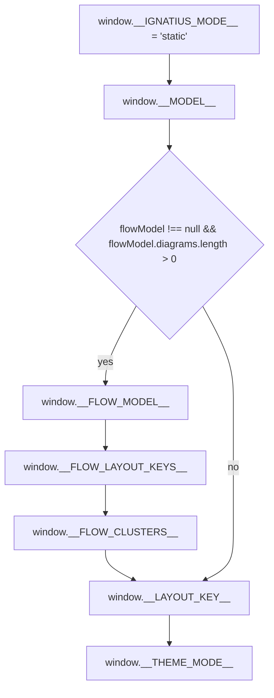
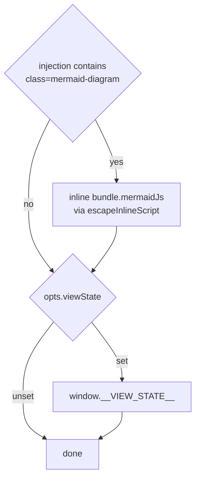
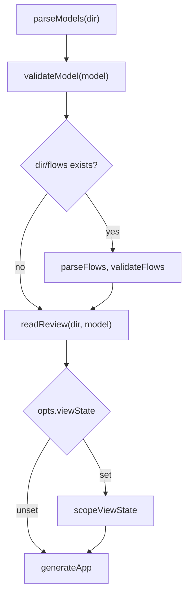

# generators

## What it does

[`src/generators/`](../../src/generators) produces the self-contained HTML file written by the CLI's `export` command and returned by the server's `POST /api/export`. There is exactly one generator, `generateApp`, which injects the full union of runtime globals needed by the unified React SPA (Graph, Dictionary, Flows) into one file; there is no separate graph/dict/flow generator. [`src/generators/embedded-bundle.ts`](../../src/generators/embedded-bundle.ts) supplies the HTML/JS/CSS bundle content (plus the Mermaid sidecar) that `generateApp` inlines, either from the compiled binary's embedded files or from `dist/static/` on disk. [`src/generators/export-model.ts`](../../src/generators/export-model.ts) wraps both: `exportModel` parses and validates a model root, then renders the export, so the CLI and the server share one path and one set of findings.

## How it works

`generateApp(model, flowModel, sourceOrDir, opts)` resolves a `BundleContent` (from disk or passed directly), builds one injection `<script>` block, then rewrites the bundle's HTML template in place: it swaps the external stylesheet `<link>` for an inlined `<style>`, swaps the external module `<script src>` for the injection script followed by an inlined `<script type="module">`, strips the bundle's own live-mode boot script, and rewrites `<title>` from the model's display name.

### Global injection order

A `flowModel` with zero diagrams skips flow-global injection outright, identical to `flowModel === null`: `__FLOW_MODEL__`, `__FLOW_LAYOUT_KEYS__`, and `__FLOW_CLUSTERS__` come back `undefined` at runtime, not empty stubs, even when `clusters` is non-empty.

A clusters-only model still parses `clusters` before any diagram exists, so `flowModel.clusters` can hold data even while the diagram check above suppresses its injection.

### Conditional script tail

The Mermaid sidecar and `__VIEW_STATE__` follow the injection block, each only when its input exists. The Mermaid sidecar is the large one, so a model with no diagram does not pay for it.

The check is a substring test on the serialized JSON, which holds every rendered body (entity, group, flow node, cluster, change note), so a diagram in any of them triggers the inline.

### exportModel

`exportModel` is the parse, validate, scope, render sequence behind both entry points. The review read is best-effort: a failure logs to stderr and exports without a change review.

`scopeViewState(viewState, layoutKey, flowLayoutKeys)` trims the layout stores in the exporter's `localStorage` (`GRAPH_LAYOUT_STORAGE_KEY`, `FLOW_LAYOUT_STORAGE_KEY`) to this model's entries, because every model served on one origin shares them. Graph entries are kept when the key equals `layoutFingerprint(model)`; flow entries are kept when the part before `::` is one of the model's `buildFlowLayoutKeys` values. Other storage keys and `hash` pass through, and a store left with no entries, or one that is not a JSON object, is dropped. The result is `{ html, model, globalErrors, entityErrors, flowErrors }`.

## Where it lives

| Path | Role |
|---|---|
| [`src/generators/app.ts`](../../src/generators/app.ts) | `generateApp(model, flowModel, sourceOrDir, opts)` and the `ViewState` type (`{ storage, hash }`). Resolves `sourceOrDir` (default `'dist/static'`) to a `BundleContent` via `loadBundleFromDir` when given a string, or uses it directly when already a `BundleContent`. Builds the injection script (`window.__MODEL__`, conditionally `__FLOW_MODEL__`/`__FLOW_LAYOUT_KEYS__`/`__FLOW_CLUSTERS__`, then `__CHANGE_REVIEW__` when `opts.review` is non-null (the export's change review against an existing baseline), then always `__LAYOUT_KEY__` via `layoutFingerprint(model)` and `__THEME_MODE__` from `opts.themeMode`, default `'dark'`), followed by the conditional Mermaid script and `__VIEW_STATE__` (see Conditional script tail). Escapes every `<` in JSON payloads as `\u003c` via a local `escapeScriptClose` (so `</script` and `<!--<script` in note titles or descriptions stay inert), escapes `</script` in the inlined JS (bundle and Mermaid) via `escapeInlineScript`, and HTML-escapes `&`, `<`, `>` in the `<title>` rewrite via a local `escapeHtmlText`. |
| [`src/generators/export-model.ts`](../../src/generators/export-model.ts) | `exportModel(dir, bundle, opts)` and `scopeViewState`. Parses and validates the model root (and `flows/` when present), reads the change review, scopes `opts.viewState`, and calls `generateApp`. |
| [`src/generators/embedded-bundle.ts`](../../src/generators/embedded-bundle.ts) | Defines `BundleContent = { htmlTemplate, cssContent, jsContent, mermaidJs }`. `loadBundleFromDir(bundleDir)` reads `index.html`, extracts the hashed JS/CSS filenames via regex against `src=`/`href=`, falls back to a `Glob('index-*.{js,css}')` scan, throws a descriptive error (naming the exact `bun build` command and listing the directory's actual contents) if either file still can't be found, and reads `mermaid.js` from the same directory. `loadEmbeddedBundle()` is the compiled-binary path: it imports `dist/static/index.html`, `index.js`, `index.css`, and `mermaid.js` at module load time with `with { type: 'file' }` so `bun build --compile` embeds them under `$bunfs/`, checks each exists via `Bun.file().exists()`, and throws pointing at `bun run build:bundle` (or `build:cli`) if any are missing. The module also re-exports `mermaidJsPath`. |

## Constraints

- There is one generator by design: the doc comment atop `app.ts` states there is no `graph.ts` or `flow-graph.ts` to import from — both were removed when the SPA was unified into one `generateApp`. Reintroducing a split-view generator would force every caller (currently just `exportModel`) to thread optional `flowModel`/`model` through multiple generator functions instead of one, the exact coupling the unification removed.
- The escaping helpers are not interchangeable and are not interchangeable: `escapeScriptClose` neutralizes `<` in JSON payloads inside a `<script>` body, `escapeInlineScript` neutralizes `</script` in inlined JS (the bundle and Mermaid, both of which contain that string), while `escapeHtmlText` escapes `&`/`<`/`>` for HTML text content (the `<title>` rewrite only). Swapping them breaks differently: using `escapeHtmlText` on the JSON payload or inlined JS leaves a literal `</script` sequence unescaped, letting the browser's HTML parser close the enclosing `<script>` tag early and truncate the injected bundle; using `escapeScriptClose` on the `<title>` rewrite leaves `&`/`<`/`>` unescaped, letting a model name containing those characters break the surrounding HTML markup.
- All regex-based template surgery in `app.ts` (stylesheet swap, module-script swap, live-mode-script strip, title rewrite) uses function-form replacements (`.replace(pattern, () => ...)`) rather than a string second argument, because the injected content (minified JS, arbitrary model JSON) can itself contain `$`-prefixed patterns that `String.prototype.replace` would otherwise interpret as substitution tokens.
- `embedded-bundle.ts`'s `import ... with { type: 'file' }` statements must point at stable file names (`index.html`, `index.js`, `index.css`, `mermaid.js`), not content-hashed ones, so `bun build --compile` can resolve them at compile time. The separate `build:stable-names` script ([`scripts/stable-names.ts`](../../scripts/stable-names.ts)) produces the first three by copying the hashed outputs `build:bundle` produced, and runs after `build:bundle` inside `build:cli`; `build:bundle` builds `mermaid.js` under its stable name directly from [`src/app/mermaid-entry.ts`](../../src/app/mermaid-entry.ts). A missing `mermaid.js` fails `loadEmbeddedBundle` and `loadBundleFromDir` even for a model with no diagram.
- Covered by [`test/checks/test-app-title.ts`](../../test/checks/test-app-title.ts), [`test/checks/test-branding-zero-network.ts`](../../test/checks/test-branding-zero-network.ts), [`test/checks/test-graph-branding.ts`](../../test/checks/test-graph-branding.ts), [`test/checks/test-layout-key-injection.ts`](../../test/checks/test-layout-key-injection.ts), [`test/checks/test-app-gen-zero-diagrams.ts`](../../test/checks/test-app-gen-zero-diagrams.ts) (pins the zero-diagrams-equals-null behavior above), [`test/checks/test-export-mermaid.ts`](../../test/checks/test-export-mermaid.ts), and [`test/checks/test-export-view-state.ts`](../../test/checks/test-export-view-state.ts) (also imports `scopeViewState`), run via `bun run test` (a shell loop over `test/checks/*.ts`), not `bun test`/`bun:test`. These import from [`src/generators/`](../../src/generators) directly, so a signature change to `generateApp`, `BundleContent`, or `scopeViewState` — or to the embedded-bundle loading contract in `embedded-bundle.ts` — breaks a check even when `app.ts`'s own generation logic hasn't changed.

## Coupling

- **parser** ([`src/model/`](../../src/model)) — `generateApp` takes a `Model` (from [`src/model/parse.ts`](../../src/model/parse.ts)) and calls `layoutFingerprint` (from [`src/model/layout-fingerprint.ts`](../../src/model/layout-fingerprint.ts)) directly. `exportModel` additionally calls `parseModels`, `validateModel` ([`src/model/validate.ts`](../../src/model/validate.ts)), and `readReview` ([`src/model/change-store.ts`](../../src/model/change-store.ts)); a change to any of their shapes or signatures is a breaking change here.
- **flows** ([`src/flows/`](../../src/flows)) — `generateApp` takes a `FlowModel | null` (from [`src/flows/flow-parse.ts`](../../src/flows/flow-parse.ts)), reads its `diagrams` and `clusters` fields, and calls `buildFlowLayoutKeys` (from [`src/flows/flow-fingerprint.ts`](../../src/flows/flow-fingerprint.ts)). `exportModel` also calls `parseFlows` and `validateFlows` ([`src/flows/flow-validate.ts`](../../src/flows/flow-validate.ts)); a shape change to any of those is a breaking change here.
- **frontend** ([`src/app/`](../../src/app)) — `embedded-bundle.ts` imports the *compiled output* of the frontend (`dist/static/index.html`/`.js`/`.css`), not its source, so a source-level React change only reaches this domain after a `bun run build:bundle`. `app.ts`'s regex-based `<link>`/`<script>` replacement and its `window.__IGNATIUS_MODE__ = 'live';` strip both depend on the exact markup shape [`src/app/index.html`](../../src/app/index.html) compiles down to; a template restructure there can silently break the string replacement (the regexes would simply fail to match). [`src/app/logic/view-state.ts`](../../src/app/logic/view-state.ts) imports the `ViewState` type, reads `window.__VIEW_STATE__`, and collects the live state sent to the export endpoint; `scopeViewState` imports the layout key constants from [`src/app/logic/storage-keys.ts`](../../src/app/logic/storage-keys.ts). The frontend reads `window.__FLOW_CLUSTERS__` back out in [`src/app/hooks/useModelData.ts`](../../src/app/hooks/useModelData.ts) and [`src/app/views/flow/FlowsView.tsx`](../../src/app/views/flow/FlowsView.tsx), so the injected key name and shape (`FlowCluster[]`) are a contract with both sides.
- **cli** ([`src/cli/cli.ts`](../../src/cli/cli.ts)) — the `export` command dynamically `import()`s `loadEmbeddedBundle`, then calls `exportModel(dir, bundle, { themeMode })` and prints the returned findings; the exit code derives from `globalErrors` and Class B `flowErrors`.
- **server** ([`src/server/server.ts`](../../src/server/server.ts)) — `POST /api/export` loads the embedded bundle, then calls `exportModel(modelsDir, bundle, { themeMode, viewState })` with the view state parsed from the request body, and returns the HTML as an attachment.
- **docs** — documented for CLI users in [`docs/guides/commands.md`](../guides/commands.md) (the `## export` section) and listed as "Static output for `export`" in [`docs/guides/building-from-source.md`](../guides/building-from-source.md)'s source-layout table.
- No other domain imports from [`src/generators/`](../../src/generators) besides `cli` and `server`; the frontend imports only the `ViewState` type.

