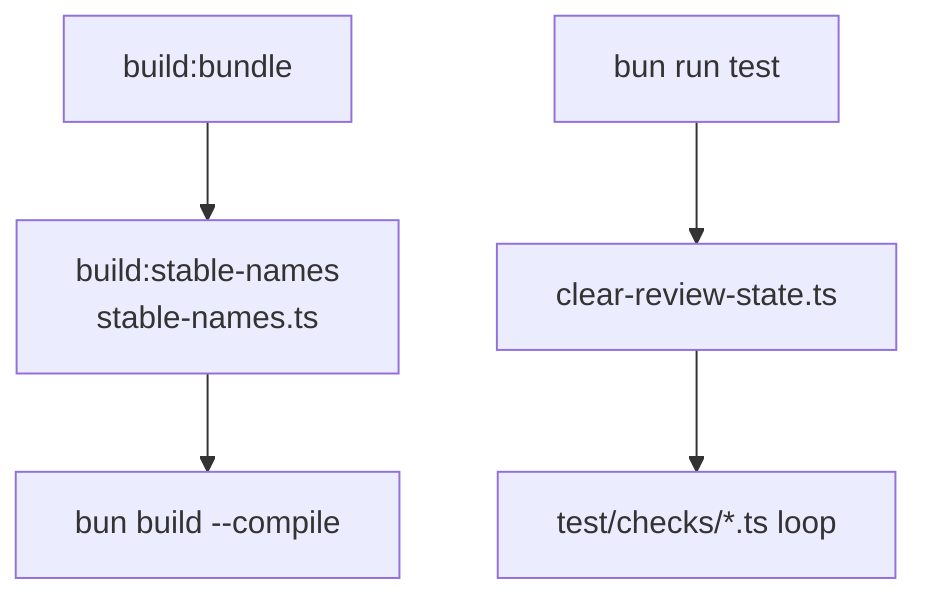

# scripts

## What it does

[`scripts/`](../../scripts) holds standalone Bun scripts run directly with `bun scripts/<name>.ts`, not imported by application code. They fall into these groups: a required build post-processing step (`stable-names.ts`), a test-run reset step (`clear-review-state.ts`), a one-time data-migration script (`convert-yaml-to-md.ts`), and dev-time tools for synthetic model generation, performance measurement, and manual visual/diagnostic inspection (`gen-synthetic-model.ts`, `perf-harness.ts`, `probe.ts`, `screenshot.ts`). Without `clear-review-state.ts`, a check that serves a repo model leaves a change-review baseline behind, and later checks see a Changes panel they did not expect.

## How it works

Scripts are plain top-level-await Bun scripts, not wrapped in a `main()` function or a CLI framework (`citty`, used by the cli domain, is not used here). CLI args are read ad hoc via `process.argv.indexOf(flag)` helpers: `argValue` is duplicated identically in `gen-synthetic-model.ts` and `perf-harness.ts`, while `argFlag` exists only in `perf-harness.ts`.

The diagnostic scripts split by driver: `probe.ts` and `screenshot.ts` use the `webview-bun` devDependency to drive a native webview window, and `perf-harness.ts` is the only script that uses the `playwright` devDependency.

Only two scripts are wired into [`package.json`](../../package.json): `stable-names.ts` through `build:stable-names`, and `clear-review-state.ts` as the first command of [`test`](../../test).

`build:cli` runs the bundle, stable-names, and compile stages in order, because the compile needs import paths known at compile time. [`test`](../../test) clears review state before the check loop so a stale `.ignatius/baseline.json` cannot change what a check sees.

## Where it lives

| Path | Role |
|---|---|
| [`scripts/stable-names.ts`](../../scripts/stable-names.ts) | post-build step that copies the content-hashed `index-*.js`/`index-*.css` files in `dist/static/` to stable names `index.js`/`index.css`. Reads `dist/static/index.html` to find the authoritative hashed filenames via regex on the `src=`/`href=` attributes; falls back to a `Bun.Glob('index-*.js'/'index-*.css')` scan only if the HTML match fails. Exits with code 1 and an error message if either the JS or the CSS file can't be found — the two are checked independently, so it exits on the first missing one rather than waiting for both to be absent. Required before `bun build --compile` because compiled binaries need import paths known at compile time. |
| [`scripts/clear-review-state.ts`](../../scripts/clear-review-state.ts) | test-run reset. For each directory under [`models/`](../../models) and [`test/fixtures/`](../../test/fixtures), removes its `.ignatius/` folder recursively (`rmSync` with `force: true`, so a missing folder is fine). `ignatius serve` writes `.ignatius/baseline.json` into the model it serves (see [`docs/guides/change-review.md`](../guides/change-review.md)), and checks serve repo models in place; a stale baseline would make a later check's served model render change highlights and a Changes panel. Takes no arguments. Reads [`models/`](../../models) and [`test/fixtures/`](../../test/fixtures) with `readdirSync` and does not catch a missing parent directory, so both must exist. |
| [`scripts/convert-yaml-to-md.ts`](../../scripts/convert-yaml-to-md.ts) | one-time migration script that reads a hardcoded input `tmp/sample_model.yaml`, parses it with the `yaml` package, and writes one markdown file per entity into `models/<group>/<entity>.md`. Derives an IDEF1X classification per entity (`Subtype`, `Associative`, `Dependent`, `Classifier`, or `Independent`) from subtype membership, identifying-relationship count, and column shape; derives a `group` (`reference`, `transactional`, `catalog`, `identity`) from the entity's declared `groups` or by walking up identifying parents. Emits YAML frontmatter (`entity`, `classification`, `group`, `pk`, `columns`, optional `ak`/`subtypes`/`relationships`) plus a markdown body with `## Subtypes`, `## Values`, and `## Constraints` sections built from the source YAML. |
| [`scripts/probe.ts`](../../scripts/probe.ts) | ad-hoc diagnostic script. Opens a native `webview-bun` window against a URL (default `http://localhost:3777`), waits for a `.react-flow__node` element to appear, then serializes visible node positions (parsed from each element's CSS `transform`) and edge count into a JSON report printed to stdout. Has a 60-second safety-quit timer and a 30-second wait-for-node timeout. Exits 0 only if a `report` payload was produced. |
| [`scripts/screenshot.ts`](../../scripts/screenshot.ts) | snapshot helper that opens a native `webview-bun` window against a URL (default `http://localhost:3777`), waits up to 8 seconds for `.card svg` to appear, then serializes every `<svg>` inside a `.card` on the page (wrapped with an XML declaration and a dark background `<rect>`) and writes each to a file under an output directory (default `/tmp/ignatius-shots`, second CLI arg). Filenames are sanitized to `[a-z0-9._-]` and prefixed with a zero-padded index. Uses `writeFileSync` synchronously inside the `webview.bind` callback specifically to avoid an IPC deadlock in `webview-bun` that affects `await`ed writes from a bind handler. Exits 0 only if at least one file was written. |
| [`scripts/gen-synthetic-model.ts`](../../scripts/gen-synthetic-model.ts) | synthetic IDEF1X model generator for perf testing. CLI: `bun scripts/gen-synthetic-model.ts [--n 300] [--out tmp/my-model]`. Writes a complete model root: `ignatius.yml` (with a hardcoded dark/light theme), one `groups/<id>.md` file per group across fixed groups (`core`, `catalog`, `sales`, `finance`, `ops`, `reporting`, distributed via fixed weights `[0.18, 0.20, 0.22, 0.18, 0.16, 0.06]`), and one entity markdown file per generated entity under `data/<group>/`. Always includes hardcoded subtype clusters (`Party` → `Person`/`Organization`, `Product` → `PhysicalProduct`/`DigitalProduct`, `Channel` → `WebChannel`/`PartnerChannel`). Non-cluster entities get 1–3 FK relationships wired via a hub-and-peer strategy targeting ~1.4–1.8× edges per node while avoiding cycles. Default output directory: `tmp/synthetic-model-<n>/`. |
| [`scripts/perf-harness.ts`](../../scripts/perf-harness.ts) | Playwright-based render latency measurement harness. CLI: `bun scripts/perf-harness.ts [--model <dir>] [--n <count>] [--port <port>] [--runs <k>] [--mode organic\|hierarchical]`. Without `--model`, first spawns `bun scripts/gen-synthetic-model.ts --n <N> --out tmp/synthetic-model-<N>` as a subprocess. Measures `parseModels()` timing directly via a dynamic import of `../src/model/parse`, spawns `bun src/cli/cli.ts serve <modelDir> --port <PORT>` as a subprocess server, fetches `/api/model` for payload byte size, then drives a headless Chromium page via `playwright` to measure `time-to-layoutstop` (navigation start until `window.__IGNATIUS_PERF__` is stamped) and `time-to-interactive` (layoutstop + a 200ms settle). Clears the `ignatius-layout-positions` `localStorage` key before each measured run so ELK always runs cold; `--mode` optionally forces `ignatius-layout-mode` in `localStorage` before navigation. Uses a 10-minute `waitForFunction` timeout to accommodate large (300+ node) graphs. Prints a fixed-width ASCII report table to stdout. Not run by `bun run test` or CI. |
| [`docs/guides/building-from-source.md`](../guides/building-from-source.md) | Documents the `build:cli` sequence (`build:bundle`, `build:stable-names`, compile), naming `stable-names.ts` as the file-renaming stage |

## Constraints

| Constraint | Detail |
|---|---|
| `clear-review-state.ts` has no existence guard | It reads [`models/`](../../models) and [`test/fixtures/`](../../test/fixtures) with `readdirSync` and does not catch a missing parent, so `bun run test` fails if either directory is missing |
| `probe.ts` selectors target React Flow | It waits for `.react-flow__node` and reads `.react-flow__edge`, but the frontend graph is Cytoscape.js (`cytoscape`/`cytoscape-navigator` in [`src/app/`](../../src/app)), which renders no such DOM elements, so the selectors do not match the current graph |
| `screenshot.ts` writes synchronously | The `webview.bind` handler uses `writeFileSync` instead of awaited Bun file writes, to avoid an IPC deadlock in `webview-bun` |
| `stable-names.ts` is required before compile | Skipping it leaves hashed `index-*` filenames that the compiled binary cannot resolve |
| `perf-harness.ts` is not part of `bun run test` or CI | It hangs until its 10-minute timeout if the `window.__IGNATIUS_PERF__` global disappears |

## Coupling

- [`scripts/stable-names.ts`](../../scripts/stable-names.ts) is wired into [`package.json`](../../package.json)'s `build:stable-names` script, which `build:cli` depends on; it is also invoked directly as a CI step in [`.github/workflows/ci.yml`](../../.github/workflows/ci.yml) and [`.github/workflows/release-please.yml`](../../.github/workflows/release-please.yml). It reads `dist/static/index.html`, so any change to how the frontend/build pipeline ([`src/app/`](../../src/app)) names or references its hashed bundle entrypoints in the emitted HTML can break its regex match.
- [`scripts/clear-review-state.ts`](../../scripts/clear-review-state.ts) is the first command in [`package.json`](../../package.json)'s [`test`](../../test) script (`bun scripts/clear-review-state.ts && for f in test/checks/*.ts; ...`), so it runs once before the check loop and a failure stops the run. It deletes the `.ignatius/` state that [`src/model/change-store.ts`](../../src/model/change-store.ts) (owned by the parser domain, called by the server and cli domains) writes into a served model; the `models/*/.gitignore` files listing `.ignatius/` keep that state out of git. A rename of the `.ignatius/` folder in the change-review feature ([`docs/spec/model-change-review.md`](../spec/model-change-review.md)) requires the same rename here.
- [`scripts/gen-synthetic-model.ts`](../../scripts/gen-synthetic-model.ts) is invoked as a subprocess by [`test/checks/test-synthetic-model.ts`](../../test/checks/test-synthetic-model.ts) (run by `bun run test` and CI), by two [`test/visual/`](../../test/visual) scripts (`test-cp5b-edge-paint-on-load.ts`, `test-cp2-preset-layout.ts`), and by [`scripts/perf-harness.ts`](../../scripts/perf-harness.ts). Its emitted entity/group markdown frontmatter schema (`entity`, `group`, `pk`, `columns`, `relationships`, `subtypes`) must stay parseable by the parser domain's `parseModels()` ([`src/model/parse.ts`](../../src/model/parse.ts)) — `test-synthetic-model.ts` asserts exactly that.
- [`scripts/convert-yaml-to-md.ts`](../../scripts/convert-yaml-to-md.ts) writes into `models/<group>/<entity>.md` using the same entity frontmatter shape the parser domain expects, and its role as the old-format migration path is referenced from the skill domain's design/spec docs ([`docs/design/ignatius-modeling-skill.md`](../design/ignatius-modeling-skill.md), [`docs/spec/ignatius-modeling-skill.md`](../spec/ignatius-modeling-skill.md)) as the tool that already covers YAML→markdown migration.
- [`scripts/perf-harness.ts`](../../scripts/perf-harness.ts) imports `parseModels` directly from the parser domain ([`src/model/parse.ts`](../../src/model/parse.ts)), spawns the cli domain's `src/cli/cli.ts serve` subcommand, and reads the `window.__IGNATIUS_PERF__` global stamped by the frontend/app domain in [`src/app/views/graph/GraphView.tsx`](../../src/app/views/graph/GraphView.tsx) — a rename or removal of that global breaks the harness silently (it would just hang until the 10-minute timeout).
- [`scripts/probe.ts`](../../scripts/probe.ts) and [`scripts/screenshot.ts`](../../scripts/screenshot.ts) both target a running dev server (default `http://localhost:3777`, matching the `dev`/`dev:cli` [`package.json`](../../package.json) scripts) and depend on specific DOM structure in the frontend/app domain to find their targets.
- No [`package.json`](../../package.json) script wires up `probe.ts`, `screenshot.ts`, `gen-synthetic-model.ts`, `perf-harness.ts`, or `convert-yaml-to-md.ts` directly — only `build:stable-names` → `stable-names.ts` and the [`test`](../../test) script's `clear-review-state.ts` prefix are wired into [`package.json`](../../package.json); the rest are invoked ad hoc via `bun scripts/<name>.ts` per each script's own usage comment, or as subprocesses from test files.
