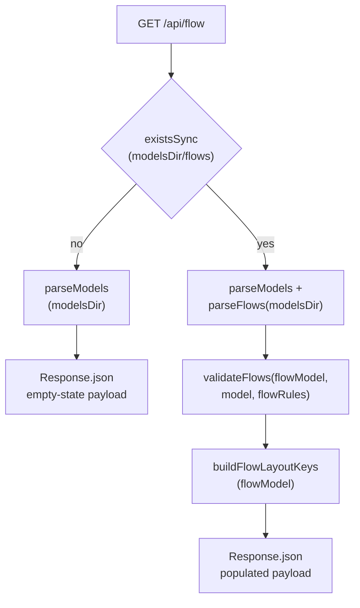
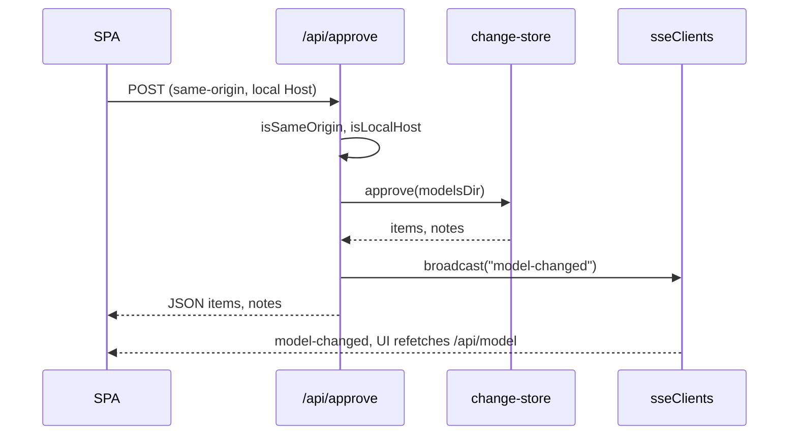
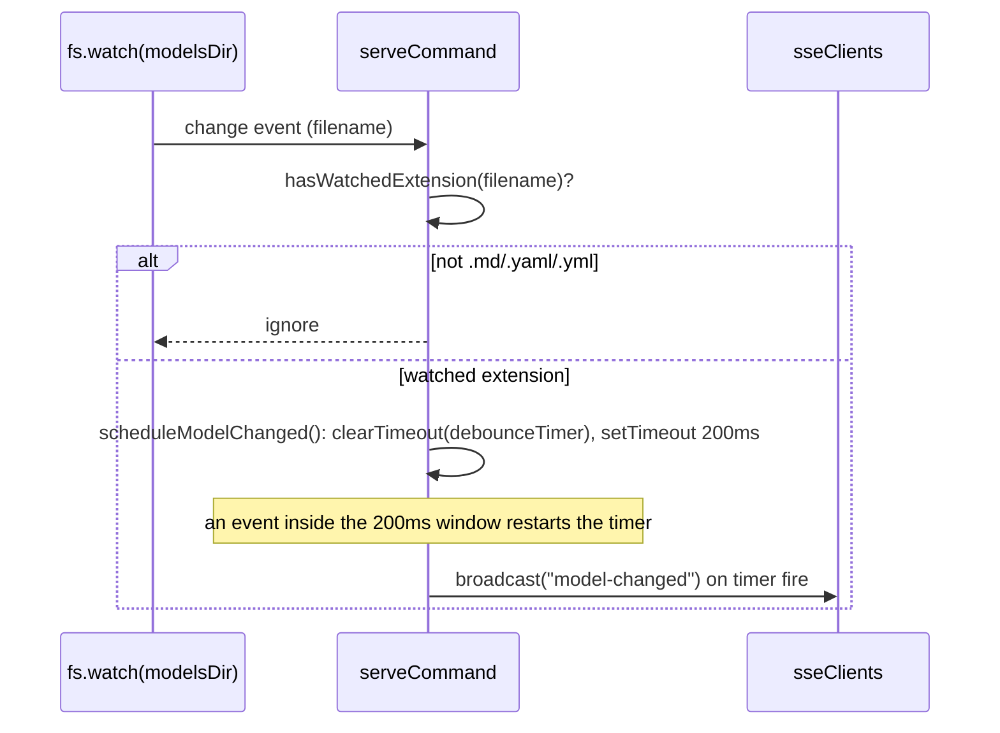
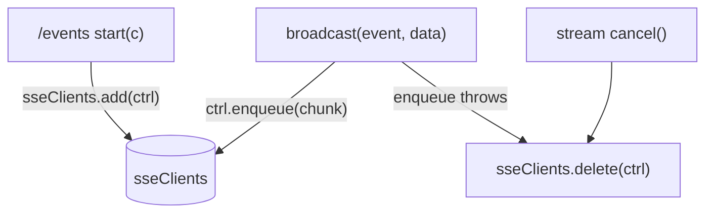

# server

## What it does

Without [`src/server/server.ts`](../../src/server/server.ts) there is no way to view a model or a flow diagram in a browser, no live-reload when a model file changes on disk, and no way to review what an agent changed in a model and approve it, and no way to export the current view as a standalone HTML file: it is the process a running `ignatius serve` invocation actually is. The file is a single-file domain exporting `serveCommand(modelsDir, opts)`, which starts a `Bun.serve()` instance that serves the ignatius SPA shell and its JSON/SSE API for one model directory.

## How it works

`serveCommand` registers every route on `Bun.serve`'s native `routes` map (no router library), wires an `fs.watch` on `modelsDir` plus a stat poll on the change-review baseline file, and returns a `ServeHandle = { server, stop }`. The domain's real logic sits in the `/api/flow` branch, the SSE broadcast loop that drives hot reload, the review/approve cycle built on `/api/model` and `/api/approve`, and the `/api/export` body cap and view-state filter.

### `serveCommand`'s route table

| Route | Behavior |
|---|---|
| `/` | [`src/app/index.html`](../../src/app/index.html) bound directly as a Bun HTML import (the SPA shell) |
| `/dict` | 302 redirect to `/#view=dict` |
| `/flow` | 302 redirect to `/#view=flow` |
| `/flow-dict` | 302 redirect to `/#view=dict` (the process dictionary is fused into the SPA Dictionary view) |
| `/api/model` | `parseModels(modelsDir)` then `validateModel(model)` then `layoutFingerprint(model)` then `buildReview(modelsDir, model)`; returns `{ model, parseGlobalErrors, validation, layoutKey, diff }`. `diff` is the change review, or `null` when `buildReview` rejects (the error is logged with `console.error`). |
| `POST /api/approve` | any other method gets 405 with `Allow: POST`; a request failing `isSameOrigin` or `isLocalHost` gets 403; otherwise `approve(modelsDir)`, then `broadcast('model-changed')`, then returns `{ items, notes }` |
| `POST /api/export` | any other method gets 405 with `Allow: POST`; a request failing `isSameOrigin` or `isLocalHost` gets 403; the body is read through `readTextCapped` (413 over `MAX_EXPORT_BODY_BYTES`, 5 MiB), parsed as JSON (400 if invalid), and reduced by `parseViewState` to `{ storage, hash }` (400 if the body is not an object with an object `storage`). `loadEmbeddedBundle()` is imported on demand (500 `Export bundle not built: run bun run build:bundle` on failure). `exportModel(modelsDir, bundle, { themeMode, viewState })` renders the HTML, returned as an attachment named `slugify(model._meta?.name ?? '')` + `.html`; an `exportModel` error gives 500 `Export failed: ...`. `themeMode` is `light` when `storage['ignatius-theme']` is `light`, else `dark`. |
| `/api/flow` | see the branch diagram below; returns `{ diagrams, entityModel, validation, flowLayoutKeys, clusters }` in both branches |
| `/api/asset?path=` | resolves `path` under `modelsDir`; 400 when `path` is missing, is absolute, or has a `normalize(path)` that starts with `..`; 404 if the resolved file doesn't exist; otherwise streams the `Bun.file` |
| `/static/mermaid.js` | `mermaidJsPath` from [`src/generators/embedded-bundle.ts`](../../src/generators/embedded-bundle.ts), imported on demand and streamed as `text/javascript`; 404 `mermaid.js not built: run bun run build:bundle` when the import fails |
| `/events` | SSE stream; disables Bun's idle timeout, tracks its controller in `sseClients` |

Function handlers answer every HTTP method; only `/api/approve` and `/api/export` check `req.method`.

### The `/api/flow` empty-state and populated branches converge on one response shape

Both branches return `diagrams`, `entityModel`, `validation`, `flowLayoutKeys`, and `clusters`. The empty-state branch parses the model solely to populate `entityModel`, and returns `diagrams: []`, `clusters: []`, `flowLayoutKeys: {}`, and an empty `validation` rather than omitting any key. A source comment on the guard names `entityModel` as the key whose absence would break a consumer.

### Approve resets the review baseline and every open tab refetches

The change review compares the current parse against a stored baseline (`baselinePath(modelsDir)`, `baseline.json` under the ignatius directory in `modelsDir`). `/api/model` carries that comparison as `diff`; `/api/approve` accepts the current parse as the new baseline and deletes the change notes, as implemented in [`src/model/change-store.ts`](../../src/model/change-store.ts). The design is in [`docs/design/model-change-review.md`](../design/model-change-review.md).

The approve handler calls `broadcast('model-changed')` itself, so every connected tab refetches `/api/model`.

### fs.watch coalesces bursty file events into one SSE broadcast per debounce window

The baseline file is watched separately. `ensureBaseline(modelsDir)` runs once after `Bun.serve` starts; when it settles (success or logged failure) and `stop()` has not run, `watchFile(baselineFile, { interval: 500 }, onBaselineStat)` starts. A changed `mtimeMs` calls the same `scheduleModelChanged()`, so a CLI `approve` that clears no notes (and so touches only the baseline) still reaches open tabs. The recursive `fs.watch` does not cover this: it ignores non-model extensions, and matching `baseline.json` there proved unreliable on macOS (source comment at the `watchFile` call).

### SSE clients leave `sseClients` on `cancel()` or on a failed `enqueue`

Each `/events` stream adds its controller to `sseClients`; one of two callbacks removes it.

`broadcast(event, data)` encodes an `event: ...\ndata: ...\n\n` SSE frame and enqueues it to every controller in the per-instance `sseClients` set. The stream's `cancel()` callback is the primary cleanup path: it fires on a normal disconnect (tab closed, `EventSource.close()`). A controller whose `enqueue` throws (controller already closed) is deleted from the set during that same `broadcast` iteration. `/events` calls `server.timeout(req, 0)` so Bun's default idle timeout never kills the long-lived stream, and writes a `: connected\n\n` comment line on open so the client sees an immediate response.

## Where it lives

| Path | What |
|---|---|
| [`src/server/server.ts`](../../src/server/server.ts) | The entire domain: `serveCommand`, `ServeHandle`, route table, `isSameOrigin` and `isLocalHost` guards, SSE broadcast, `fs.watch` debounce, baseline stat poll, `import.meta.main` entry point. No subdirectory under [`src/server/`](../../src/server). |
| `test/checks/*.ts` files that import `serveCommand` (see `grep -rln serveCommand test/checks/*.ts`) | Integration checks that boot a real server to exercise it; there is no [`src/server/`](../../src/server) test directory. |

## Constraints

| Constraint | Detail |
|---|---|
| `/api/flow` response shape is fixed across both branches | The empty-state branch (no `flows/` directory) still parses the model and returns `entityModel` and `clusters: []`; a consumer reading `entityModel` would break only on models with no `flows/` if the empty state omitted it. |
| `/api/approve` and `/api/export` are POSTs guarded by header checks | The server listens on every interface and a bodyless POST is a CORS simple request. `isSameOrigin` rejects a `sec-fetch-site` other than `same-origin` and an `origin` whose host differs from `Host`; `isLocalHost` accepts only the hostnames `localhost`, a dotted IPv4 literal, or a bracketed IPv6 literal, because a DNS-rebound page reaches the server under its own domain name where every request looks same-origin. A client that sends neither `Origin` nor `Sec-Fetch-Site` (curl) passes `isSameOrigin`. `/api/export` takes a JSON body, but the same guards apply. |
| `/api/export` caps the body while streaming and keeps only viewer keys | `readTextCapped` counts bytes per chunk and cancels the reader past 5 MiB, so a chunked body with no `content-length` is never buffered whole. `parseViewState` drops every `storage` entry whose key does not start with `ignatius-` or whose value is not a string, so arbitrary page localStorage never reaches `exportModel`. |
| `/static/mermaid.js` and `/api/export` need a built bundle | Both import [`src/generators/embedded-bundle.ts`](../../src/generators/embedded-bundle.ts) lazily so the server still starts from source before `dist/static` exists; until `bun run build:bundle` runs they return 404 and 500 respectively. |
| `diff` degrades to `null` instead of failing `/api/model` | A `buildReview` error is logged and the rest of the payload is still returned, so a consumer must treat `diff: null` as "no review available", not "no changes". |
| Baseline polling starts after `ensureBaseline` settles | The poll is armed after `ensureBaseline` settles because, armed earlier, the file's creation by the first baseline write (`ensureBaseline` at startup, or `buildReview`) would fire a spurious `model-changed`. `stop()` sets `stopped` and calls `unwatchFile` so a late settle does not re-arm the poll. |
| `/api/asset` path guard runs before the file is read | Rejects `isAbsolute(rawPath)` and a `normalize(rawPath)` starting with `..` with a 400 before `Bun.file(...)` is touched. Dropping the check, or running it after `Bun.file(...)` reads, serves files outside `modelsDir`; `resolve()` itself reads nothing. |
| `/events` disables the default idle timeout | `server.timeout(req, 0)` on the SSE route only; every other route keeps Bun's default. Without the override, Bun's default idle timeout would silently close the long-lived SSE stream, killing live-reload for any tab left open past the timeout. |
| Watched extensions are `.md`, `.yaml`, `.yml` | `.yml` matters as much as `.yaml`: a comment in the source notes the model marker is `ignatius.yml`, so without watching `.yml` an edit to name, theme, branding, or `flow_rules` would never trigger a reload. |
| `import.meta.main` gates the direct-invocation entry point, not a path comparison | A comment explains why: in a compiled Bun binary every bundled module shares the same `$bunfs` path, so comparing `import.meta.path === Bun.main` would always be true. |
| `development: { hmr: true, console: true }` is passed to `Bun.serve` unconditionally | Not gated on an environment check, so even under `NODE_ENV=production` a compiled binary still gets HMR and dev console output. Passing this object also enables Bun's contextual-error page (stack traces in the response) regardless of which keys it sets, since Bun gates that page on the field's truthiness alone. |
| `sseClients` removal relies on `cancel()` firing or `enqueue` throwing | A controller that neither cancels nor throws (a TCP-level drop with no FIN/RST) stays in the set until `stop()` clears it. |

## Coupling

- **parser** ([`src/model/parse.ts`](../../src/model/parse.ts) `parseModels`, [`src/model/layout-fingerprint.ts`](../../src/model/layout-fingerprint.ts) `layoutFingerprint`, [`src/model/change-store.ts`](../../src/model/change-store.ts) `approve`, `baselinePath`, `buildReview`, `ensureBaseline`) is imported for `/api/model`, `/api/approve`, and both `/api/flow` branches. A shape change to `Model` or `ParseResult` forces a matching change in the JSON contracts here and in the frontend that consumes them. `change-store.ts` feeds `diff`, the `/api/approve` body, and the baseline file the stat poll watches; a change to the baseline location or the `{ items, notes }` return shape breaks the poll and the response.
- **validate** ([`src/model/validate.ts`](../../src/model/validate.ts) `validateModel`) feeds `validation` on `/api/model`; a change to `ValidationResult` forces a matching change in the JSON contract.
- **flows** ([`src/flows/flow-parse.ts`](../../src/flows/flow-parse.ts) `parseFlows`, [`src/flows/flow-validate.ts`](../../src/flows/flow-validate.ts) `validateFlows`, [`src/flows/flow-fingerprint.ts`](../../src/flows/flow-fingerprint.ts) `buildFlowLayoutKeys`) drives `/api/flow`'s populated branch. `FlowModel.clusters` (from [`src/flows/flow-clusters.ts`](../../src/flows/flow-clusters.ts)) travels through the endpoint as `clusters`; a change to `FlowModel`'s shape forces a matching change here. `model._meta?.flowRules`, populated from `flow_rules:` in `ignatius.yml` by the parser, is passed into `validateFlows` as its config argument.
- **generators** ([`src/generators/export-model.ts`](../../src/generators/export-model.ts) `exportModel`, [`src/generators/embedded-bundle.ts`](../../src/generators/embedded-bundle.ts) `loadEmbeddedBundle`, `mermaidJsPath`, and the `ViewState` type from `src/generators/app`) back `/api/export` and `/static/mermaid.js`; a change to `ViewState` or the `exportModel` return shape `{ html, model }` breaks the endpoint. [`src/router/agents.ts`](../../src/router/agents.ts) `slugify` names the download and [`src/flows/flow-markdown.ts`](../../src/flows/flow-markdown.ts) `isRecord` types the body check. Design: [`docs/design/viewer-qol.md`](../design/viewer-qol.md).
- **frontend** ([`src/app/index.html`](../../src/app/index.html)) is bound directly to the `/` route as a Bun HTML import; a frontend build change is picked up through Bun's bundling of that import, with no separate wiring in this file.
- **cli** ([`src/cli/serve-port.ts`](../../src/cli/serve-port.ts) `serveWithPortFallback`) wraps `serveCommand` in an EADDRINUSE retry/prompt loop for the `serve` command; a change to how `serveCommand` throws on a bound port would break that fallback.
- **scripts** ([`scripts/perf-harness.ts`](../../scripts/perf-harness.ts)) runs `bun src/cli/cli.ts serve <modelDir> --port <port>` as a subprocess to benchmark a running server; it is coupled through the CLI command, not a direct import.
- Tests: `test/checks/*.ts` import `serveCommand` and boot a real server for integration checks (see the table above).
